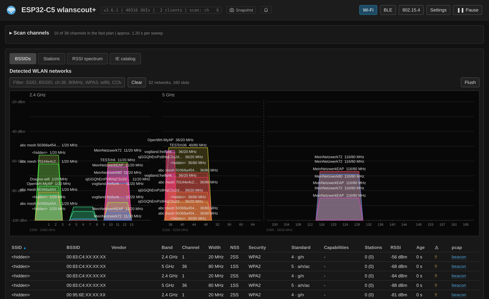
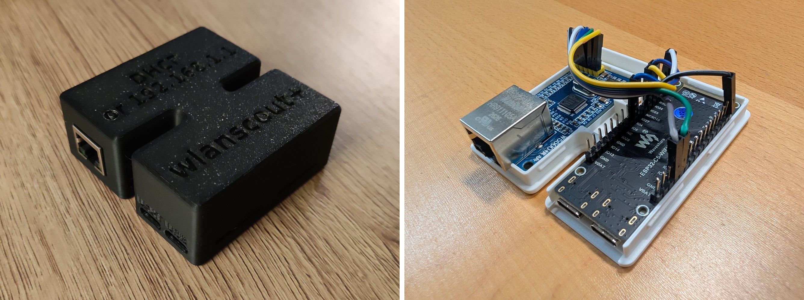
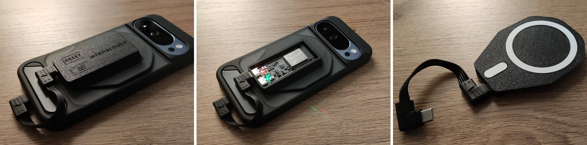

# ESP32-C5 wlanscout+

**A passive 802.11 survey sensor, with BLE and 802.15.4.**

A passive 2.4 and 5 GHz survey tool on an ESP32-C5 with W5500 Ethernet.
It sweeps the band in promiscuous mode, decodes 802.11 management
frames, and serves a self-contained web interface over Ethernet, or
without Ethernet to a phone on its USB-C port. The
`+` stands for the two other protocols: the same radio also scans
Bluetooth Low Energy advertisements and IEEE 802.15.4, one mode at a
time.

Everything runs on the device. No cloud, no app store, no external
dependencies beyond the Arduino core.




- **Wi-Fi** — a BSSID table with full security and PHY detail, the
  stations on every AP and a graph of which client is on which AP; next
  to them an RSSI spectrum per channel with its average, the highest
  level seen (max-hold) and a waterfall history
  - **Anomaly hints** — misconfigurations and oddities per BSS, from a
    missing Country element to SAE without PMF, and configuration
    changes of a running AP with the old value
  - **Wi-Fi 7 multi-link** — AP and station MLDs, decoded from beacons
    and association requests:
    - all links of an MLD by band and link ID, including 6 GHz links
      the AP only announces
    - EMLSR and EMLMR with their padding and transition delays
    - the link pairs a station cannot use at the same time (NSTR)
    - TID-to-link mapping and the other MLD capabilities
  - **Association history** — the full capability set of every client
    that joined while the sensor was listening, kept after it goes quiet
  - **IE catalog** — every element, vendor element and suite the
    firmware does not decode yet, collected across reboots with example
    frames as pcap, to take along on a walk and look at in Wireshark
- **BLE** — advertisement scan with RSSI chart, device table, company
  identifiers, active and passive modes
- **IEEE 802.15.4** — frame capture with node table, or an energy-detect
  waterfall that shows everything in the 2.4 GHz band that is not
  802.11: microwave ovens, video senders, hopping Bluetooth links
- **Capture** — management frames kept in PSRAM and downloadable as
  libpcap with radiotap headers, per BSSID, per station, per buffer or
  as a whole
- **Export** — a single JSON document with everything the sensor knows,
  designed to be merged across several sensors covering one area
- **Snapshots** — a press on the board's BOOT button, or on the camera
  button in the page, keeps the moment on flash, named if wanted, to be
  looked at later with the same tables and tooltips; exported as files
  and imported on any sensor
- **Phone over USB-C** — without Ethernet, the board on a phone and the
  same page in Chrome over WebUSB, installable as an app that also
  starts offline; the firmware can be flashed from the phone as well

---

## Why this project

For Wi-Fi professionals working where **not every AP is theirs**:
apartment blocks, shared office floors, event venues, campuses. It
shows which client sits on which BSS, what each side can do and where
the airtime goes, unattended on Ethernet for days, with nothing but a
browser to look at.

**This is not a hacker tool.** There is no deauthentication, no
injection, no frame forging, no handshake capture aimed at cracking, no
WPS attack, no evil twin. In scanner mode the radio only receives, and
everything shown is something a device in range broadcast on its own.

More on the motivation, the intended use and related tools in
[Background](docs/background.md).

---

## Hardware

- **Waveshare ESP32-C5-WIFI6-KIT** with **16 MB flash** and **8 MB
  PSRAM** ([this one](https://www.amazon.de/dp/B0GDFY22Q1) was used).
  PSRAM is required: boards without it, such as the ESP32-C5-Mini, do
  not run this firmware. The **Seeed Studio XIAO ESP32-C5** (8 MB flash,
  8 MB PSRAM) takes the [XIAO build](docs/hardware.md#xiao-build):
  everything but Ethernet, over USB only
- **W5500 Ethernet module** on SPI (SCLK 23, MOSI 24, MISO 25, CS 26,
  RST 4; [this one](https://www.amazon.de/dp/B0FB94KPVT) was used) — or none, for the board on a phone over USB
- optional **3D-printed cases** in [`3d-printed-housing/`](3d-printed-housing/):
  one for both boards, and a MagSafe case for the board alone on the
  back of a phone, also as a variant for the XIAO ESP32-C5, see
  [Hardware](docs/hardware.md#enclosure)

Wiring, memory and Ethernet cabling in [Hardware](docs/hardware.md).



---

## Quick start

### Sensor on a phone

1. Open the flasher **<https://oposum01.github.io/wlanscout/flash.html>**
   in Chrome on the phone, plug the board's USB-C port marked **USB**
   (not UART) into the phone and tap **Flash firmware**.
2. When it is done, unplug the board once and plug it back in, or press
   the reset button (**RST**) on the ESP32-C5 board once.
3. Open the app **<https://oposum01.github.io/wlanscout/>** in Chrome
   and install it from the menu (*Install app*); it then also starts
   without a network.
4. Start it, tap **USB** and allow the board.



Updates come from *Settings → Sensor → Firmware* with `wlanscout.ino.bin`
of the [latest release](https://github.com/Oposum01/wlanscout/releases/latest),
or again from the flasher. Details in
[Sensor on a phone over USB](docs/usb.md).

### Sensor on Ethernet

1. Flash the firmware: with the flasher from a phone as above, with
   esptool and the images in `firmware/` (`FLASH.txt` says which file
   goes where), or built from source, see below.
2. Wire up the W5500 as in the [pin table](docs/hardware.md) and connect
   it to a switch.
3. Power the board over USB-C and read the address off the serial
   console (115200 baud); without DHCP it is `192.168.1.1`
   ([First start](docs/install.md#first-start)).
4. Open `http://<address>/` in a browser.

### Building from source

Install **esp32 by Espressif Systems** (3.3.0 or later) in the Arduino
Boards Manager, open `source/wlanscout/wlanscout.ino`, select **ESP32C5
Dev Module** with Flash Size **16MB (128Mb)** and PSRAM **Enabled**,
then upload. Step by step in [Installation](docs/install.md), with
arduino-cli, the XIAO build and releases in
[arduino-cli and releases](docs/install.md#arduino-cli-and-releases).

---

## Repository layout

```
wlanscout/
  source/wlanscout/      the Arduino sketch (the folder carries the
                         sketch's name, an Arduino rule):
    wlanscout.ino          firmware: includes, settings, setup() and loop()
    NN_*.ino               the rest of the firmware, one file per part
    config.h               the board and what is built in
    index_html.h           web interface, the source of the page
    index_html_gz.h        the same packed, as the sensor serves it
                           (tools/make_page_gz.py)
    oui_table.h            vendor table, generated from the IEEE registries
    partitions.csv         partition table, used instead of the menu
    partitions_xiao.csv    the same for 8 MB flash (Seeed Studio XIAO ESP32-C5)
    partitions_xiao_1slot.csv  8 MB flash, one firmware slot (option)
  firmware/              the built images of the current version and
                         FLASH.txt (which file goes where)
  index.html             the page as a static, installable copy for a
  flash.html             phone over USB, and the flasher, which loads
  sw.js, manifest.webmanifest, favicon.svg, icon-*.png, .nojekyll
                         from firmware/ (docs/usb.md); at the top so
                         GitHub Pages can publish the repository
  tools/make_release.py  fills firmware/ and the page from a build
  tools/build_xiao.sh    builds the XIAO firmware (8 MB, USB only)
  tools/make_static.py   builds the page alone
  tools/make_page_gz.py  packs index_html.h into index_html_gz.h
  tools/make_oui.py      regenerates oui_table.h
  tools/check_against_tshark.py
                         compares the parsers with Wireshark
  tools/static/          flasher page and FLASH.txt they copy
  tests/                 browser tests for the page (docs/testing.md)
  3d-printed-housing/    enclosure: OpenSCAD source and STL files
  docs/                  documentation and screenshots
  LICENSE                GPL-2.0
  LINKING-EXCEPTION      permission to link with ESP-IDF / arduino-esp32
  LICENSING.md           why the exception, SPDX tags, the vendor data
```

`oui_table.h` is generated but kept in the repository, so the sketch
builds without any extra step. The release site (`firmware/`, the static
page and the flasher) is generated by `tools/make_release.py` and kept
in git, see [arduino-cli and releases](docs/install.md#arduino-cli-and-releases).

---

## Documentation

[`docs/README.md`](docs/README.md) is the table of contents.

- [Hardware](docs/hardware.md) — board, wiring, PSRAM, Ethernet cabling
- [Installation](docs/install.md) — board package, Arduino settings,
  vendor table, first start
- [Sensor on a phone over USB](docs/usb.md) — without Ethernet, from
  Chrome over WebUSB
- [Sweep and reception](docs/sweep.md) — channel plan, fast sweep, what the radio
  can and cannot see
- [Wi-Fi views](docs/wifi-views.md) — spectrum, RSSI and waterfall,
  network table, BSS load, anomaly hints, Wi-Fi 7 multi-link APs,
  the IE catalog
- [Stations](docs/stations.md) — station graph, live tables, association
  history, multi-link stations
- [Capture buffers](docs/capture.md) — the pcap rings and what they keep
- [BLE](docs/ble.md) and [IEEE 802.15.4](docs/ieee802154.md) — the two
  other radio modes
- [Settings and persistence](docs/settings.md) — what survives a
  reboot, snapshots
- [HTTP API and export](docs/api.md) — endpoints, control parameters,
  multi-sensor export
- [Tuning and troubleshooting](docs/tuning.md) — limits, memory, common
  problems
- [Tests](docs/testing.md) — tests for the page and the firmware, no
  sensor needed
- [Internals](docs/internals.md) — the sketch's files, for changing the
  firmware

---

## Future ideas

Nothing here is promised; the details are in [Outlook](docs/outlook.md).

- a second C5 running esp-sdr as a real spectrum front end
- a collector that merges the export of several sensors
- which security clients really use, counted per BSS
- more anomaly hints — suggestions very welcome

---

## How this was built

The firmware, the web interface and this documentation were written with
[Claude](https://claude.ai), Anthropic's AI assistant, and tested on
real hardware; more in [Background](docs/background.md#how-this-was-built).

**Feedback is very welcome** — issues, corrections, captures that are
decoded wrongly, and above all cases worth flagging as an anomaly that
are not in the list yet.

---

## Licence

**GNU General Public License v2.0 only** (GPL-2.0-only) with a linking
exception for the firmware, so it may be linked with ESP-IDF and the
Arduino core: [`LICENSE`](LICENSE),
[`LINKING-EXCEPTION`](LINKING-EXCEPTION). The MagSafe and XIAO
cases are CC BY-NC-SA 4.0. Why the exception, the SPDX tags, contributions and the
vendor table's data: [`LICENSING.md`](LICENSING.md).

Copyright (C) 2026 Dr.-Ing. Simon Wunderlich Systementwicklung &
Beratung (<https://www.simonwunderlich.de/>). Written by Jan Fuchs
<jf [at] simonwunderlich . de> as work for Simon Wunderlich. Source:
<https://github.com/Oposum01/wlanscout>.
