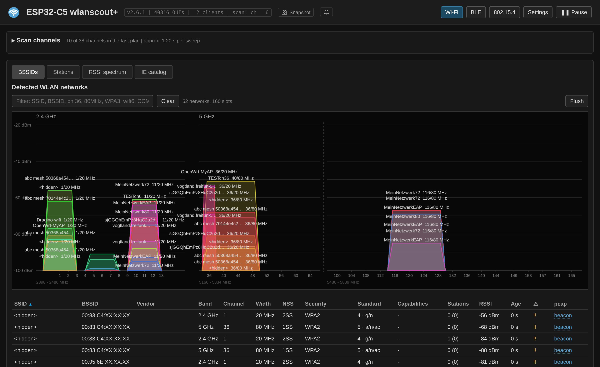
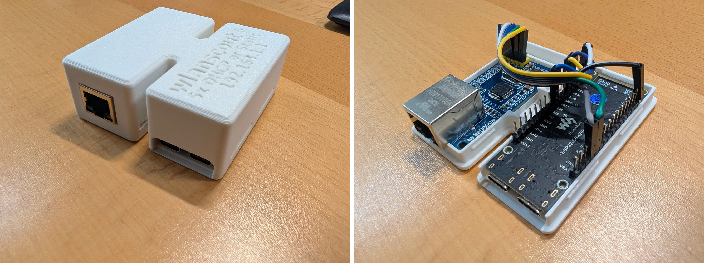
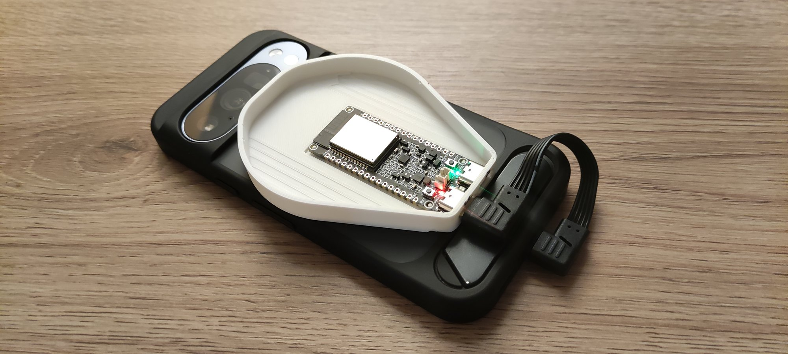

# ESP32-C5 wlanscout+

**A passive 802.11 survey sensor, with BLE and 802.15.4.**

A passive 2.4 and 5 GHz survey tool on an ESP32-C5 with W5500 Ethernet.
It sweeps the band in promiscuous mode, decodes 802.11 management
frames, and serves a self-contained web interface over Ethernet, or
without Ethernet to a phone on its USB-C port. The
`+` stands for the two other protocols: the same radio also scans
Bluetooth Low Energy advertisements and IEEE 802.15.4, one mode at a
time.

Everything runs on the device. No cloud, no app store, no external
dependencies beyond the Arduino core.




- **Wi-Fi** — a BSSID table with full security and PHY detail, the
  stations on every AP and a graph of which client is on which AP; next
  to them an RSSI spectrum per channel with its average, the highest
  level seen (max-hold) and a waterfall history
  - **Anomaly hints** — misconfigurations and oddities per BSS, from a
    missing Country element to SAE without PMF, and configuration
    changes of a running AP with the old value
  - **Wi-Fi 7 multi-link** — AP and station MLDs, decoded from beacons
    and association requests:
    - all links of an MLD by band and link ID, including 6 GHz links
      the AP only announces
    - EMLSR and EMLMR with their padding and transition delays
    - the link pairs a station cannot use at the same time (NSTR)
    - TID-to-link mapping and the other MLD capabilities
  - **Association history** — the full capability set of every client
    that joined while the sensor was listening, kept after it goes quiet
  - **IE catalog** — every element, vendor element and suite the
    firmware does not decode yet, collected across reboots with example
    frames as pcap, to take along on a walk and look at in Wireshark
- **BLE** — advertisement scan with RSSI chart, device table, company
  identifiers, active and passive modes
- **IEEE 802.15.4** — frame capture with node table, or an energy-detect
  waterfall that shows everything in the 2.4 GHz band that is not
  802.11: microwave ovens, video senders, hopping Bluetooth links
- **Capture** — management frames kept in PSRAM and downloadable as
  libpcap with radiotap headers, per BSSID, per station, per buffer or
  as a whole
- **Export** — a single JSON document with everything the sensor knows,
  designed to be merged across several sensors covering one area
- **Snapshots** — a press on the board's BOOT button, or on the camera
  button in the page, keeps the moment on flash, named if wanted, to be
  looked at later with the same tables and tooltips; exported as files
  and imported on any sensor
- **Phone over USB-C** — without Ethernet, the board on a phone and the
  same page in Chrome over WebUSB, installable as an app that also
  starts offline; the firmware can be flashed from the phone as well

---

## Why this project

Range and throughput tests in the office at
[Simon Wunderlich](https://www.simonwunderlich.de/) kept coming out wrong
— a run that should have been reproducible drifted from one day to the
next. The cause turned out to be colleagues bringing up APs for their
own testing, some with around a hundred clients associated for load
tests. The number of APs had barely changed, only what was hanging off
them, and nothing in the test setup showed it. Seeing stations per BSS
is what made it obvious.

It is built for Wi-Fi professionals working where **not every AP is
theirs**: apartment blocks, shared office floors, event venues,
campuses. A management platform shows its own APs in detail and
everything else as a rogue entry with an RSSI value; this fills in the
rest — which client sits on which BSS, what each side can do, and where
the airtime goes. It runs unattended on Ethernet from a fixed position,
for days, and needs nothing but a browser to look at.

**This is not a hacker tool.** There is no deauthentication, no
injection, no frame forging, no handshake capture aimed at cracking, no
WPS attack, no evil twin. In scanner mode the radio only receives, and
everything shown is something a device in range broadcast on its own.

More on the motivation, the intended use and related tools in
[Background](docs/background.md).

---

## Hardware

- **Waveshare ESP32-C5-WIFI6-KIT** with **16 MB flash** and **8 MB
  PSRAM**. The flash holds two firmware slots of 6.25 MB for updates and
  the storage for the IE catalog and the snapshots. The PSRAM is the
  memory for the capture ring and the tables, about 5 MB of it is
  allocated at boot; it is mandatory, boards without PSRAM such as the
  ESP32-C5-Mini do not run this firmware
- **W5500 Ethernet module** on SPI (SCLK 23, MOSI 24, MISO 25, CS 26,
  RST 4) — or none, for the board on a phone over USB
- optional **3D-printed enclosure** in [`3d-printed-housing/`](3d-printed-housing/)
  for both boards; without the W5500 (phone over USB) the board fits
  cases on MakerWorld, listed in [Hardware](docs/hardware.md#enclosure)

The W5500 has no auto-MDI/MDI-X: use a straight cable to a switch, a
crossover cable to a PC. Wiring, pin table and details in
[Hardware](docs/hardware.md).



---

## Quick start

1. Install **esp32 by Espressif Systems** (3.3.0 or later) in the
   Arduino Boards Manager.
2. Open `source/wlanscout/wlanscout.ino`, select **ESP32C5 Dev Module** with Flash Size
   **16MB (128Mb)** and PSRAM **Enabled**, then upload. The partition
   table comes with the sketch (`partitions.csv`, two 6.25 MB slots for
   updates over the network); the Partition Scheme menu is ignored.
3. Connect Ethernet, read the address off the serial console
   (115200 baud) and open `http://<address>/`. Without a DHCP server the
   sensor falls back to `192.168.1.1` by itself.

Ready-made images are in `firmware/`, with `FLASH.txt` saying which
file goes where, for esptool or an update over the network.

**Without Ethernet**, on a phone: the top of this repository is the
static copy of the page; published with GitHub Pages (or copied to any
https web space), open it in Chrome on the phone, plug the board's USB-C port marked **USB** into the phone
and press **USB**. The same copy can flash the firmware from the phone
and be installed as an app. Details in
[Sensor on a phone over USB](docs/usb.md).



Step by step, with the reasons behind each setting, in
[Installation](docs/install.md).

---

## Repository layout

```
wlanscout/
  source/wlanscout/      the Arduino sketch (the folder carries the
                         sketch's name, an Arduino rule):
    wlanscout.ino          firmware
    index_html.h           web interface, the source of the page
    index_html_gz.h        the same packed, as the sensor serves it
                           (tools/make_page_gz.py)
    oui_table.h            vendor table, generated from the IEEE registry
    partitions.csv         partition table, used instead of the menu
  firmware/              the built images of the current version and
                         FLASH.txt (which file goes where)
  index.html             the page as a static, installable copy for a
  flash.html             phone over USB, and the flasher, which loads
  sw.js, manifest.webmanifest, favicon.svg, icon-*.png, .nojekyll
                         from firmware/ (docs/usb.md); at the top so
                         GitHub Pages can publish the repository
  tools/make_release.py  fills firmware/ and the page from a build
  tools/make_static.py   builds the page alone
  tools/make_page_gz.py  packs index_html.h into index_html_gz.h
  tools/make_oui.py      regenerates oui_table.h
  tools/check_against_tshark.py
                         compares the parsers with Wireshark
  tools/static/          flasher page and FLASH.txt they copy
  tests/                 browser tests for the page (docs/testing.md)
  3d-printed-housing/    enclosure: OpenSCAD source and STL files
  docs/                  documentation and screenshots
  LICENSE                GPL-2.0
  LINKING-EXCEPTION      permission to link with ESP-IDF / arduino-esp32
```

`oui_table.h` is generated but kept in the repository, so the sketch
builds without any extra step; `tools/make_oui.py` refreshes it from the
current IEEE listing. `firmware/` and the page at the top always hold
the version in `wlanscout.ino`: after a build,

```sh
MAP="-ffile-prefix-map=$HOME/.arduino15=~/.arduino15"
arduino-cli compile \
    --fqbn esp32:esp32:esp32c5:FlashSize=16M,PartitionScheme=huge_app,PSRAM=enabled \
    --build-property "compiler.c.extra_flags=$MAP" \
    --build-property "compiler.cpp.extra_flags=$MAP" \
    --build-path build source/wlanscout
python3 tools/make_release.py build
```

refreshes both. The prefix map keeps the builder's home directory out
of the images: the core's source file names end up in its log
messages.

---

## Documentation

[`docs/README.md`](docs/README.md) is the table of contents.

- [Hardware](docs/hardware.md) — board, wiring, PSRAM, Ethernet cabling
- [Installation](docs/install.md) — board package, Arduino settings,
  vendor table, first start
- [Sensor on a phone over USB](docs/usb.md) — without Ethernet, from
  Chrome over WebUSB
- [Sweep and reception](docs/sweep.md) — channel plan, fast sweep, what the radio
  can and cannot see
- [Wi-Fi views](docs/wifi-views.md) — spectrum, RSSI and waterfall,
  network table, BSS load, anomaly hints, Wi-Fi 7 multi-link APs,
  the IE catalog
- [Stations](docs/stations.md) — station graph, live tables, association
  history, multi-link stations
- [Capture buffers](docs/capture.md) — the pcap rings and what they keep
- [BLE](docs/ble.md) and [IEEE 802.15.4](docs/ieee802154.md) — the two
  other radio modes
- [Settings and persistence](docs/settings.md) — what survives a
  reboot, snapshots
- [HTTP API and export](docs/api.md) — endpoints, control parameters,
  multi-sensor export
- [Tuning and troubleshooting](docs/tuning.md) — limits, memory, common
  problems
- [Tests](docs/testing.md) — browser tests for the web page, no sensor
  needed

---

## Future ideas

Nothing here is promised; the details are in [Outlook](docs/outlook.md).

- a second C5 running esp-sdr as a real spectrum front end
- a collector that merges the export of several sensors
- which security clients really use, counted per BSS
- more anomaly hints — suggestions very welcome

---

## How this was built

The firmware, the web interface and this documentation were written with
[Claude](https://claude.ai), Anthropic's AI assistant, over a long series
of sessions and tested on real hardware against real access points.
Several rounds went into correcting things the model had got wrong; the
likeliest kind of defect left is one that compiles, runs, looks right
and still differs subtly from the standard. More in
[Background](docs/background.md#how-this-was-built).

**Feedback is very welcome** — issues, corrections, captures that are
decoded wrongly, and above all cases worth flagging as an anomaly that
are not in the list yet.

---

## Licence

**GNU General Public License v2.0 only** (GPL-2.0-only) with a linking
exception for the firmware. The full GPL text is in [`LICENSE`](LICENSE),
the canonical copy from
<https://www.gnu.org/licenses/old-licenses/gpl-2.0.txt>; the exception is
in [`LINKING-EXCEPTION`](LINKING-EXCEPTION).

**Why the exception.** The firmware is linked with ESP-IDF and the
Arduino core for the ESP32. ESP-IDF is Apache-2.0, which the FSF
considers incompatible with GPLv2, and both ship binary-only libraries,
the Wi-Fi driver and the Bluetooth controller among them, whose source
is not available to pass on. Without the exception, a built firmware image could not be
distributed under GPLv2 at all. The exception permits exactly that
combination and nothing more: everything else in the firmware stays
under the plain GPL-2.0-only terms. It is the same construction as the
well-known OpenSSL exceptions in other GPLv2 projects.

Copyright (C) 2026 Dr.-Ing. Simon Wunderlich Systementwicklung &
Beratung (<https://www.simonwunderlich.de/>). Written by Jan Fuchs
<jf [at] simonwunderlich . de> as work for Simon Wunderlich. Source:
<https://github.com/Oposum01/wlanscout>.

Every source file carries the licence as an
[SPDX](https://spdx.org/licenses/GPL-2.0-only.html) tag instead of the
long notice. The firmware sources (`source/wlanscout/wlanscout.ino`,
`index_html.h`)
name the exception:

```
// SPDX-License-Identifier: GPL-2.0-only WITH AdditionRef-wlanscout-linking-exception
// SPDX-FileCopyrightText: 2026 Dr.-Ing. Simon Wunderlich Systementwicklung & Beratung
// SPDX-FileContributor: Jan Fuchs <jf [at] simonwunderlich . de>
```

`tools/make_oui.py` and the enclosure in `3d-printed-housing/` are not
linked with anything and carry plain `GPL-2.0-only`.

The exception can only be granted by whoever holds the copyright.
Contributions from outside therefore have to accept it as well, or the
firmware they touch could no longer be distributed as a built image.

"Only" rather than "or later" means GPL-3.0 code, such as
[esp-sdr](docs/outlook.md), cannot be merged into this firmware as it
stands.

**Vendor table.** `oui_table.h` is generated by `tools/make_oui.py` from
the IEEE public OUI listing (<https://standards-oui.ieee.org/oui/oui.csv>).
Like Wireshark's generated `manuf-data.c`, it carries the licence of the
code it is linked into and names the listing as its source in the file
header. IEEE does not assert any copyright in the OUI public listing or
restrict its distribution; Debian ships the same data as public domain
in its `ieee-data` package. IEEE asks users to fetch the list from them
and update it regularly — see
[Updating the vendor table](docs/install.md#updating-the-vendor-table).
The raw `oui.csv` download is not part of the repository.
