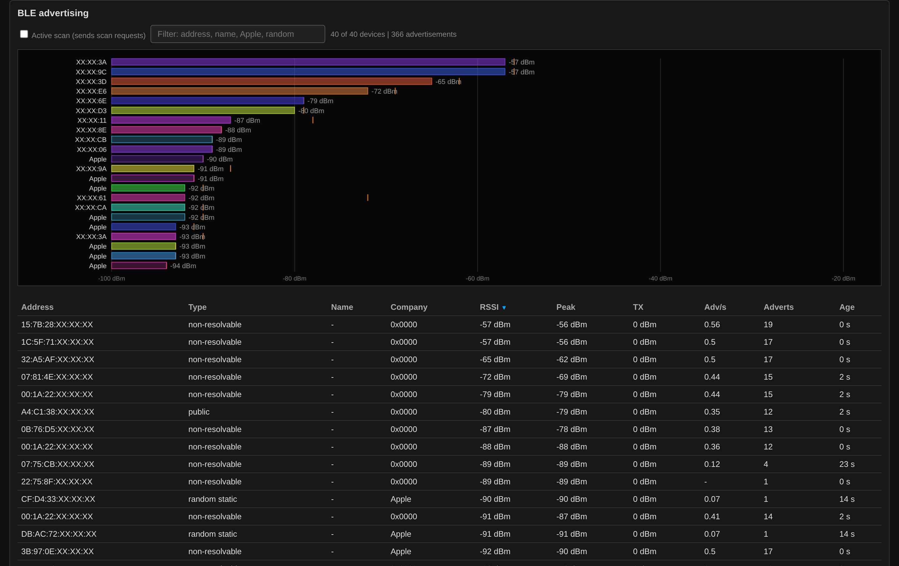

# BLE

The **BLE** button in the header switches the radio over. It is one
mode at a time: while BLE runs, the Wi-Fi sweep stops.

Only the three **advertising channels 37, 38 and 39** are received. An
established connection hops over the data channels, and this controller
cannot follow it, so what you see is who announces itself, not who
talks to whom. The scan runs with a 100 ms interval and a 99 ms window,
which keeps the receiver listening almost all the time.

**Passive or active.** A passive scan transmits nothing. An active scan
answers advertisements with scan requests and collects the scan
responses as well, which is where many devices put their name — at the
price that the sensor is no longer invisible. The choice is stored with
the other settings and survives a restart; out of the box the scan is
passive.

The **chart** shows the 22 strongest devices that match the filter,
one bar per device at its current RSSI, with the peak as a tick. A
device is labelled by its name, else by its company, else by the last
three bytes of its address. The **table** lists all of them, sorted by
any column:

| Column | Meaning |
|--------|---------|
| Type | public, random static, resolvable private or non-resolvable |
| Company | Bluetooth SIG company identifier from the manufacturer data |
| Peak | strongest RSSI seen since the device appeared |
| TX | advertised TX power, if the device sends it |
| Adv/s, Adverts | advertisement rate and total count |

The **address type** comes from the top two bits of the address alone.
Resolvable private addresses rotate at regular intervals, so the same phone
turns up as a new device again and again and is useless for tracking —
which is the point of them. Since the bits are all there is to go on, a
public address whose top bits happen to look random is labelled as
random.

The tooltip adds the advertised service and, when TX power is sent, a
rough path loss of TX power minus RSSI. The filter searches address,
name, type, service and company, so `apple` or `random` work as you
would expect. At most 80 devices are kept; one that has not been heard
for 90 s is dropped.
