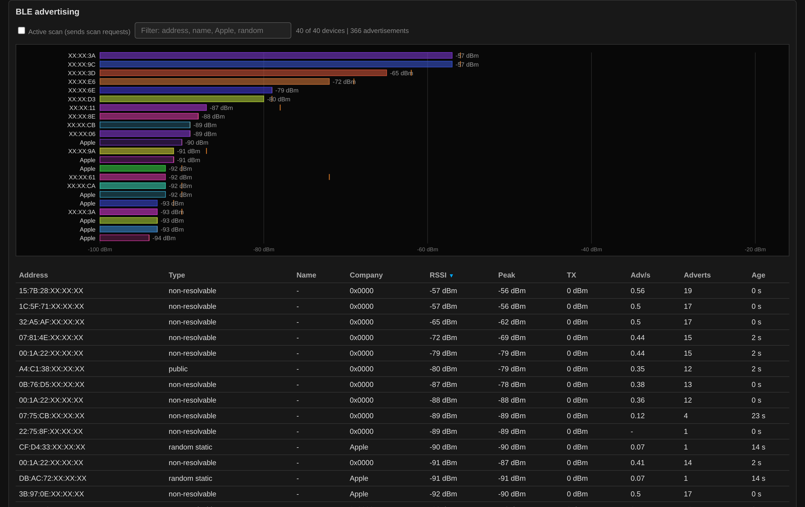

# BLE

The **BLE** button in the header switches the radio over. It is one
mode at a time: while BLE runs, the Wi-Fi sweep stops.

Only the three **advertising channels 37, 38 and 39** are received. An
established connection hops over the data channels, and this controller
cannot follow it, so what you see is who announces itself, not who
talks to whom. The scan runs with a 100 ms interval and a 99 ms window,
which keeps the receiver listening almost all the time.

**Passive or active.** A passive scan transmits nothing. An active scan
answers advertisements with scan requests and collects the scan
responses as well, which is where many devices put their name — at the
price that the sensor is no longer invisible. The choice is stored with
the other settings and survives a restart; out of the box the scan is
passive.

The **chart** shows the 22 strongest devices that match the filter,
one bar per device at its current RSSI, with the peak as a tick. A
device is labelled by its name, else by its company, else by the last
three bytes of its address. The **table** lists all of them, sorted by
any column:

| Column | Meaning |
|--------|---------|
| Type | public, random static, resolvable private or non-resolvable |
| Company | Bluetooth SIG company identifier from the manufacturer data |
| Peak | strongest RSSI seen since the device appeared |
| TX | advertised TX power, if the device sends it |
| Adv/s, Adverts | advertisement rate and total count |
| Vendor (OUI), Service, Known for | optional, under **Columns ▾**: the IEEE vendor of a public address (its OUI in hex when unknown, "-" for a random address, which has none), the first advertised service UUID, how long the device has been known |

**Company names.** The sensor names 13 company identifiers itself,
others show as hex (`0x1142`). Ticking **Company names from the
internet** makes this browser fetch the Bluetooth SIG's list of about
4000 from bitbucket.org (a copy at Nordic Semiconductor on GitHub when
that fails), keep it for a week and show those names in the table, the
tooltip and *Seen most*. Off by default; nothing about the devices is
sent anywhere, and unticking it deletes the stored list.

The **address type** comes from the advertisement itself, which says
whether the address is public (an IEEE OUI) or random; for a random one
its top two bits tell the kind. Resolvable private addresses rotate at
regular intervals, so the same phone turns up as a new device again and
again and is useless for tracking, which is the point of them.

The tooltip adds the advertised service and, when TX power is sent, a
rough path loss of TX power minus RSSI. The filter searches address,
name, type, service and company, so `apple` or `random` work as you
would expect. At most 80 devices are kept; one that has not been heard
for 90 s is dropped.

**Seen most.** Below the table the sensor counts which devices come by,
and how often, to show a pattern over days: only devices whose address
stays, public and random static ones, since a rotating address would
only count itself. A **hit** is a device heard again after five minutes
of silence; the table has the hits, the advertisements, when it was
first and last seen, and the hits per hour of the day as a small bar
chart (sensor time, once the clock is set). Up to 512 devices are kept,
the one with the fewest hits giving way; the counts are saved on flash
every ten minutes and before a restart, so they add up across restarts.
*Clear counts* starts afresh.

**Capture.** Every advertisement reported goes into a log of its own, a
ring of 64 kB chunks growing to 1 MB like the Wi-Fi rings: *Download
advertisements (pcap)* above the table, a device's own in its row, and
the store under Settings → Capture. The file has Wireshark's link type
for Bluetooth LE link layer packets with a pseudo header
(LINKTYPE_BLUETOOTH_LE_LL_WITH_PHDR, 256) carrying the RSSI. The
controller reports a device about once per 10 s scan window (duplicates
are filtered), and the Bluetooth library joins advertising data and
scan response: they are cut apart again at the last whole AD structure
within 31 octets. The controller passes on only packets with a right
CRC but not the CRC itself; it is computed again from the packet, so
Wireshark finds it correct. The advertising channel is not reported:
the RF channel is 0, which Wireshark shows as channel 37 whichever of
the three it was.

**Classic Bluetooth** (BR/EDR) is not possible: the ESP32-C5 has a
Bluetooth LE radio only, so inquiry scans for older phones, headsets or
car kits that do not advertise over LE cannot be done with it.
