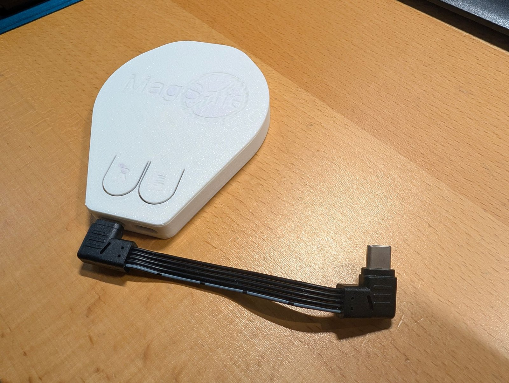

# Hardware

Built for the **Waveshare ESP32-C5-WIFI6-KIT-NXRX** with a W5500
Ethernet module on SPI.

| Signal | GPIO |
|--------|------|
| SCLK   | 23   |
| MOSI   | 24   |
| MISO   | 25   |
| CS     | 26   |
| RST    | 4    |
| INT    | not connected (`-1`, the driver polls the link over SPI) |

The pins are defines at the top of the sketch.

> **Flash and PSRAM.** The kit carries two kinds of memory. The
> **16 MB flash** keeps what survives a restart: two firmware slots of
> 6.25 MB, so an update goes into the slot not running, 3.4 MB for
> the IE catalog, the snapshots and the event log, and a small area for
> the settings ([Installation](install.md)). The **8 MB PSRAM** is working memory:
> roughly 5 MB of it are allocated at boot, the capture ring alone takes
> 3.1 MB.
>
> **PSRAM is mandatory.** A board without PSRAM, such as the
> **ESP32-C5-Mini**, will not run this firmware — the allocations fail
> at startup and nothing comes up. Check the part number before
> ordering: the Waveshare kit above carries 8 MB of PSRAM, several
> otherwise identical C5 boards carry none.

> **Direct connection to a PC:** the W5500 does not support auto-MDI/MDI-X
> (datasheet 5.5.6). A straight cable works to a switch or router; for a
> PC or another W5500 you need a crossover cable, unless the other end
> has working auto-MDI/MDI-X. Not every laptop does.

## USB ports

The kit has two USB-C ports:

| Port   | Goes to | Used for |
|--------|---------|----------|
| **UART** | CH343 USB-to-serial bridge, GPIO 11/12 | the serial log (115200 baud), uploading from the Arduino IDE |
| **USB**  | the chip's own USB Serial/JTAG, GPIO 13/14 | the sensor on a phone over WebUSB and flashing from the phone ([Sensor on a phone over USB](usb.md)); uploading from a PC works here too |

Next to them, **BOOT** (GPIO 28) takes a snapshot when pressed while
the sensor runs, and the RGB LED (GPIO 27) answers, see
[Snapshots](settings.md#snapshots); held while the board starts it
enters the download mode instead.

Either one powers the board. A plain serial terminal on the **USB**
port resets the chip when it opens it (RTS); the page sets DTR only
and leaves it running.

## Enclosure

[`3d-printed-housing/`](../3d-printed-housing/) holds a snap-fit case for
the two boards: the OpenSCAD source `esp32c5_w5500_v21.scad` and the
printable `wlanscout_tray.stl` and `wlanscout_hood.stl`. The boards are
wired directly, with the wires kept at least 15 mm from the antenna;
the comment block at the top of the `.scad` file describes the layout
and the measurements to check before printing.

**Without the W5500**, for use on a phone over USB (see
[Sensor on a phone over USB](usb.md)), the bare Waveshare board fits
cases made by others, both on MakerWorld:

- [Biscuit – DIY MagSafe case, ESP32-C5 Waveshare](https://makerworld.com/de/models/2590419-biscuit-diy-magsafe-case-esp32-c5-waveshare),
  a MagSafe case for the back of a phone
- [Waveshare ESP32-C5 case](https://makerworld.com/de/models/1974552-waveshare-esp32-c5-case)

