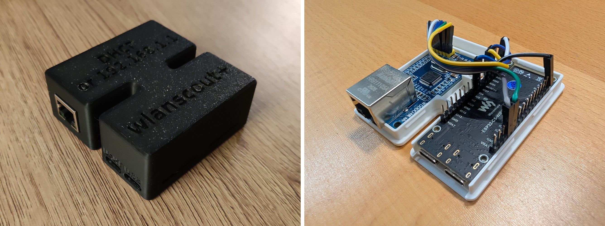
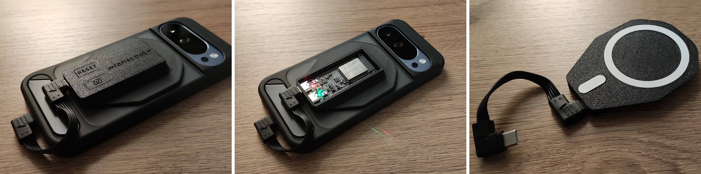
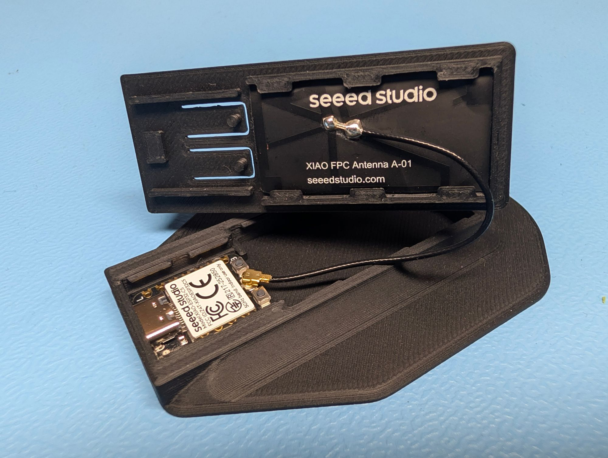

# Hardware

Built for the **Waveshare ESP32-C5-WIFI6-KIT** (N16R8 or N32R8) with a W5500
Ethernet module on SPI ([this board](https://www.amazon.de/dp/B0GDFY22Q1)
and [this W5500 module](https://www.amazon.de/dp/B0FB94KPVT) were used).

| Signal | GPIO |
|--------|------|
| SCLK   | 23   |
| MOSI   | 24   |
| MISO   | 25   |
| CS     | 26   |
| RST    | 4    |
| INT    | not connected (`-1`, the driver polls the link over SPI) |

The pins are defines in `config.h`.

> **Keep the wires short: 10 cm Dupont wires**
> ([these](https://www.amazon.de/dp/B0HFQQRCCF) were used). The W5500
> takes its 3.3 V and the 10 MHz SPI over the same loose wires; with
> 20 cm wires the test sensor's W5500 reset itself every few hours to
> days (registers back at their defaults, link down for two seconds).
> The firmware notices that within a second and reinitialises the
> interface ("the W5500 reset by itself" in the event log), see
> [Tuning](tuning.md).

The **Seeed Studio XIAO ESP32-C5** (8 MB flash, 8 MB PSRAM) runs
everything but Ethernet, over USB only, new firmware from the page
over USB like the kit: the [XIAO build](#xiao-build). Flash and PSRAM
of both boards: [Memory](#memory).

> **PSRAM is mandatory.** A board without PSRAM, such as the
> **ESP32-C5-Mini**, will not run this firmware — the allocations fail
> at startup and nothing comes up. Check the part number before
> ordering: the Waveshare kit above carries 8 MB of PSRAM, several
> otherwise identical C5 boards carry none.

> **Direct connection to a PC:** the W5500 does not support auto-MDI/MDI-X
> (datasheet 5.5.6). A straight cable works to a switch or router; for a
> PC or another W5500 you need a crossover cable, unless the other end
> has working auto-MDI/MDI-X. Not every laptop does.

## Memory

The flash keeps what survives a restart, the PSRAM is working memory.

| | Waveshare kit | XIAO | XIAO with one slot (`XIAO_ONE_SLOT=1`) |
|---|---|---|---|
| flash | 16 MB | 8 MB | 8 MB |
| firmware | two slots of 6.25 MB: an update goes into the one not running | two slots of 3.25 MB, the same way | one slot of 3.25 MB: new firmware through the download mode |
| LittleFS: IE catalog, snapshots, event log, BLE hits | 3.4 MB | 1.4 MB | 4.625 MB |
| settings (NVS), boot selection, core dump | 20 kB, 8 kB, 64 kB | the same | the same |
| partition table | `partitions.csv` | `partitions_xiao.csv` | `partitions_xiao_1slot.csv` |
| PSRAM | 8 MB, about 3.7 MB taken at boot, the capture rings grow into the rest ([Tuning](tuning.md)) | the same | the same |

## XIAO build

For the **Seeed Studio XIAO ESP32-C5**: 8 MB flash, 8 MB PSRAM (quad),
native USB, no antenna on the board but a u.FL connector, a single
yellow LED on GPIO 27, BOOT on GPIO 28. It runs the full feature set,
see the table below, but over USB only: the W5500 is not supported on
this board, and the page comes from the static site, not from the
sensor. `tools/build_xiao.sh BUILDDIR` builds it for the core's
`XIAO_ESP32C5` board with the XIAO values from the comment in
`config.h` (`BOARD_ID "xiao"`, `ENABLE_ETHERNET 0`, the plain LED),
`partitions_xiao.csv` and *USB CDC On Boot* off;
`wlanscout.ino.merged.bin` from BUILDDIR goes to 0x0. The same in the
Arduino IDE: see [Installation](install.md). Every table limit is the
same on both boards ([Tuning](tuning.md)).

As an option, `XIAO_ONE_SLOT=1 tools/build_xiao.sh BUILDDIR` builds
it with one firmware slot (`ENABLE_OTA 0`,
`partitions_xiao_1slot.csv`): 4.625 MB LittleFS instead of 1.4 MB,
but no updates from the page, new firmware goes in through the
download mode ([flasher](usb.md#flashing-from-the-phone)). Switching
between the two needs a full install, the file system starts empty.
The smaller limits in the table below follow the size of the file
system, so the option gets those of the full build. What differs:

| | Waveshare kit | XIAO |
|---|---|---|
| W5500 Ethernet | yes | none, USB only |
| the page in the firmware | yes, on port 80 | no, from the static site |
| GPIO 26 | W5500 CS | the XIAO's battery measurement, left alone |
| antenna | on the board | u.FL only, attach one before scanning |
| status LED (GPIO 27) | RGB, green ok, red failed | yellow, two short blinks ok, one long failed |
| firmware and file system | see [Memory](#memory) | |
| IE catalog frames per snapshot | up to 256 kB | up to 128 kB |
| IE catalog pcap file, at most | 1 MB | 320 kB |
| free before a snapshot is written (the oldest go first), snapshots kept | 512 kB, up to 10; fewer once the catalog's pcap file fills, its frames going into each one | 256 kB, about 7 of 100 kB with a full catalog but few frames, 10 with an empty one, 2–3 with the catalog's pcap file full or every table full |

- **Antenna:** without one the board sees next to nothing. The FPC
  antenna in the box is called 2.4 GHz in one Seeed table and
  2.4/5 GHz in another; for 5 GHz a dual-band antenna is the safe pick.
- **GPIO 26** switches the board's battery measurement (ADC on GPIO 6)
  and is left alone, unlike on the kit (W5500 CS).
- **Updates** take only an image of the same build: each image names
  its board (`kit` or `xiao`; images before 2.8.19 count as
  `kit`), and one built for more flash than the board has is refused
  too. An upload from the page is checked by the sensor itself, and
  *Check for new firmware* asks the XIAO's own release
  (`firmware/xiao/`). The option with one slot has no updates from the
  page: *Settings → Sensor → Update in download mode* opens the
  flasher, which checks the image and the board before it writes
  ([Flashing from the phone](usb.md#flashing-from-the-phone)).

## USB ports

The kit has two USB-C ports:

| Port   | Goes to | Used for |
|--------|---------|----------|
| **UART** | CH343 USB-to-serial bridge, GPIO 11/12 | the serial log (115200 baud), uploading from the Arduino IDE |
| **USB**  | the chip's own USB Serial/JTAG, GPIO 13/14 | the sensor on a phone over WebUSB and flashing from the phone ([Sensor on a phone over USB](usb.md)); uploading from a PC works here too |

Next to them, **BOOT** (GPIO 28) takes a snapshot when pressed while
the sensor runs, and the RGB LED (GPIO 27) answers, see
[Snapshots](settings.md#snapshots); held while the board starts it
enters the download mode instead.

Either one powers the board. A plain serial terminal on the **USB**
port resets the chip when it opens it (RTS); the page sets DTR only
and leaves it running.

## Enclosure

[`3d-printed-housing/`](../3d-printed-housing/) holds two cases, each as
OpenSCAD source and the printable STLs.

**Ethernet sensor** (board and W5500): `esp32c5_w5500_v31.scad` with
`esp32c5_w5500_v31_tray.stl` and `esp32c5_w5500_v31_hood.stl`. The
boards sit in pockets that follow their outlines, the ESP32-C5 with its
components down, the USB-C ports and the RJ45 at the front. They are
wired directly, with the wires kept at least 15 mm from the antenna.
The hood snaps over the tray without screws. RESET and BOOT are pressed
through flexure tongues in the floor, engraved underneath. The comment
block at the top of the `.scad` file describes the layout and the
measurements to check before printing.

**Phone sensor** (board alone, see [Sensor on a phone over
USB](usb.md)): `esp32-c5-magsafe-case-v7.scad` with
`esp32-c5-magsafe-case-base-v7.stl` and
`esp32-c5-magsafe-case-lid-v7.stl`, a MagSafe case for the back of a
phone. The metal ring is glued into the recess on the underside; these
[MagSafe metal rings](https://www.amazon.de/dp/B0DH217VB7) were used.
The lid snaps on and has flexure buttons for RESET and the snapshot
(BOOT), *USB* and *Serial* stand below the ports.

This case is a compromise for the radio. Espressif recommends at least
15 mm clearance around the PCB antenna in all directions
([ESP32-C5 PCB layout design](https://docs.espressif.com/projects/esp-hardware-design-guidelines/en/latest/esp32c5/pcb-layout-design.html)).
Here the board lies about 1.5 mm above the phone's back, and the steel
ring runs right under the antenna. Expect weaker signals and fewer
networks than from the Ethernet sensor or the bare board held away
from the phone.

It is adapted from
[Biscuit – DIY MagSafe case, ESP32-C5 Waveshare](https://makerworld.com/de/models/2590419-biscuit-diy-magsafe-case-esp32-c5-waveshare)
by [Dtmcnamara](https://makerworld.com/de/@Dtmcnamara), licensed under
[CC BY-NC-SA 4.0](https://creativecommons.org/licenses/by-nc-sa/4.0/).
These three files are under the same licence, not under the GPL of the
rest of wlanscout: free to share and adapt, with credit, not for
commercial use, and changes under the same licence. The `.scad` file
lists what was changed.

**XIAO sensor** (Seeed Studio XIAO ESP32-C5, see [XIAO
build](#xiao-build)): `xiao_c5_case-v3.scad` with
`xiao_c5_bottom-v3.stl` and `xiao_c5_lid-v3.stl`, derived from the
MagSafe case above, with the same ring recess underneath. The board
sits at the front with its USB-C port at the edge; its FPC antenna is
slid under the tabs on the lid's underside, behind the board, and its
cable plugs into the board's U.FL connector. The lid has flexure
buttons for the snapshot (BOOT, camera pictogram, left seen from the
USB end) and RESET (right); a T-shaped pad on its underside, between
the buttons' tongues, presses on the board's RF shield and holds the
board down. Print the lid upside down
(`part = "lid_print"`), no support needed. Derived from the MagSafe
case, these three files are under CC BY-NC-SA 4.0 as well.

Without the W5500 the bare board also fits the
[Waveshare ESP32-C5 case](https://makerworld.com/de/models/1974552-waveshare-esp32-c5-case)
on MakerWorld.
