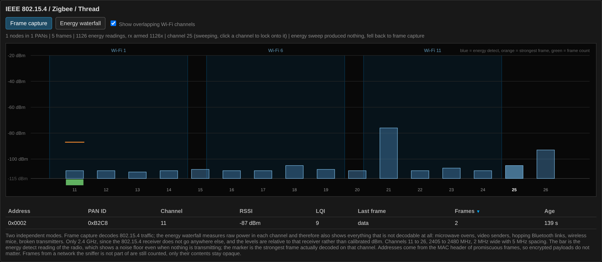
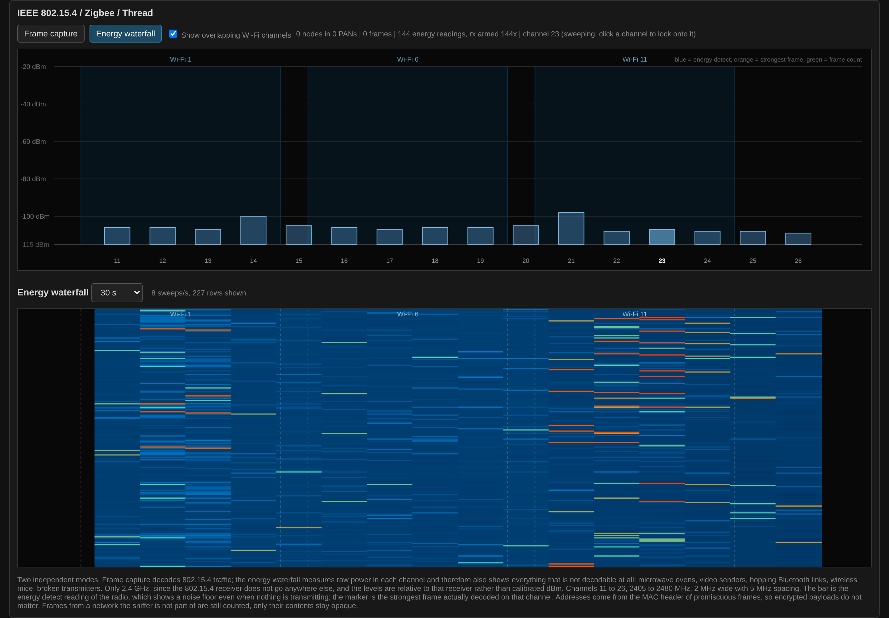

# IEEE 802.15.4

The **802.15.4** button switches the radio to Zigbee, Thread and
everything else on IEEE 802.15.4: channels 11 to 26, 2405 to 2480 MHz,
2 MHz wide and 5 MHz apart. As with BLE, Wi-Fi scanning stops for as
long as this mode runs.

There are two sub-modes.

**Frame capture** sweeps the 16 channels with a 300 ms dwell, a little
under five seconds per round, and decodes what it receives. Clicking a
channel in the chart locks the receiver onto it; clicking it again
resumes the sweep. In the chart, the blue bar is the energy detect
reading of the channel, the orange marker the strongest frame actually
decoded there and the green bar below the axis the frame count. The
Wi-Fi channels 1, 6 and 11 are shaded in the background, since they are
what usually sits on top of an 802.15.4 network; the checkbox hides
them.

The node table lists every address seen, short (`0x1234`) or extended
(64 bit, marked `ext`), with PAN ID, channel, RSSI, LQI, the type of the
last frame (beacon, data, ack, command) and a frame count. Addresses
come from the MAC header, so a network the sensor is not part of still
shows up; only the encrypted payload stays opaque. At most 40 nodes are
kept, each for three minutes after its last frame.

**Energy waterfall** gives up decoding and measures raw power in each
channel instead, one row per sweep, over a selectable range from 30 s
to 30 min. This is the one view in the firmware that sees energy which
is not a decodable frame at all: microwave ovens, video senders,
hopping Bluetooth links, wireless mice. The levels
are relative to this receiver, not calibrated dBm; its noise floor sits
around -105 to -110 dBm. A sweep over all 16 channels takes well under
a second, so the waterfall runs at several rows per second. If no sweep
completes within 10 s the firmware gives up, says so in the status line
and falls back to frame capture.

Should the web server stop answering for 10 s while 802.15.4 runs, the
device returns to Wi-Fi on its own, so a stuck mode never leaves it
unreachable.
