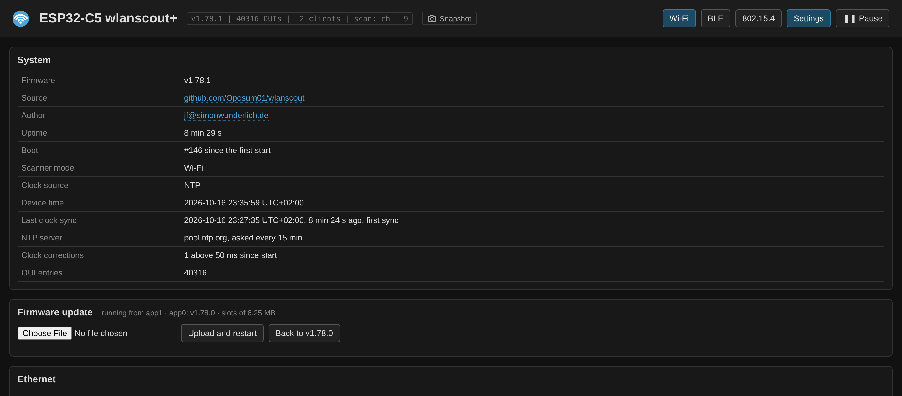
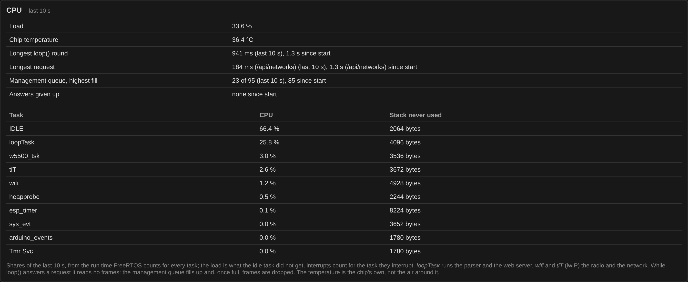

# Settings and persistence

These survive a reboot, stored in NVS:

| Setting | Key |
|---------|-----|
| default channel plan, used at start | `defmask`, a 64-bit mask |
| fast sweep | `fast` |
| capture on/off | `cap` |
| captured frame types | `capmask` |
| display timezone | `tz`, minutes east of UTC |
| BLE active scan | `bleactive` |
| IE catalog recording | `catalog` |
| sensor name | `name`, also used for the DHCP hostname |
| boot counter, for the catalog | `boots`, raised on every start |
| what a snapshot keeps | `snapparts`, bits as for `/api/snapshot?parts=` |

They are written only when one of them actually changes, never on a
poll, so the flash sees a handful of writes a session rather than
thousands. A stored channel mask of zero is ignored and the default kept
— otherwise a device on which every channel was once deselected would
come up with a stalled sweep.

The **IE catalog** itself (see [Wi-Fi views](wifi-views.md#ie-catalog))
is not in NVS but in a LittleFS file system on the 3.4 MB `spiffs` data
partition of `partitions.csv`, which nothing else uses. Uploading a new
firmware, over USB or the network, leaves it alone; writing the merged
image at 0x0 or erasing the flash removes it.

The **snapshots** live in the same file system; see below.

So does the **event log** (`/eventlog.bin`): every entry is appended the
moment it is logged, so a power cut loses nothing, and the file is
written anew from the last 80 entries once it holds 160. Each start adds
"device started, firmware v…, <reason>" — *power on* after a power
cut, *crash*, *task watchdog*, *brownout, supply too weak*, *restart by
the firmware* after an update or rollback. Entries logged before the
clock was set get their wall time once it is known; those of a start
that never got a clock show only the seconds after that start. The
same goes for the snapshots of the start, the IE catalog's first and
last sightings and the association history: whatever was recorded
before the clock with the uptime only is dated the moment NTP, the
browser or an AP's Time Advertisement sets it. A sensor on a power
bank gets it by a phone on its other USB-C port, the power bank
left in, so that it does not restart; the capture ring needs nothing,
its timestamps are worked out on download. The catalog's pcap file
keeps the time its frames were written with.
After a *crash* ESP-IDF has written a core dump into its own flash
partition; the next start logs what it says once — the task, the
address and the cause, e.g. "crash in loopTask at 0x4201a2b4: load
access fault" — and the event log shows it in a box above the table,
with *Download core dump* and *Delete*, until it is deleted or a later
crash replaces it.
`/api/system` has the reason of the current start as `reset`. The
page shows the log 20 entries to a page, newest first, with a page
choice under it.

The **CPU** section of Settings says how busy the sensor is, from
`/api/system` (`cpu`, `temp`, `loop`), measured every 10 s:

- the load, what the idle task did not get, and per task its share
  and the stack it never used; *loopTask* runs the parser and the web
  server, *wifi* and *tiT* (lwIP) the radio and the network;
- the chip's own temperature, not the air around it;
- the longest round of loop() and the longest request it answered,
  with its path, in the last 10 s and since the start;
- the highest fill of the management queue. While loop() answers a
  request it reads no frames: the queue fills, and once full, frames
  are dropped (*Management frames dropped* under the counters). Long
  answers do that, `/api/networks` with many networks above all;
- the answers given up since the start, with the last client: a client
  that stops reading in the middle of one, a VPN switched off for
  instance, gets 2 s, then the sensor moves on. Each one is a line on
  the serial console, not an event in the log.

The **operating mode is deliberately not stored**. After a restart the
device always comes up as a Wi-Fi scanner, even if BLE was running last.
A sensor that returns from a power cut in a mode nobody expects is worse
than one that behaves predictably.

The **timezone** shifts displayed times only. Everything inside the
device stays on UTC — capture timestamps, export, clock arithmetic — so
a capture taken here still lines up with one taken anywhere else. There
is no daylight saving rule on board; pick the offset that applies.

## Snapshots

A snapshot keeps the state of one moment for later: what the page reads
from the sensor — status, channel plan, live channel data, networks
with the 6 GHz list and the bell's configuration changes, stations, association history, IE catalog, the
spectrum history for every time range the page offers, and the BLE and
802.15.4 tables — written as one JSON file to the flash, each answer
exactly as the endpoint gives it.

**Keep** under Settings → Snapshots chooses what goes in: networks,
stations, association history, spectrum (live channel data and its
history), IE catalog, BLE, 802.15.4; status and channel plan always.
The choice is stored on the sensor and survives a reboot (`snapparts`
in the table above, bits 1, 2, 4, 8, 16, 32, 64 in that order). Until
one is made, the spectrum, BLE and 802.15.4 are left out: the spectrum
history is the biggest part, and in Wi-Fi mode the BLE and 802.15.4
tables are empty anyway. A part
left out is not in the file; viewed, its tables stay empty, and the
bar names what the snapshot left out (the status line does not call that
a lost connection). The capture buffers are not part of
it; their 3 MB do not fit, and the catalog's frames stay in the
catalog. The pcap links in a snapshot therefore ask the connected
sensor for what its capture buffers hold now: frames of that moment
may have been overwritten since, and for a snapshot imported from
another sensor they were never there. When the sensor has none, the
message under the link says that as well. A snapshot is about 100 kB and
takes under a second.

There are two ways to take one:

- a **short press on the BOOT button** of the board, with or without a
  page open — useful when a phone only powers the sensor in the
  field. The RGB LED blinks green twice when the file is written, red
  when it failed. BOOT (GPIO 28) is only a strapping pin at reset:
  held while the board starts, it enters the download mode, so do not
  hold it while plugging in. Without a clock, on a power bank, the
  snapshot is dated later in the same run: plug the phone into the
  board's other port while the power bank stays in, open the page
  over USB, and the browser's time dates it (see below);
- the **camera button** next to the status badge, on every view (on a
  phone the icon alone), or **Take snapshot** under Settings →
  Snapshots. The button turns green for a moment and the status line
  names the snapshot, red when it failed.

The last **ten** are kept, the oldest goes; a snapshot also gives way
when less than 512 kB of the file system would be left. Next to the IE
catalog about 2 MB are left for snapshots: ten of the usual 100 kB fit
easily, with every table full (160 networks, 100 stations, 120
associations) a snapshot grows to several hundred kB and fewer stay. Each has a
number, counting up, and its time: date and time when the clock was
set at that moment, by NTP, the browser or an AP's time advertisement,
otherwise the time since power-on; a clock set later does not date it
afterwards. They survive a reboot and a
firmware update.

**Rename** gives one a name of up to 40 characters, e.g. the place it
was taken; an empty name removes it. The name is kept in a file of its
own next to the snapshot (`/snap/<seq>.name`), goes with it when it is
deleted, and comes first in a download as `name`, so an opened file
still shows it.

**View** opens one: the page then reads that snapshot instead of the
sensor, with all its tables, graphs and tooltips, and a bar under the
header says so. Settings that would change the sensor are refused
until **Back to live**.

**Export** saves one as a `.zip` holding its `.json`, **Export all**
every snapshot of the sensor in a single `.zip`, one `.json` each
(`wlanscout-snapshot-7-Keller.json`: number, then the name). The page
packs them itself, so it works over USB as well; a snapshot shrinks to
a tenth or less. **Import** puts such files on a sensor again, the
same one or another, one file or several, `.zip` (also from another
ZIP tool, stored or deflated) or `.json`: each goes up on its own,
oldest first, and takes the next
number, so imports count as the newest and the oldest make room as for
a new snapshot. The sensor keeps an upload only when it arrived whole
and starts as a snapshot does. **View file** shows a file (of a `.zip` with several the newest) without
putting it on the sensor, also in the static copy on a phone with no
sensor plugged in. **Clear all** deletes every snapshot on the sensor,
after asking. The event log notes each snapshot taken (by the page or the
BOOT button), imported, renamed or deleted, and Clear all.

The format of one snapshot: `wlanscout_snapshot`, `seq`,
`epoch` (0 without a clock; a snapshot dated later keeps the 0 in the
file and gets the time in its download), `uptime`, `fw`, `sensor`, `sensorid`,
`name` when it has one, `parts` and `answers`, the endpoint answers keyed by the URL the page asks for
(`/api/networks`, `/api/history?range=1800000`, …).
