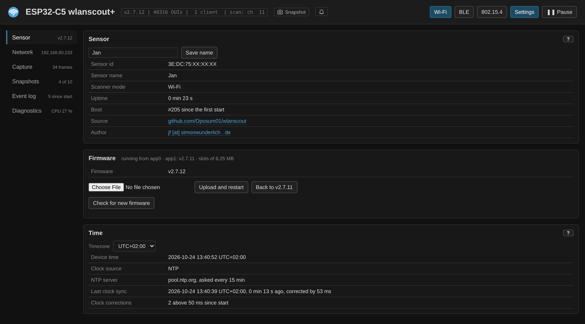
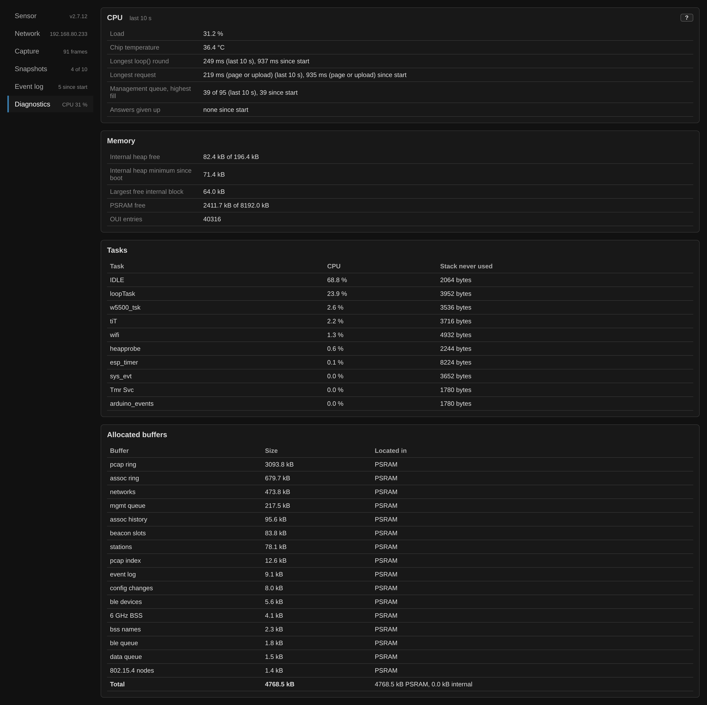

# Settings and persistence

Settings is split into tabs, on the left (on a phone on top), each
with a short status beside it:

| Tab | What it holds |
|-----|---------------|
| Sensor | name, sensor id (the MAC of the W5500, or derived from the chip without one), scanner mode, uptime, boot, source and author; the firmware with *Upload and restart*, *Back to*, *Reboot* and *Check for new firmware*, or *Update in download mode* in a build without updates from the page (the XIAO's option with one firmware slot, see [Flashing from the phone](usb.md#flashing-from-the-phone)); the time with the timezone and daylight saving, the clock source, NTP and the corrections |
| Network | Ethernet (address, mask, gateway, DNS, MAC, hostname, link) and DHCP (client, lease, failed attempts) |
| Capture | sweep and frame counters, the capture settings, and the stores on the sensor (frame ring, beacons, association requests, association history) with their fill and *download all* / *clear*; the graphs recorded, kept or with their tab open, with *CSV* and *stop* |
| Snapshots | the snapshots and the export |
| Event log | the event log and, after a crash, the core dump; the tab says *crash* in red then |
| Diagnostics | CPU, memory, tasks and the allocated buffers |

The tab picked is kept per browser. The longer explanations are behind
the **?** of each box.

These survive a reboot, stored in NVS:

| Setting | Key |
|---------|-----|
| default channel plan, used at start | `defmask`, a 64-bit mask |
| fast sweep | `fast` |
| capture on/off | `cap` |
| captured frame types | `capmask` |
| display timezone | `tz`, standard minutes east of UTC |
| timezone from the country codes | `tzauto`, until `tz` or `dst` is set by hand |
| auto daylight saving | `dst`, 0 off, 1 Europe, 2 North America, 3 Australia south-east, 4 New Zealand |
| BLE active scan | `bleactive` |
| IE catalog recording | `catalog` |
| sensor name | `name`, also used for the DHCP hostname |
| boot counter, for the catalog | `boots`, raised on every start |
| what a snapshot keeps | `snapparts`, bits as for `/api/snapshot?parts=` |
| graphs kept without a viewer | `watchkeep`, six octets per BSSID |
| remember capture mode, and the mode picked last | `keepmode`, `mode` (0 Wi-Fi, 1 BLE, 2 802.15.4) |

They are written only when one of them changes
([Internals](internals.md#settings-in-nvs)).

The **capture mode** (Wi-Fi, BLE or 802.15.4) is not stored unless
**Remember capture mode after a restart** is ticked under Settings →
Sensor: off, every start scans Wi-Fi; on, the sensor starts in the mode
a page picked last, e.g. as a BLE sensor on a power bank. The return to
Wi-Fi of an 802.15.4 sensor that no page asks anything for 10 s does
not count as picked, and at the start no page has asked yet, so a
sensor kept in 802.15.4 stays there until a page switches it.

**RESET pressed twice** is the way back when no page can reach the
sensor in the mode it keeps starting in. Press the reset button
(**RST** on the kit, **RESET** on the XIAO), wait for the LED (blue on
the kit), and press it again while the LED is lit, about 8 s. The
sensor starts in Wi-Fi, forgets the mode it kept, notes "RESET pressed
twice" in the event log and blinks green. The tick stays, so the next
mode a page picks is kept again.

To the chip the button is a power cut: one press cannot be told from
pulling the plug, two can. Every start after power-on marks itself in
NVS for 10 s, the LED lit as long; a start that finds the mark came
within 10 s of the one before. The sketch runs only about 2 s after the
button, after the bootloader and the PSRAM test, which is why to wait
for the LED: a second press before it cuts the first start off before
it set its mark, and the sensor simply starts in the mode it keeps.

## On flash

The IE catalog ([Wi-Fi views](wifi-views.md#ie-catalog)), the snapshots
(below), the event log and the BLE hits ([BLE](ble.md)) live in a
LittleFS file system on the `spiffs` partition, its size per board under
[Memory](hardware.md#memory). Uploading a new firmware, over USB or the
network, leaves it alone; writing the merged image at 0x0 or erasing
the flash removes it.

### Event log

`/eventlog.bin`: every entry is appended the moment it is logged, so a
power cut loses nothing, and the file is written anew from the last 80
entries once it holds 160. Each start adds "device started, firmware
v…, <reason>": *power on* after a power cut, *crash*, *task watchdog*,
*brownout, supply too weak*, *restart by the firmware* after an update
or rollback. `/api/system` has the reason of the current start as
`reset`. The page shows the log 20 entries to a page, newest first.

### Core dump

After a *crash* ESP-IDF has written a core dump into its own flash
partition; the next start logs what it says once, the task, the address
and the cause, e.g. "crash in loopTask at 0x4201a2b4: load access
fault". The event log shows it in a box above the table, with *Download
core dump* and *Delete*, until it is deleted or a later crash replaces
it. Decoding it: [Troubleshooting](tuning.md#troubleshooting).

## Diagnostics

The **CPU** box under Settings → Diagnostics says how busy the sensor is, from
`/api/system` (`cpu`, `temp`, `loop`), measured every 10 s:

- the load, what the idle task did not get, and per task its share
  and the stack it never used; *loopTask* runs the parser and the web
  server, *wifi* and *tiT* (lwIP) the radio and the network;
- the chip's own temperature, not the air around it;
- the longest round of loop() and the longest request it answered,
  with its path, in the last 10 s and since the start;
- the highest fill of the management queue. While loop() answers a
  request it reads no frames: the queue fills, and once full, frames
  are dropped (*Management frames dropped* under Capture). Long
  answers do that, `/api/networks` with many networks above all;
- the answers given up since the start, with the last client: a client
  that stops reading in the middle of one gets 2 s, then the sensor
  moves on ([Troubleshooting](tuning.md#troubleshooting)).

## Time

The clock comes from, in this order of rank:

1. **NTP** once Ethernet has an address, re-synced every 15 minutes: the
   server from DHCP (option 42) first, pool.ntp.org and time.nist.gov
   behind it.
2. **The browser**: the sensor's page when it opens, the static copy on
   a phone when it connects over USB.
3. **An AP** that sends a Time Advertisement element (69), for a sensor
   on its own: set once two frames of the same AP agree, renewed after
   two minutes and then every 15 minutes from the median of all APs
   heard.

Settings → Sensor shows which one it came from. Only the offset between
the wall clock and the boot timer is taken: every captured frame keeps
its own microsecond timestamp, so intervals within a capture stay exact.

What was recorded before the clock was set, with the uptime only, is
dated once it is: event log entries, the snapshots of that start, the
IE catalog's sightings and the association history. The capture ring
needs nothing, its timestamps are worked out on download; the catalog's
pcap file keeps the time its frames were written with. **A sensor on a
power bank** gets the time from a phone on its other USB-C port, the
power bank left in so that it does not restart.

The **timezone** shifts displayed times only. Everything inside the
device stays on UTC — capture timestamps, export, clock arithmetic — so
a capture taken here still lines up with one taken anywhere else. Pick
the standard offset, the one of winter, and under **Auto daylight
saving** the region. The sensor then adds the summer hour itself, and
each time gets the offset of its own date, so times from before a
switch still read right. A graph CSV across a switch names both
offsets in its header.

Until a timezone is picked, it is **auto, from the country codes**:
once a minute the sensor counts the Country elements of the networks
in range, and when more than half of at least five name the same
country, the rule of the Country note in the tooltip, it takes that
country's offset and daylight saving. A country with several
timezones (US, Canada, Mexico, Brazil, Australia, Russia …) or a rule
of its own (Egypt, Israel, Morocco, Chile …) leaves the timezone as it
is; the Time box says so. A change goes into the event log. Picking an
offset or a daylight saving rule by hand ends it, *auto* turns it on
again. A sensor updated from an older firmware starts in auto too:
the offset picked there had no daylight saving rule, and where auto
finds no country with a single timezone the offset stays.

## Snapshots

A snapshot keeps the state of one moment for later: what the page reads
from the sensor — status, channel plan, live channel data, networks
with the 6 GHz list and the bell's configuration changes, stations, association history, IE catalog, the
spectrum history for every time range the page offers, and the BLE and
802.15.4 tables — written as one JSON file to the flash, each answer
exactly as the endpoint gives it.

**Keep** under Settings → Snapshots chooses what goes in: networks,
stations, association history, spectrum (live channel data and its
history), IE catalog, BLE, 802.15.4; status and channel plan always.
The choice is stored on the sensor and survives a reboot (`snapparts`
in the table above, bits 1, 2, 4, 8, 16, 32, 64 in that order). Until
one is made, the spectrum, BLE and 802.15.4 are left out: the spectrum
history is the biggest part, and in Wi-Fi mode the BLE and 802.15.4
tables are empty anyway. A part
left out is not in the file; viewed, its tables stay empty, and the
bar names what the snapshot left out (the status line does not call that
a lost connection). The capture buffers are not part of
it; their several MB do not fit. The pcap links in a snapshot therefore ask
the connected sensor for what its capture buffers hold now: frames of
that moment may have been overwritten since, and for a snapshot
imported from another sensor they were never there. When the sensor
has none, the message under the link says that as well.

The IE catalog's frames do go in, with the catalog (from 2.8.21): each
frame in base64 with the catalog rows it carries, up to 256 kB of the
catalog's pcap file (128 kB on the XIAO), oldest first. In a snapshot the catalog's *pcap* links and *Download
all frames* take them from the snapshot, so they work on another
sensor too, for an imported snapshot or one viewed from a file; the
line under the table says how many frames the snapshot keeps and how
many did not fit. A snapshot of an older firmware has none: its links
ask the connected sensor, and the message says why they may be
missing. Each snapshot carries its own copy, two taken in a row keep
the same frames twice. A snapshot is about 100 kB plus the catalog's
frames and takes under a second.

There are two ways to take one:

- a **short press on the BOOT button** of the board, with or without a
  page open — useful when a phone only powers the sensor in the
  field. The RGB LED blinks green twice when the file is written, red
  when it failed. BOOT (GPIO 28) is only a strapping pin at reset:
  held while the board starts, it enters the download mode, so do not
  hold it while plugging in. Without a clock it is dated later in the
  same run, see [Time](#time);
- the **camera button** next to the status badge, on every view (on a
  phone the icon alone), or **Take snapshot** under Settings →
  Snapshots. The button turns green for a moment and the status line
  names the snapshot, red when it failed.

The last **ten** are kept, the oldest goes; a snapshot also gives way
when less than 512 kB of the file system would be left. Next to the IE
catalog, its pcap file up to 1 MB, about 1.8 MB are left for snapshots
on the kit: ten of the usual 100 kB fit easily; with every table full
(250 networks, 100 stations, 120 associations), or the catalog's
frames in each, a snapshot grows to several hundred kB and fewer stay.
The XIAO ESP32-C5 has only 1.4 MB for all of it: there the catalog's
pcap file stops at 320 kB and 256 kB have to be free, which keeps
about seven of the usual snapshots; its option with one firmware slot
has 4.625 MB and the kit's limits ([Hardware](hardware.md#xiao-build)). Each has a
number, counting up, and its time: date and time when the clock was
set at that moment, by NTP, the browser or an AP's time advertisement,
otherwise the time since power-on; a clock set later does not date it
afterwards. They survive a reboot and a
firmware update.

| Button | What it does |
|--------|--------------|
| **Rename** | a name of up to 40 characters, e.g. the place; empty removes it. Kept in `/snap/<seq>.name`, comes first in a download as `name` |
| **View** | the page reads that snapshot instead of the sensor, with all its tables, graphs and tooltips; a bar under the header says so, and settings that would change the sensor are refused until **Back to live** |
| **Export**, **Export all** | one snapshot, or all, as a `.zip` of `.json` files (`wlanscout-snapshot-7-Keller.json`: number, then the name), packed by the page, so over USB too; a tenth of the size or less |
| **Import** | such files back onto a sensor, the same or another: `.zip` (also from another ZIP tool) or `.json`, oldest first, each taking the next number; kept only when it arrived whole |
| **View file** | shows a file without putting it on the sensor, also in the static copy with no sensor plugged in |
| **Clear all** | deletes every snapshot on the sensor, after asking |

The event log notes each snapshot taken, imported, renamed or deleted,
and Clear all.

The file format is under [Formats](api.md#formats).
