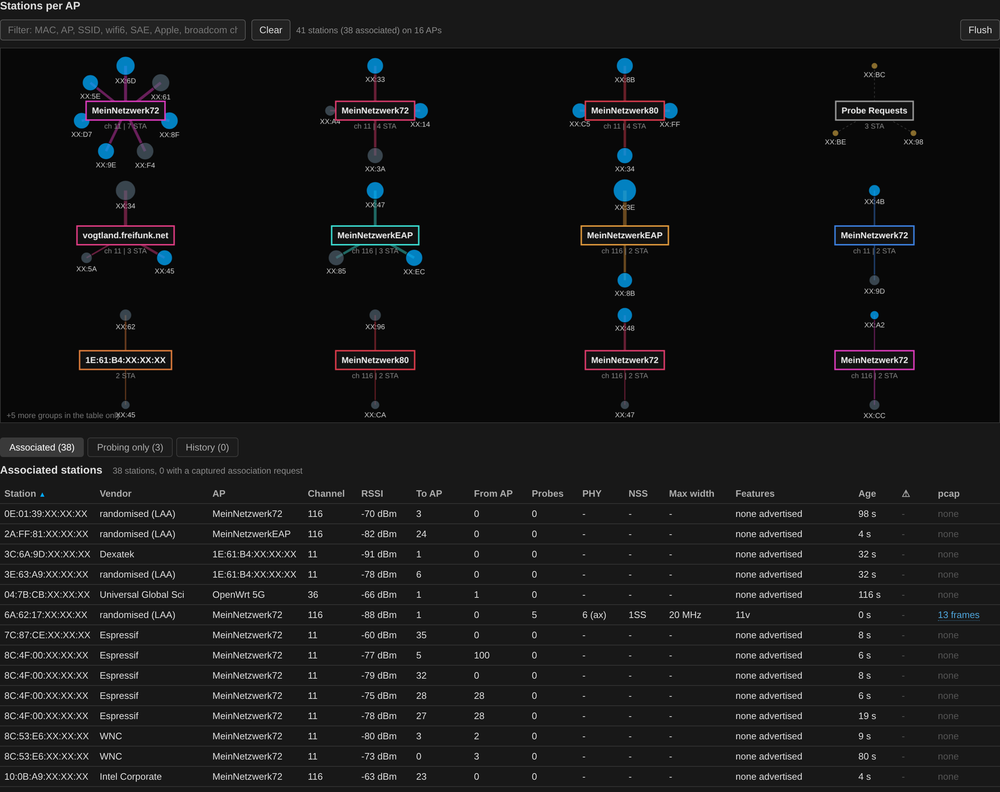
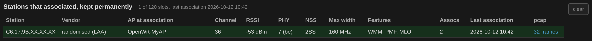
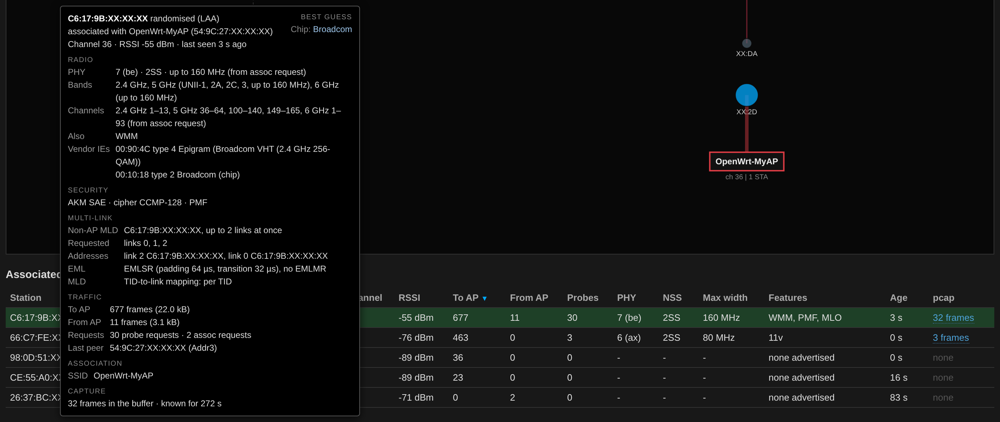

# Stations

Stations are shown in two live tables — associated, and probing only —
and in a third that does not age out. The three sit under tabs below
the graph, *Associated*, *Probing only* and *History*, each with the
number of stations the filter lets through; one table at a time, so a
table that grows does not push the one under the pointer away. The
browser keeps the tab last chosen.

**Order.** Both live tables start sorted by station address, the
association history by the newest association. A click on a column
head sorts all three by that column.

**The tooltip** has the same layout as the one for APs: under the
address, vendor and AP come channel, RSSI and age, then the sections
RADIO (PHY, bands, channels, WMM, QoS Management, the vendor
elements), SECURITY (with the RSN selection: whether the station took
the AP's RSNE or one of its RSNE Overrides),
ROAMING (11k, 11v, 11r with the mobility domain asked for, Fine Timing
Measurement), MULTI-LINK, TRAFFIC (frames each way, probe
and association requests, probed SSIDs, roaming history, last peer),
ASSOCIATION (the last result, the SSID joined, the BSS Max Idle Period
the station asked for and the AP granted: how long it may stay silent
before it has to send a keep-alive), CAPTURE and NOTES. RADIO has an
AWDL line when an AWDL sender named the station as its own address. A roam by
Fast BSS Transition (802.11r: a reassociation request whose FT element
carries a MIC) is marked as such in the BSS changes and counted under
*Roamed*.
Sections without content are left out.

**The notes column** (⚠) in all three tables boils the NOTES down to
symbols as in the network table: a pink `?` per element this sensor does
not decode (an unknown element in a probe or association request), an
amber `!` for something odd: the AP rejected the last association (with
the status code's meaning), or a station probing 20 times a minute or
more without associating anywhere the sensor can see. Sorting by the
column puts amber above any number of pink; the filter finds the note
texts as well (`unknown element`, `rejected`).

**The filter** above the station graph works like the one for BSSIDs:
every word has to match somewhere in what table and tooltip say about a
station — address, vendor, AP, probed SSIDs, capabilities, security,
the guessed maker and chip (`apple`, `broadcom chip`), its vendor and
unknown elements. Graph, both live tables and the association history
follow it. The **?** beside it lists the terms it adds itself:

| Term | Finds |
|------|-------|
| `ch:36` | channel, exactly |
| `associated` | with an AP, or `probing` |
| `wifi6` | standard (`wifi4` … `wifi7`), also `ax` |
| `sae` | AKM of its association (`psk` …) |
| `pmf` | PMF |
| `wmm` | WMM |
| `11k` | radio measurement, also `11v`, `11r` |
| `ft roam` | a fast transition (802.11r) seen |
| `ranging` | FTM requests seen |
| `mlo` | multi-link (Wi-Fi 7) |
| `awdl` | Apple Wireless Direct Link, also `apple` |
| `broadcom chip` | Wi-Fi chip from the vendor elements |

**Flush**, at the right of the same row, empties the station table
on the sensor, after asking, together with the network names learned
from the stations' probe and association requests; it fills again
from what is heard next. The association history stays, its own
*clear* empties it. In a snapshot it is greyed out, as on the
BSSID view.

Top right, under *BEST GUESS*, stand the manufacturer of the device and
its Wi-Fi chip, guessed from the vendor elements of its probe and
association requests by the same rules as for APs (see
[Wi-Fi views](wifi-views.md)). Most phones probe from a random MAC
address, which names no vendor; their vendor elements still do, an
iPhone for instance sends Apple's and Broadcom's.

**PHY, NSS and Max width** describe what a station can do, read from
the capability elements of its requests — not the channel it is on.
A Wi-Fi 7 client on channel 36 can show 320 MHz: it supports that
width, but only in 6 GHz. For APs the Width column of the network table
is different, it is the width the BSS actually operates on.

**Bands and channels** in the tooltip say where a station can operate
at all, which matters when planning: a client that lacks UNII-3 will
never join an AP on channel 149.

- **Bands** come from the Supported Operating Classes element, sent in
  probe and association requests: 2.4 GHz, 5 GHz with the UNII ranges
  and the widest width, 6 GHz with its widest width.
- **Channels** come from the Supported Channels element, which only
  association requests carry, and only from stations that do spectrum
  management. It is the exact list, per band, so it also shows gaps
  such as a missing channel 144, no UNII-4, or a 6 GHz range cut to
  what the local regulation allows. The element at the top of the
  request covers only the band of the link it was sent on; a
  multi-link station repeats it in the per-STA profile of every other
  link, and those are read as well. A profile carrying HE 6 GHz Band
  Capabilities is taken as 6 GHz, whose channel numbers start again at
  1 in steps of four.

**Hidden SSIDs** are resolved from directed probe requests and from
association requests, both of which name the network in clear. Once
learned the name is kept and not overwritten by the next beacon. Names
are also learned for APs that were never heard directly, for instance
because they are out of range or on a channel that is not being swept.

**Association outcomes** are read from the response the AP sends back.
The status code says whether the station got in, and if not, why; the
tooltip gives its meaning and its number, e.g. 17 the AP at its station
limit, 10 capabilities not supported, 31 a robust management frame
policy violation. Codes the page has no name for show as their number.
30, *rejected temporarily*, is part of normal PMF operation: the AP
still holds a protected association of the station and first checks it
with an SA Query; the response names a comeback time, shown with the
note, and the next attempt usually succeeds. It is therefore amber,
not red. A station retrying forever
against an AP that keeps answering 17 is a different problem from one
that never gets an answer at all, and without the code the two look the
same. Nothing is created from a response alone — a reply to a station
that was never heard requesting would otherwise put stations in the
table that are not there.

**Excessive probing** is flagged as a rate rather than a count, since a
station seen for an hour naturally has more probes than one seen for a
minute. Above twenty probe requests a minute without an association the
sensor can see, the tooltip says so. *That threshold is an estimate, not
a measurement — if ordinary devices trip it where you are, say so and it
can be adjusted.* It is usually a device whose
network is out of range, a captive-portal check on a loop, or a client
stuck on a profile it will never find.

**Roaming** is tracked per station with the last eight BSS changes and
their timestamps. A change needs three consecutive frames to be
accepted, since a station appearing to jump between two BSSIDs that
differ in a single bit is usually a corrupted frame. Frames that fail
the FCS are dropped outright, so are management and data frames whose
transmitter address has the group bit set — no real sender has one,
it is noise that slipped past the FCS and would otherwise show up as
a phantom station or made-up elements in the IE catalog — and frames
with ToDS and FromDS both clear
are ignored for BSS assignment — TDLS, Wi-Fi Direct and mesh traffic all
carry those bits and produced stations whose BSSID was their own
address.

**The association history** keeps a full copy of the station record for
every station whose association or reassociation request was decoded,
120 entries, never timed out. Stored per station: MAC and vendor, the
BSSID and the SSID it named in the request, the capabilities read from
the request itself — standard, channel width, spatial streams, AKM, PMF,
802.11k/v/r with the measurement and WNM detail behind them — the RSSI and channel at the time, how many association and
reassociation requests were seen, how many different BSSs it joined, and
the first and last contact as absolute timestamps. An association
request carries the full capability set, where a probe request carries
only a subset, so this is the most complete view of a station the sensor
will ever get. An association request names the station, the BSS and usually
the network in clear and is seen only at the moment a station joins, so
it is worth keeping long after the station has gone quiet.

The record is a snapshot taken at the station's last association
request. Its frame counts, probe count and age stop there and would
drift apart from the live table, so the history leaves them out: it
shows the AP the station joined, channel and RSSI at that moment, PHY,
NSS, max width, features, the number of association requests and the
time of the last one, plus the pcap link. The tooltip likewise gives
the first and latest association as absolute times instead of ages.

**Measurement and steering support.** The station tooltip lists the
radio measurements (802.11k) and WNM features (802.11v, BSS transition
management among them)
a client announces, decoded the same way as for APs — see
[Wi-Fi views](wifi-views.md#reading-the-network-table). BSS transition
management and the other Extended Capabilities bits already come with probe requests. The
RM Enabled Capabilities element is only sent in association and
reassociation requests, so the measurement list stays empty until the
station has joined while the sensor was listening. Whatever is read is
collected over all requests seen and kept in the association history.

### AWDL (Apple devices talking directly)

Apple devices use AWDL (Apple Wireless Direct Link) for AirDrop,
AirPlay, Sidecar and the like: action frames of their own on the
channels 6, 44 and 149, sent only while such a service is in use. The
sensor reads them in any case, whether the capture keeps action
frames or not. They come from an AWDL address of their own, random
and not the one the device uses in the Wi-Fi network. When the frames
also name the device's address in the Wi-Fi network and that station
is in the table, its tooltip gets an AWDL line under RADIO with the
device class the frames carry, *Mac*, *iPhone, iPad or Watch* (one
class for the three) or *Apple TV*, and the AWDL address.

A device on no Wi-Fi network names its AWDL address as its own and
sends nothing else under it. Such an AWDL sender, or one whose station
is not in the table, gets a row of its own under *Probing only*, with
*AWDL only* in the AP column; its tooltip has the device class, the
AWDL version, the country, the Wi-Fi network it is on (*on no
network* for none) and how many AWDL frames were heard. The count
line says how many rows are AWDL only. A snapshot shows them the same
way. The station filter finds both by "awdl", "apple" or the class.
The device name the frames also carry (often the owner's first name)
is not read.

### Multi-link stations

A Wi-Fi 7 station that joins an AP MLD sends a Basic Multi-Link element
in its association request. It gets `MLO` in the Features column and
the MULTI-LINK section in the tooltip:

**Links** lists the link the request went out on (the *association
link*) and the links named in its per-STA profiles, one line each:
band, link ID, the widest channel that link's capabilities allow and,
where the profile gives one, the station's address on that link. The
band comes from the profile: 6 GHz when it carries HE 6 GHz Band
Capabilities, else from its current operating class or its supported
channels. The request covers all links, so it can be heard on any link
the sensor reaches. A station may ask for more links than it can use
at once: the one above sent its request on the 5 GHz link, asked for
2.4 and 6 GHz as well, and serves two of the three at a time with
EMLSR.

**NSTR** names the link pairs, by band, on which the station cannot
send on one while receiving on the other (*non-simultaneous transmit
and receive*), e.g. `5 + 6 GHz`: the two are too close for its radio,
so it uses them one at a time. A profile flags them in its NSTR
Indication Bitmap.

**Max width** stays that of the link the request went out on, the band
the station is associated on as the sensor hears it; what the other
links allow, 320 MHz on 6 GHz for instance, is in their lines under
**Links**. EML and MLD read as for an AP (see
[Wi-Fi views](wifi-views.md#reading-the-network-table)); a non-zero
EMLSR padding and transition delay is what the station needs to move
its radio between links.

Such a station also appears once per link it transmits on, each time
with that link's own address. The per-STA profiles give those
addresses, so the tooltip of the main entry lists them under
**Links**, and the further entries are marked `MLO link` in the
Features column, with a pointer to the entry that holds the
capabilities.

Each per-STA profile carries the full capability set of its link, so
the element outgrows the 255 octets an element can hold and continues
in Fragment elements behind it. The sensor puts those back together
before reading the profiles; in the request above the 2.4 GHz profile
sat entirely in the fragment. A Fragment element right behind a full
element is not an unknown element of its own and does not go into the
IE catalog.

To catch a station's request, lock the sweep to the channel of one of
the AP's links and make the station reconnect. The request is kept whole
in the association ring and the association history, and opens in
Wireshark from the station's pcap link.
