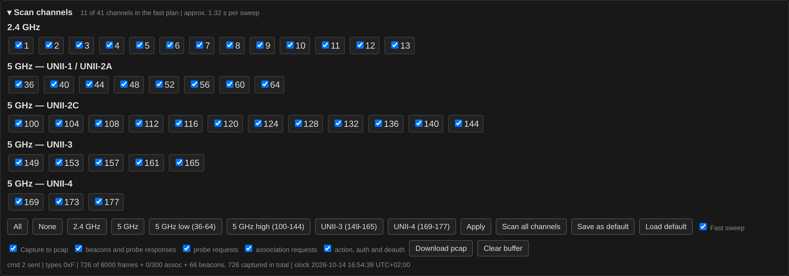

# Sweep and reception

## The sweep

41 channels are in the plan: 1–13 in 2.4 GHz and 36–177 in 5 GHz, up to
UNII-4 (169–177), which is untested, see below. 33 of
them are selected at startup, each gets 120 ms, which makes a full sweep
just under four seconds.

The selection is grouped by band. For 5 GHz that means the UNII blocks,
because the regulatory rules — and with them how worthwhile a group is
— change exactly at those edges. 2.4 GHz has no such subdivision; it is
one ISM band, and UNII is a 5 GHz naming scheme only.

| Band | Group | Channels | Selected by default |
|------|-------|----------|---------------------|
| 2.4 GHz | ISM | 1–13 | yes |
| 5 GHz | UNII-1 / UNII-2A | 36–64 | yes |
| 5 GHz | UNII-2C | 100–144 | yes |
| 5 GHz | UNII-3 | 149–165 | no |
| 5 GHz | UNII-4 | 169–177 | no |
| 6 GHz | UNII-5 to UNII-8 | — | no, the ESP32-C5 radio cannot tune there |

6 GHz is out of reach of the chip itself, so those networks appear only
through the Reduced Neighbor Report element that 2.4 and 5 GHz beacons
carry to announce co-located 6 GHz BSSs. They are listed in a table of
their own and never in the sweep.

UNII-3 and UNII-4 are outside the channel plan an ordinary WLAN device
may transmit on in Europe — which is why a transmitter stops at 144.
That rule is about transmitting, and this device only listens. The
driver tunes all of them with the country set to DE. They stay
unselected because eight extra dwells lengthen every sweep by about a
second, which is a poor trade when most sites have nothing there.

How far each of the two has actually been verified differs:

- **UNII-3 works.** An AP was received and decoded on channel 153 — an
  in-car hotspot, running there either with a regulatory domain from
  another market or deliberately. Legitimate traffic lives here too: in
  Germany 5755–5875 MHz is open to commercial fixed links as BFWA, so a
  strong directional carrier up there is more likely a provider's
  last-mile link than a rogue AP.
- **UNII-4 is untested.** The name comes from the FCC, which in 2020
  opened 5850–5895 MHz to unlicensed use in the US; in Europe the band
  belongs to Intelligent Transport Systems rather than to WLAN.
  `esp_wifi_set_channel()` accepts 169, 173 and 177 without complaint,
  but nothing has ever been received there — hardware samples that may
  reach the band exist here, it simply has not been tried yet. Tuning
  successfully is not the same as the RF path working, so treat it as
  untried. **If you have something that transmits up there, please try
  it and report back.**

The **Scan channels** panel that holds this selection starts collapsed.
It is set once and then rarely touched, while the graphs below it are
what people look at; click the heading to open it. The state is
remembered, so if you leave it open it comes back open.

**Save as default** stores the ticked channels as the default channel
plan (`defmask` in NVS), **Load default** ticks and applies it again.
Until one is saved, the default is the startup plan, everything below
channel 149. Clicking a BSS in the graph or an AP node narrows the
sweep to one channel; as long as the sweep differs from the default,
the BSSID and station views show a *Back to default channels* button.
A restart always comes back with the default plan; the selection in
use is not stored, so a sweep narrowed to one channel does not outlive
it.



**Fast sweep** narrows the plan to the channels that carry a BSSID, plus
1, 5, 9 and 13 as coverage for 2.4 GHz — the four non-overlapping 20 MHz
channels in the EU band — plus one rotating idle channel per sweep so
new networks are still found. A beacon states its own channel, so an AP
on channel 3 is discovered while listening on 1 or 5 and its channel
then joins the plan. 5 GHz channels do not overlap at 20 MHz, so nothing
can be saved there beyond skipping empty ones.

The point is not the shorter cycle in itself. Dwell time spent on an
empty channel is dwell time not spent where the frames are, and the
interesting frames — probe requests, association requests, the moment a
station joins — are rare and easy to miss. A sweep that revisits the
occupied channels three times as often catches proportionally more of
them, which is what makes the station tables and the association
history worth reading.

```
Standard: 33 channels -> 3.96 s
Fast    : 11 channels -> 1.32 s
```

---

## What it can and cannot see

The radio receives on **20 MHz with one spatial stream**. That is enough
for everything this tool evaluates, because management frames are sent
as legacy OFDM in the primary 20 MHz channel — beacons, probe requests
and association requests are fully readable even from a 160 MHz, 2SS
station.

It is not enough for the data frames of such a station. The frame and
byte counters per station are therefore systematically biased towards
devices using narrow channels and a single stream. They are useful as a
relative measure within one PHY class, not as a traffic measurement.
RSSI and the energy sweep are unaffected: power is power.

6 GHz cannot be received at all. Those networks appear only through the
Reduced Neighbor Report element in 2.4 and 5 GHz beacons, which is how
clients discover them without scanning the band. The list under the
network table names the AP that announced each one, with its SSID and
channel. An entry stays a minute after the last announcement, as long
as the network table keeps an AP. That table drops one sooner when its
160 slots are full in a dense area; the entry keeps the announcing
AP's name and channel for that, and marks it *(gone)*.

**The decoder stops at Wi-Fi 7.** Elements up to and including EHT are
understood; a later generation would be reported by whatever it still
carries of the older ones, which means it would look like the newest
thing this build happens to know. That is a limit of the parser, not of
the radio — it costs nothing but reading the amendment and adding the
element, so it is a good first contribution if you have hardware the
tool gets wrong.
