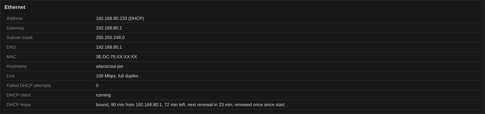

# Tuning and troubleshooting

## Tuning

All limits are defines at the top of the sketch. The tables live in
PSRAM, so raising them costs nothing but PSRAM.

| Define | Default | Notes |
|--------|---------|-------|
| `MAX_NETWORKS` | 160 | BSSIDs held |
| `MAX_CLIENTS` | 100 | stations held |
| `MAX_ASSOC_HISTORY` | 120 | permanent association record |
| `MAX_BEACON_SLOTS` | 160 | one beacon per BSSID, keep in step with `MAX_NETWORKS` |
| `PCAP_SLOTS` | 6000 | main capture ring, ~3.1 MB |
| `ASSOC_SLOTS` | 300 | association request ring, full frames, ~680 kB |
| `MGMT_FRAME_MAX` | 512 | octets kept per frame in the main ring and the beacon slots |
| `MGMT_PARSE_MAX` | 2304 | octets the parser sees and the association ring keeps; the largest MMPDU |
| `CHANNEL_DWELL_MS` | 120 | dwell per channel |
| `NETWORK_TIMEOUT_MS` | 60000 | how long an AP stays after its last beacon |
| `FILTER_CONTROL_FRAMES` | 1 | drop ACK and RTS/CTS before the callback |
| `HEAP_PROBE` | 1 | the heap watchdog described under Troubleshooting |
| `DHCP_MAX_ATTEMPTS` | 6 | before the static fallback |
| `ETH_STATIC_IP` | 192.168.1.1 | the fallback address |

`FILTER_CONTROL_FRAMES` is worth knowing about: without it every
acknowledgement reaches the callback, and in a busy environment the
resulting interrupt load competes with the SPI traffic to the W5500.
Control frames only ever contributed to the RSSI average.

Current PSRAM use, roughly 5.1 MB of 8:

```
pcap ring         3093.8 kB      assoc ring         679.7 kB
waterfall          468.8 kB      energy history     390.6 kB
mgmt queue         217.5 kB      beacon slots        83.8 kB
assoc history       71.3 kB      stations            57.8 kB
networks            53.8 kB      remainder           37.9 kB
```

The management queue and the association ring hold frames of up to
2304 octets. Both used to stop at 512, which cut off Wi-Fi 7
association requests: the station's own EHT Capabilities sit behind a
long Multi-Link element, so the station passed for Wi-Fi 6.

---

## Checking the parsers against Wireshark

`tools/check_against_tshark.py` runs the firmware's element parsers on
the host and compares them with tshark, frame by frame:

```sh
python3 tools/check_against_tshark.py capture.pcap [more.pcap ...]
```

It cuts the parser functions out of `source/wlanscout/wlanscout.ino` unchanged, builds
them with g++ and feeds them every beacon, probe response, probe request
and (re)association request of the captures. Compared are the AKMs and
ciphers, the spatial streams, the radio measurement and WNM bits, the
operating classes and the Multi-Link fields. It also lists the AKM and
cipher numbers the firmware has no name for and the elements it does
not know at all, with Wireshark's name for each. A capture downloaded
from the sensor is the natural input; any capture with radiotap or raw
802.11 frames works. Frames cut off by the capture are skipped.

Needs tshark, editcap and g++. The exit status is 1 if anything
differs, so it can run before every release.

---

## Troubleshooting

**No web interface, no address.** Read the serial console at 115200
baud. It prints a heap line periodically, so attaching late still shows
the current state — but the startup messages, including the Ethernet
init and the allocation table, scroll past once. Press the **reset
button** with the console already open to see the whole sequence from
the beginning. The heap line carries link state, DHCP client state and
the attempt counter. If the
client says `running` and nothing appears on the wire, the W5500
transmit path is wedged — the firmware reinitialises the interface after
two failed attempts, which recovers it in about a second.

**Unreachable for a while, then back by itself.** The event log shows
what the lease did. The first lease is logged with its server and time,
and so is a renewal the server did not answer at once, the step to
rebinding and a lease that ended. A renewal that goes through on the first
try is only counted; Settings shows the count, the state and the time
left in the *DHCP lease* row. Once lwIP has dropped the address it is
logged as lost, and the same recovery as without a lease starts: two
attempts, then the interface is reinitialised.



**After a crash.** The event log names the task, the address and the
cause, and Settings offers the core dump. It is decoded on a PC with
[esp-coredump](https://github.com/espressif/esp-coredump) (`pip install
esp-coredump`) and the `.elf` of the very firmware that crashed — the
build directory's `wlanscout.ino.elf`; the box says whether that is the
one running now, and the file name carries the start of its ELF SHA-256:

```
esp-coredump --chip esp32c5 info_corefile -t raw \
    -c wlanscout-coredump-3fa1c0de.bin \
    --gdb ~/.arduino15/packages/esp32/tools/riscv32-esp-elf-gdb/*/bin/riscv32-esp-elf-gdb \
    build/wlanscout.ino.elf
```

The gdb is the one the Arduino board package brings. It prints the
backtrace down to the source line, the registers and every task with
the stack it used. Without the matching `.elf` only the raw addresses are
left, so keep it for every firmware that is handed out.

**Not answering for a few minutes while the page was open over a
VPN.** Switching the VPN off sends the sensor no reset, the client's
packets just stop. An answer under way then waits for room on every
piece it writes; the sensor gives it up once a piece has made no
progress for 2 s; the serial console says "[tx] answer to … given up
after … kB, the client stopped reading", and Settings counts them under
CPU. While it waits, loop() reads no frames and
the management queue (96 frames) runs over, so a few hundred frames can
be lost. Closing the tab first avoids even that.

**Link flaps without touching the cable.** The driver polls the link
over SPI because `W5500_INT` is `-1`. Wiring the interrupt pin and
setting the define makes link detection event-driven.

**Dropped frames climbing fast.** `drops mgmt` and `drops data` count
frames discarded because the queue was full, meaning `loop()` could not
keep up. Raising `MGMT_QUEUE_SIZE` costs only PSRAM.

**Internal heap dipping.** With `HEAP_PROBE` set, a 1 ms sampler watches
the allocator's own low-water mark and reports every new low with the
request that was running at the time, how long the device had been
idle, and the request answered last with the address it came from:

```
[probe] NEW LOW 58.8 kB  (free now 122.6, dma 107.3)  stack 5428 words
        label 'idle'  idle 331 ms  last '/api/networks' from 192.168.1.23
        at 06:14:22
```

It samples the watermark rather than the free size on purpose: the
allocator maintains that on every malloc and free, so dips far shorter
than any polling interval are still caught. The label is only
trustworthy when `idle` is near zero.

**Nothing in the 802.15.4 view.** The energy detect floor of this radio
sits around -105 to -110 dBm. If the bars are there but flat, nothing is
transmitting. If `energy readings` stays at 0 while `rx armed` counts
up, energy detect is not working on this build.
