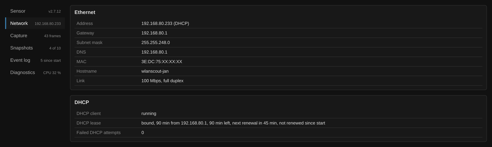

# Tuning and troubleshooting

## Tuning

The limits are defines, most of them in `wlanscout.ino`, the others in
the numbered tabs next to it (named in the table), the board and its
features in `config.h`. The tables live in PSRAM, so raising them
costs nothing but PSRAM.

| Define | Default | Notes |
|--------|---------|-------|
| `MAX_NETWORKS` | 250 | BSSIDs held; the page shows the count in red once the table is full |
| `MAX_SIXG_BSS` | 40 | 6 GHz BSSs known from neighbour reports |
| `MAX_CLIENTS` | 100 | stations held |
| `MAX_ASSOC_HISTORY` | 120 | permanent association record (`02_model.ino`) |
| `CFG_CHANGES`, `CFG_EVENTS` | 8, 64 | configuration changes per BSS, in the bell |
| `CATALOG_MAX` | 256 | IE catalog rows (`14_catalog.ino`) |
| `LOG_ENTRIES` | 80 | event log (`02_model.ino`) |
| `SNAP_KEEP` | 10 | snapshots kept (`32_snapshots.ino`) |
| `WATCH_MAX` | 4 | BSSs with graphs at once |
| `MGMT_QUEUE_SIZE` | 96 | management frames waiting for the parser |
| `MGMT_PARSE_MAX` | 2304 | octets the parser sees and the rings keep; the largest MMPDU |
| `MGMT_FRAME_MAX` | 1536 | octets kept per beacon in the beacon slots |
| `MAX_BEACON_SLOTS` | `MAX_NETWORKS` | one beacon per BSSID |
| `FRAME_CHUNK_BYTES` | 64 kB | the step the capture rings grow in |
| `RING_CHUNKS_MAX`, `RING_RESERVE` | 80, 1 MB | main capture ring, at most 5 MB; PSRAM it leaves free |
| `ASSOC_CHUNKS_MAX`, `ASSOC_RESERVE` | 24, 512 kB | association request ring, at most 1.5 MB |
| `BV_CHUNKS_MAX`, `BV_RESERVE` | 16, 512 kB | beacon versions, at most 1 MB |
| `BV_KEEP` | 8 | beacon versions per BSS |
| `BV_VOLATILE_CHANGES`, `BV_VOLATILE_MS` | 4, 60 s | changes of an element that make it volatile |
| `MAX_BLE_DEVICES` | 80 | BLE devices in the live table |
| `BLE_CHUNKS_MAX`, `BLE_RESERVE` | 16, 512 kB | BLE advertisements, at most 1 MB |
| `BLE_HITS_MAX` | 512 | BLE devices counted, about 50 kB |
| `BLE_HIT_GAP_MS` | 5 min | silence after which a device counts again |
| `ZB_MAX_NODES`, `ED_HISTORY_SIZE` | 40, 20000 | 802.15.4 nodes, energy waterfall rows |
| `HISTORY_FINE_ROWS` | 2400 | waterfall rows per sweep, for the short ranges |
| `HISTORY_STEP_MS` | 5000 | one waterfall row per step for the long ranges |
| `HISTORY_SPAN_MS` | 24 h | the most the rows per step reach back, sized at boot |
| `CHANNEL_DWELL_MS` | 120 | dwell per channel |
| `NETWORK_TIMEOUT_MS` | 60000 | how long an AP stays after its last beacon |
| `FILTER_CONTROL_FRAMES` | 1 | drop ACK and RTS/CTS before the callback |
| `WIFI_RX_BUFFERS` | 16 | receive buffers the WiFi driver may hold, about 2.3 kB of internal RAM each; Arduino's 32 let bursts take up to 74 kB |
| `HEAP_PROBE` | 1 | the heap watchdog described under Troubleshooting (`01_heap_probe.ino`) |
| `HEAP_PROBE_RX_ALL` | 0 | test only: control frames and FCS failures reach the callback to be counted |
| `DHCP_MAX_ATTEMPTS` | 6 | before the static fallback |
| `ETH_STATIC_IP` | 192.168.1.1 | the fallback address |

`FILTER_CONTROL_FRAMES` is worth knowing about: without it every
acknowledgement reaches the callback, and in a busy environment the
resulting interrupt load competes with the SPI traffic to the W5500.
Control frames only ever contributed to the RSSI average.

PSRAM at boot, about 3.7 MB of 8 on the kit (2.8.49); the rest is there
for the capture rings and the beacon versions to grow into, up to their
reserves:

```
waterfall, 5 s         810.0 kB      networks               746.1 kB
energy history         390.6 kB      beacon slots           380.9 kB
beacon versions, index 261.7 kB      mgmt queue             217.5 kB
waterfall, sweeps      112.5 kB      assoc history           95.6 kB
stations                78.1 kB      pcap ring               64.0 kB
assoc ring              64.0 kB      beacon versions         64.0 kB
BLE log                 64.0 kB      smaller tables          89.9 kB
outside the list       264.7 kB
```

Settings → Diagnostics lists every allocation with its current size,
the capture rings included.

---

## Checking the parsers against Wireshark

`tools/check_against_tshark.py` runs the firmware's element parsers on
the host and compares them with tshark, frame by frame:

```sh
python3 tools/check_against_tshark.py capture.pcap [more.pcap ...]
```

It cuts the parser functions out of the sketch's files unchanged, builds
them with g++ and feeds them every beacon, probe response, probe request
and (re)association request of the captures. Compared are the AKMs and
ciphers, the spatial streams, the radio measurement and WNM bits, the
operating classes and the Multi-Link fields. It also lists the AKM and
cipher numbers the firmware has no name for and the elements it does
not know at all, with Wireshark's name for each. A capture downloaded
from the sensor is the natural input; any capture with radiotap or raw
802.11 frames works. Frames cut off by the capture are skipped.

Needs tshark, editcap and g++. The exit status is 1 if anything
differs, so it can run before every release.

---

## Troubleshooting

**No web interface, no address.** Read the serial console at 115200
baud. It prints a heap line periodically, so attaching late still shows
the current state — but the startup messages, including the Ethernet
init and the allocation table, scroll past once. Press the **reset
button** with the console already open to see the whole sequence from
the beginning. The heap line carries link state, DHCP client state and
the attempt counter. If the
client says `running` and nothing appears on the wire, the W5500
transmit path is wedged — the firmware reinitialises the interface after
two failed attempts, which recovers it in about a second.

**Unreachable for a while, then back by itself.** The event log shows
what the lease did. The first lease is logged with its server and time,
and so is a renewal the server did not answer at once, the step to
rebinding and a lease that ended. A renewal that goes through on the first
try is only counted; Settings → Network shows the count, the state and
the time left in the *DHCP lease* row. Once lwIP has dropped the address it is
logged as lost, and the same recovery as without a lease starts: two
attempts, then the interface is reinitialised.

**The W5500 resetting by itself.** On the kit the W5500 has been seen
to reset on its own, cause not yet known: every register back to its
default, MAC address zero, socket closed, and the PHY negotiating
again, so the switch logs the port down and up within two seconds.
The ESP-IDF driver does not notice and nothing gets through until the
interface is reinitialised. The firmware reads the MAC address back
once a second and reinitialises at once when it is zero; the serial
console shows the registers (`[w5500] reset by itself`) and the event
log says "the W5500 reset by itself".

**Link up, but no answer, not even to ping or ARP.** The W5500's
transmit path can wedge while the link stays up: the serial console
goes on with its heap lines, the switch shows the port up, and the
address would only go once the lease has run out, up to 90 minutes
later. So once a minute, while DHCP gave an address, the firmware asks
the gateway by ARP; after three checks without an answer, three to
four minutes, it reinitialises the interface, and the event log says
"gateway … did not answer ARP 3 times". The serial console counts the
misses. Not on the static fallback, which may have no gateway.
Type `ethreinit` and Enter on the serial console (115200 baud) to
take the interface down and up again at once, without waiting for the
check; the event log notes it.
With every missed answer, every DHCP attempt without a lease, every
"no link" line and on `w5500`, the console shows what the
W5500 itself says:

```
[w5500] no ARP answer: ver 04 mr 00 mac 02:00:00:12:34:56 ir 00 imr 00
        sir 00 simr 01 phy BF (link 1 100M full)
[w5500] no ARP answer: s0 mr 84 cr 00 ir 00 sr 42 imr 0F  tx free 16384
        rd 1234 wr 1234  rx size 0 rd 5678 wr 5678
```

A version other than 04 means the SPI reads garbage, a zero MAC a chip
that was reset behind the driver's back. Socket 0 runs in MACRAW mode,
`sr 42` while it is open. Between two dumps, `rx wr` moving means
frames come in and `rx rd` following that the driver takes them; `tx
wr` moving means the driver hands frames over and `tx rd` catching up
that the chip sends them. `help` lists the commands. On the kit the terminal has to keep DTR and
RTS off: through the CH343 they drive the board's reset and BOOT.



**After a crash.** The event log names the task, the address and the
cause, and Settings → Event log offers the core dump. It is decoded on a PC with
[esp-coredump](https://github.com/espressif/esp-coredump) (`pip install
esp-coredump`) and the `.elf` of the very firmware that crashed — the
build directory's `wlanscout.ino.elf`; the box says whether that is the
one running now, and the file name carries the start of its ELF SHA-256:

```
esp-coredump --chip esp32c5 info_corefile -t raw \
    -c wlanscout-coredump-3fa1c0de.bin \
    --gdb ~/.arduino15/packages/esp32/tools/riscv32-esp-elf-gdb/*/bin/riscv32-esp-elf-gdb \
    build/wlanscout.ino.elf
```

The gdb is the one the Arduino board package brings. It prints the
backtrace down to the source line, the registers and every task with
the stack it used. Without the matching `.elf` only the raw addresses are
left, so keep it for every firmware that is handed out.

**Not answering for a few minutes while the page was open over a
VPN.** Switching the VPN off sends the sensor no reset, the client's
packets just stop. An answer under way then waits for room on every
piece it writes; the sensor gives it up once a piece has made no
progress for 2 s; the serial console says "[tx] answer to … given up
after … kB, the client stopped reading", and Settings counts them under
CPU. While it waits, loop() reads no frames and
the management queue (96 frames) runs over, so a few hundred frames can
be lost. Closing the tab first avoids even that.

**Link flaps without touching the cable.** The driver polls the link
over SPI because `W5500_INT` is `-1`. Wiring the interrupt pin and
setting the define makes link detection event-driven.

**Dropped frames climbing fast.** `drops mgmt` and `drops data` count
frames discarded because the queue was full, meaning `loop()` could not
keep up. Raising `MGMT_QUEUE_SIZE` costs only PSRAM.

**Internal heap dipping.** With `HEAP_PROBE` set, a 1 ms sampler watches
the allocator's own low-water mark and reports every new low with the
request that was running at the time, how long the device had been
idle, and the request answered last with the address it came from:

```
[probe] NEW LOW 58.8 kB  (free now 122.6, dma 107.3)  stack 5428 words
        label 'idle'  idle 331 ms  last '/api/networks' from 192.168.1.23
        at 06:14:22
```

It samples the watermark rather than the free size on purpose: the
allocator maintains that on every malloc and free, so dips far shorter
than any polling interval are still caught. The label is only
trustworthy when `idle` is near zero.

The watermark tells that a dip happened, not what filled the heap. So
while the free heap is 30 kB below a baseline taken while more than
70 kB were free, the sampler, running above the WiFi task and lwIP,
walks the internal heap at once and counts the used blocks by size
against the baseline, and notes the tasks that were ready to run, the
channel, the frames the callback got per second over the last 100 to
200 ms, the fill of the management and data queues and the callback's
longest run and its total per second, how long ago the channel was
switched, and how many frames per second still came with the channel
before and how long after the switch. With `HEAP_PROBE_RX_ALL` (a
test build) control frames and frames that failed the FCS reach the
callback too, are counted and dropped, so `ctrl` and `fcs` show
everything the driver had to handle. The deepest one is printed with
the next heap line:

```
[heapsnap] free 14.9 kB  maxblock 13.0 kB  at 15:06:37  label 'idle'
           ch 40  rx/s mgmt 120 data 3400 ctrl 5200 fcs 310  queues 3 63
           cb max 850 us, 41000 us/s  switch 17 ms ago, stale 90/s up to
           12 ms after
           vs 75.3 kB free:  <=512 +22 (+3.7 kB)  <=4k +23 (+53.5 kB)
           ready: wifi loopTask
```

Only the sizes that grew by more than 1 kB are listed. Many blocks of
about 2.3 kB, each with a small one, are frames the WiFi driver holds
until its task hands them to the callback; up to 1.8 kB are lwIP's
pbufs, a few large ones a request. The ready tasks tell which side was
busy.

Those driver buffers are what the dips mostly are. On a busy channel
(seen on channel 11 with a few hundred to a few thousand data frames
per second) the driver fills every dynamic receive buffer it has before
the callback gets the first frame, with or without channel switching,
whatever the promiscuous filter lets through and with A-MPDU reception
off as well: the filter is applied after a buffer has been taken. The
callback itself was never the bottleneck (well under 50 us a frame).
Arduino starts the driver with 32 buffers, up to 74 kB, which left the
kit with 5.5 kB free; `setupWiFiScanner()` therefore starts the driver
itself before `WiFi.mode()`, with `WIFI_RX_BUFFERS` (16). Dips now stop
at about 37 kB, plus a few kB of small blocks; frames arriving faster
than that are dropped by the driver. The boot log says
`WiFi receive buffers: 16 (0x0)`.

Every write to the flash from loop() (catalog, its pcap file, the event
log, a snapshot, the settings) prints how long it took and the heap's
low before and after, `[flash] catalog save 52 ms, low 75.3 -> 14.9 kB`:
while the flash is written the cache is off, the WiFi task stands and
the frames that keep arriving wait in the driver's buffers.

**Nothing in the 802.15.4 view.** The energy detect floor of this radio
sits around -105 to -110 dBm. If the bars are there but flat, nothing is
transmitting. If `energy readings` stays at 0 while `rx armed` counts
up, energy detect is not working on this build.
