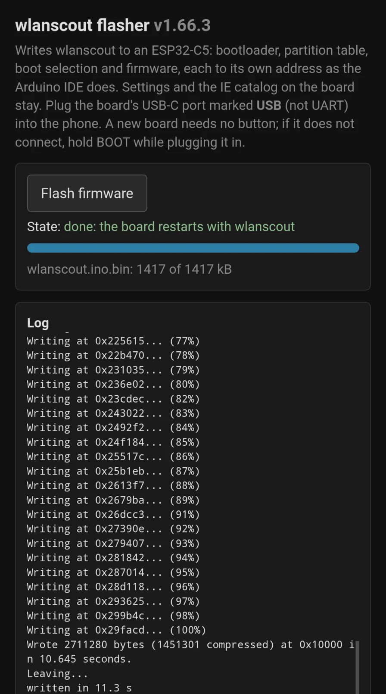
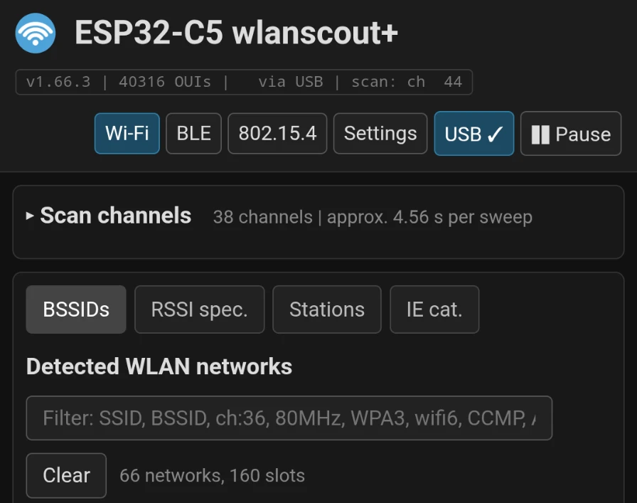
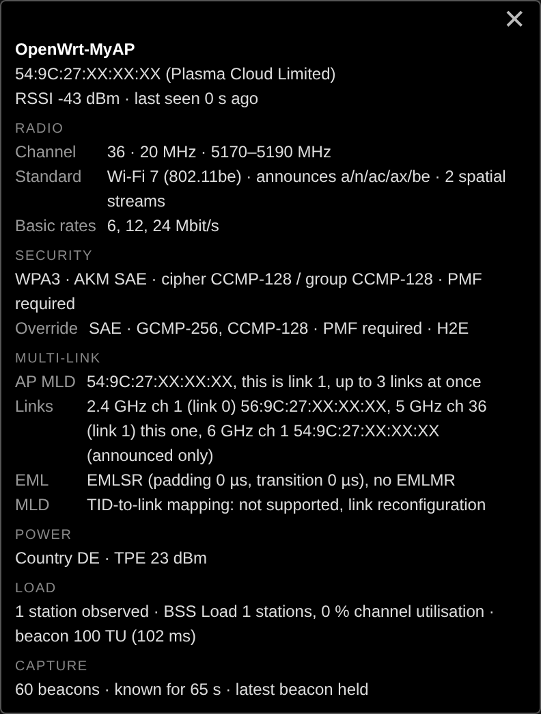

# Sensor on a phone over USB

Without Ethernet the sensor can run from a phone: the board's USB-C
port marked **USB** (not the one marked UART) goes into the phone, the
phone powers it, and a copy of the web page opened in Chrome talks to it
over WebUSB. Everything the page shows over Ethernet works the same way.

## What is needed

- The board's native USB port. On the Waveshare ESP32-C5-WIFI6-KIT that
  is the connector marked USB; the one marked UART goes through a CH343
  USB-to-serial bridge, carries the log, and is not used for this.
- A cable with data lines, not a charging-only one.
- Chrome on Android, or Chrome/Edge on a desktop. Firefox and Safari
  have no WebUSB. Chrome's own Web Serial does not list the board on
  Android; WebUSB does.
- A copy of the page served over https: WebUSB is only available in a
  secure context, and the sensor itself serves plain http. The page is
  the same file the sensor serves; on https it shows a **USB** button
  next to Pause.

A W5500 is not needed. Cases for the bare board, one of them for a
MagSafe phone back, are listed under [Enclosure](hardware.md#enclosure).

Without a W5500 the start-up log says
`ETH.begin(): FAILED, no W5500? Running on USB only` and the sensor
carries on; the sensor id is derived from the chip the way the W5500
driver does, so it stays the same with or without one.

## The static copy

It is the top of the repository, always for the version in
`wlanscout.ino`: `index.html` is the page, next to it
`manifest.webmanifest`, `sw.js`, the icons and the flasher
`flash.html`, which loads the firmware from `firmware/`. GitHub Pages
publishes it as it is: *Settings → Pages → Deploy from a branch*,
branch `master`, folder `/ (root)`; `.nojekyll` keeps Pages from
running Jekyll over it. The page is then at
`https://<user>.github.io/<repository>/`, the flasher at `…/flash.html`.
Any other https web space works as well, with the same files.

`tools/make_release.py` refreshes the page after a build, together
with `firmware/`; `tools/make_static.py` builds it alone, from
`index_html.h`, into a folder of its own:

```
python3 tools/make_static.py out/ --page app.html
```

Only this copy gets the manifest and the service worker, the sensor's
own page stays as it is.

With `--firmware` and the Arduino build directory the static copy also
gets the flasher (see [Flashing from the phone](#flashing-from-the-phone)),
the parts copied next to it, or with `--parts-dir firmware` loaded from
that folder, as in the repository. The script refuses a build directory
whose firmware is not the version in `wlanscout.ino`:

```
python3 tools/make_static.py out/ --page app.html --firmware build/
```

**As an app.** With the manifest and the service worker Chrome offers
*Install app* (menu ⋮ → *Install app*, not just *Add to home screen*).
Installed, it starts in its own window without the address bar, and
without a network: the service worker keeps the page and its icons
after the first visit. A new firmware version gets a new cache, the
next start with a network fetches it.

## Flashing from the phone

`flash.html` writes the firmware to a board on the phone's USB port with
[esptool-js](https://github.com/espressif/esptool-js), new boards
included: the chip's USB port is in its ROM, and the reset into the
download mode goes over the same USB lines, no BOOT button needed. It
writes the four parts each to its own address, bootloader 0x2000,
partition table 0x8000, boot selection 0xe000, firmware 0x10000, as the
Arduino IDE does; not `merged.bin`, which is padded to the full 16 MB
and would wipe the settings and the IE catalog. The flasher needs a network; it is not kept for offline use.

Tested on an Android tablet and a phone: about 1.4 MB compressed,
written in about 11 s without a button press, the board then starts
wlanscout+.



**After flashing, unplug the board once** and plug it back in, or
press its reset button once, before using the page, so that it starts
from a proper reset rather than from the flasher's.

## Using it

1. Plug the board's USB port into the phone.
2. Open the page and press **USB**; choose *USB JTAG/serial debug unit*.
3. The button turns into *USB ✓*, the status badge says *via USB*
   instead of the number of web clients, and the page fills as usual. Unplugging
   the board drops the link; press USB again after plugging it back in.



A tap on a row or a shape opens its tooltip; the ✕ in its corner or a
tap anywhere else closes it. A tooltip taller than the screen, a
Wi-Fi 7 AP with all its notes for instance, stays within the screen
and scrolls inside.



In the field a short press on the board's BOOT button, or the camera
button next to the status badge, keeps the moment as a snapshot, the LED
blinks green; it can be viewed later in
Settings → Snapshots, see [Snapshots](settings.md#snapshots).

The pcap links and *download all* save the file through the page
instead of a plain link. *Settings → Firmware update* works over USB
as well: choose `wlanscout.ino.bin` on the phone and *Upload and
restart*. The sensor restarts and comes back on the USB port; the page
takes the link up again by itself and waits for the new version, whose
requests then also confirm it (without them it would go back to the
previous firmware after five minutes), and hands it the browser's
clock again, which a restart loses. No PC and no new copy of the
page are needed for that, only the file.

## How it works

The firmware answers the same API on the web server and on the chip's
USB Serial/JTAG port; the handlers do not know which side asked. On USB
a request is one line, the answer comes framed:

```
GET /api/networks?range=60000\n

0x02 "200 application/json\n"  <len lo><len hi><bytes> ... 0x00 0x00
```

The header line holds the status code, the content type and, for
downloads, a file name. The body follows in chunks of a two-byte length
(little endian) and the bytes; a chunk of length 0 ends the answer, so
binary pcap data needs no escaping. One request at a time; the page
queues them.

A snapshot goes the other way with a `PUT`: the request line with the
length, then exactly that many bytes, then the answer as above.

```
PUT /api/snapshotimport?len=95321&epoch=1791896972&uptime=27&name=Hall\n
<95321 bytes of the snapshot>

0x02 "200 application/json\n"  ... {"ok":1,"seq":12} ... 0x00 0x00
```

A firmware goes the same way, `PUT /api/ota?len=2548368` and the
image, with the checks of an update over the network. The bytes go in
pieces of 2048; after each piece but the last the client waits for the
byte 0x06 from the sensor, sent once it has written the piece away.
The USB port has no flow control of its own: what does not fit the
sensor's receive queue while it writes the flash is lost, and a file
sent in one go arrived with holes ("USB stalled"). The firmware reads
the bytes before any further request line; if they stop coming for
10 s it gives up and answers with an error.

Two details that matter for anyone writing their own client:

- **No reset on connect.** The page sets DTR and leaves RTS off. RTS on
  resets the chip, which is what a plain serial terminal on Linux does
  when it opens the port: the first answer then comes about 4 s later,
  after the boot, and the tables start empty.
- **Empty packets.** The ESP ends a transfer with a zero-length packet.
  Google's web-serial-polyfill hands those to its stream, which throws
  "chunk is empty"; the page reads the USB endpoint itself and skips
  them.

Measured on a phone: `/api/networks` with 62 networks, 49 kB, in about
100 ms.
