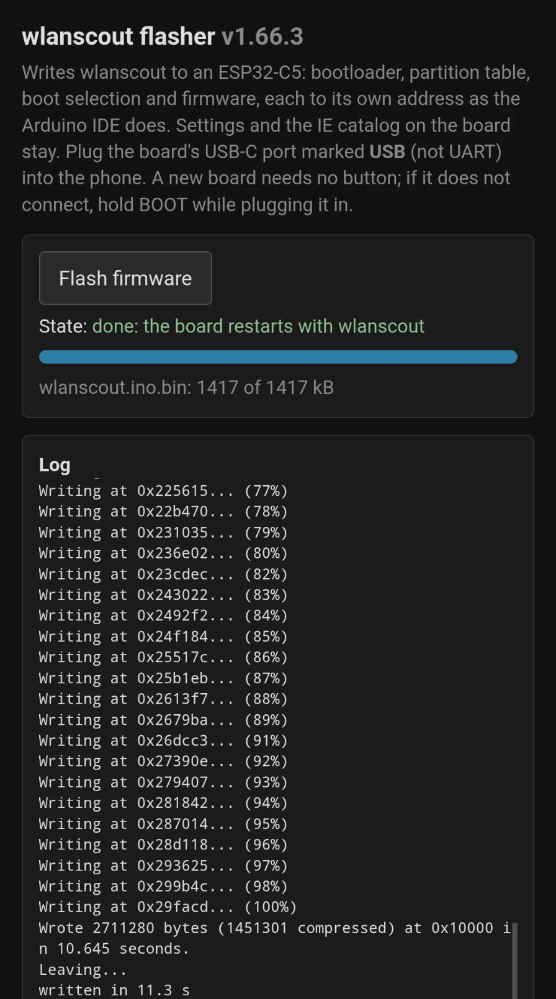
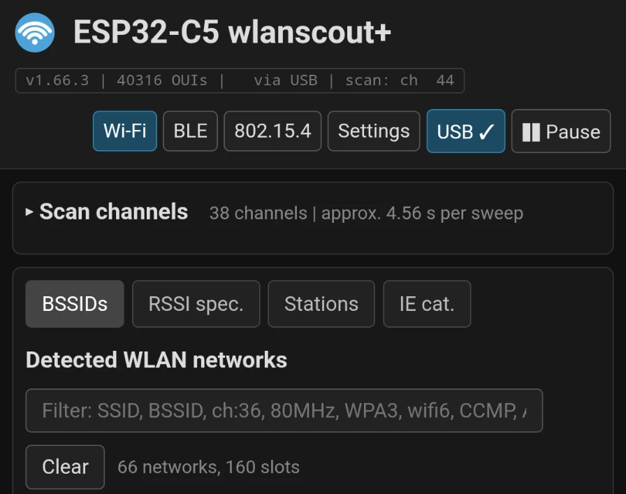
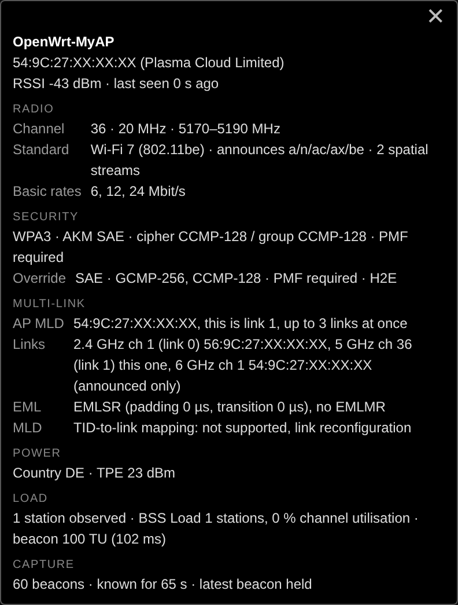

# Sensor on a phone over USB

Without Ethernet the sensor can run from a phone: the board's USB-C
port marked **USB** (not the one marked UART) goes into the phone, the
phone powers it, and a copy of the web page opened in Chrome talks to it
over WebUSB. Everything the page shows over Ethernet works the same way.

## What is needed

- The board's native USB port. On the Waveshare ESP32-C5-WIFI6-KIT that
  is the connector marked USB; the one marked UART goes through a CH343
  USB-to-serial bridge, carries the log, and is not used for this.
- A cable with data lines, not a charging-only one.
- Chrome on Android, or Chrome/Edge on a desktop (on Linux after the
  steps below). Firefox and Safari have no WebUSB. Chrome's own Web
  Serial does not list the board on Android; WebUSB does.
- A copy of the page served over https: WebUSB is only available in a
  secure context, and the sensor itself serves plain http. The page is
  the same file the sensor serves; on https it shows a **USB** button
  next to Pause.

**On a Linux PC** Chrome lists the board but cannot open it over
WebUSB: the device file under `/dev/bus/usb` belongs to root, and the
kernel's `cdc_acm` driver has taken the board as `/dev/ttyACM…`, which
keeps WebUSB out. Android has neither problem. The simple way round is
the **Serial** button next to **USB**, shown where the browser has Web
Serial (Chrome and Edge on a desktop): it opens the same link through
`/dev/ttyACM…`, needs no root and nothing below. One link at a time;
the other button closes it and opens its own.

For WebUSB instead, once, as root, a udev rule that gives the board to
the `plugdev` group (the user has to be in it):

```
echo 'SUBSYSTEM=="usb", ATTR{idVendor}=="303a", ATTR{idProduct}=="1001", MODE="0660", GROUP="plugdev"' \
    | sudo tee /etc/udev/rules.d/60-wlanscout.rules
sudo udevadm control --reload
```

Then unplug the board and plug it in again, and after every plugging
in release it from `cdc_acm` before pressing **USB**:

```
for i in /sys/bus/usb/drivers/cdc_acm/*:1.*; do
    d=$(dirname "$(readlink -f "$i")")
    [ "$(cat "$d/idVendor"):$(cat "$d/idProduct")" = 303a:1001 ] &&
        basename "$i" | sudo tee /sys/bus/usb/drivers/cdc_acm/unbind
done
```

That looks up the board's interfaces (`3-1:1.0` and `3-1:1.1` for
instance, the kernel log names them on plugging in) and leaves other
serial adapters, the CH343 behind the UART port among them, alone.
While released, the board has no `/dev/ttyACM…`: no serial console and
no upload from the Arduino IDE over that port until it is plugged in
anew.

A W5500 is not needed. A MagSafe case for the bare board on the back
of a phone is in `3d-printed-housing/`, see [Enclosure](hardware.md#enclosure).

Without a W5500 the start-up log says
`ETH.begin(): FAILED, no W5500? Running on USB only` and the sensor
carries on; its sensor id, a MAC address that identifies it in the
export and the snapshots, is derived from the chip the way the W5500
driver does, so it stays the same with or without one.

## The static copy

It is the top of the repository, always for the version in
`wlanscout.ino`: `index.html` is the page, next to it
`manifest.webmanifest`, `sw.js`, the icons and the flasher
`flash.html`, which loads the firmware from `firmware/`. GitHub Pages
publishes it as it is: *Settings → Pages → Deploy from a branch*,
branch `master`, folder `/ (root)`; `.nojekyll` keeps Pages from
running Jekyll over it. The page is then at
`https://<user>.github.io/<repository>/`, the flasher at `…/flash.html`.
Any other https web space works as well, with the same files.

`tools/make_release.py` refreshes the page after a build, together
with `firmware/`; `tools/make_static.py` builds it alone, from
`index_html.h`, into a folder of its own:

```
python3 tools/make_static.py out/ --page app.html
```

Only this copy gets the manifest and the service worker, the sensor's
own page stays as it is.

With `--firmware` and the Arduino build directory the static copy also
gets the flasher (see [Flashing from the phone](#flashing-from-the-phone)),
the parts copied next to it, or with `--parts-dir firmware` loaded from
that folder, as in the repository. The script refuses a build directory
whose firmware is not the version in `wlanscout.ino`:

```
python3 tools/make_static.py out/ --page app.html --firmware build/
```

**As an app.** With the manifest and the service worker Chrome offers
*Install app* (menu ⋮ → *Install app*, not just *Add to home screen*).
Installed, it starts in its own window without the address bar, and
without a network: the service worker keeps the page and its icons
after the first visit. A new firmware version gets a new cache, the
next start with a network fetches it.

## Flashing from the phone

`flash.html` writes the firmware to a board on the phone's USB port with
[esptool-js](https://github.com/espressif/esptool-js), new boards
included: the chip's USB port is in its ROM, and the reset into the
download mode goes over the same USB lines, no BOOT button needed. The
ROM cannot be overwritten, so a write that breaks off, or a firmware
that no longer starts, is never the end: flash again, and if the board
does not answer, hold BOOT, press RESET, release BOOT and try once
more. The flasher needs a network for esptool-js; it is not kept for
offline use.

It asks three things:

- **Board**: the Waveshare ESP32-C5-WIFI6-KIT (16 MB, `firmware/`) or
  the Seeed Studio XIAO ESP32-C5 (8 MB, `firmware/xiao/`).
- **What**: *Update the firmware only* writes 0x10000 and nothing
  else; *Full install* also writes the bootloader (0x2000), the
  partition table (0x8000) and the boot selection (0xe000) of the
  board's release, for a new board or another table. Neither erases:
  settings, IE catalog and snapshots stay where the table keeps them.
  `merged.bin`, padded to the whole flash, is never written.
- **Firmware**: the board's release, or a `.bin` file from the phone.

Before anything is written it checks:

| Check | When | Passed anyway with |
|-------|------|--------------------|
| an ESP32 image (0xE9), built for the ESP32-C5 (chip id 23) | the file is chosen | *Ignore failed checks* |
| a wlanscout+ firmware, its version marker | the file is chosen | *Ignore failed checks* |
| for the chosen board, its `BOARD_ID` marker (none before 2.8.19: the kit's) | the file is chosen | *Ignore failed checks* |
| no more flash than the board has | the file is chosen | *Ignore failed checks* |
| newer than the version running, when opened from a sensor | the file is chosen | *Force* |
| an ESP32-C5 with the flash size of the board | in download mode | *Ignore failed checks* |
| for an update: the board's partition table, whose first slot holds the image and which fits the flash (a 16 MB table on the 8 MB XIAO asks for a full install) | in download mode | *Ignore failed checks* |

A failed check stops it, nothing written, the board back in its
firmware. *Force* goes back to an older release or writes the same one
again; neither option stands in for the other.

**The XIAO** takes updates from the page over USB like the kit;
*Check for new firmware* asks `firmware/xiao/version.json` for it.
Built with one firmware slot instead (`ENABLE_OTA` 0, see
[Hardware](hardware.md#xiao-build)), it offers *Update in download
mode* in *Settings → Sensor → Firmware* instead of an upload: the page
lets go of USB and opens `flash.html?board=xiao&running=<version>`,
set to update its release. After writing, the board restarts in the
new firmware; press **USB** on the page again.

Tested on an Android tablet and a phone: about 1.4 MB compressed,
written in about 11 s without a button press, the board then starts
wlanscout+.



**After flashing, unplug the board once** and plug it back in, or
press its reset button once, before using the page, so that it starts
from a proper reset rather than from the flasher's.

## Using it

1. Plug the board's USB port into the phone.
2. Open the page and press **USB**; choose *USB JTAG/serial debug unit*.
3. The button turns into *USB ✓*, the status badge says *via USB*
   instead of the number of web clients, and the page fills as usual. Unplugging
   the board drops the link; press USB again after plugging it back in.



A tap on a row or a shape opens its tooltip; the ✕ in its corner or a
tap anywhere else closes it. A tooltip taller than the screen, a
Wi-Fi 7 AP with all its notes for instance, stays within the screen
and scrolls inside.



In the field a short press on the board's BOOT button, or the camera
button next to the status badge, keeps the moment as a snapshot, the LED
blinks green; it can be viewed later in
Settings → Snapshots, see [Snapshots](settings.md#snapshots). Without
a phone attached the sensor has no clock; how its snapshots still get
a date: [Time](settings.md#time).

The pcap links and *download all* save the file through the page
instead of a plain link. *Settings → Sensor → Firmware* works over USB
as well: choose `wlanscout.ino.bin` on the phone and *Upload and
restart*. The sensor restarts and comes back on the USB port; the page
takes the link up again by itself and waits for the new version, whose
requests then also confirm it (without them it would go back to the
previous firmware after five minutes), and hands it the browser's
clock again, which a restart loses. No PC and no new copy of the
page are needed for that, only the file.

## How it works

The page talks to the sensor with the same API as over Ethernet, framed
for the USB port: [Transport over USB](api.md#transport-over-usb).
