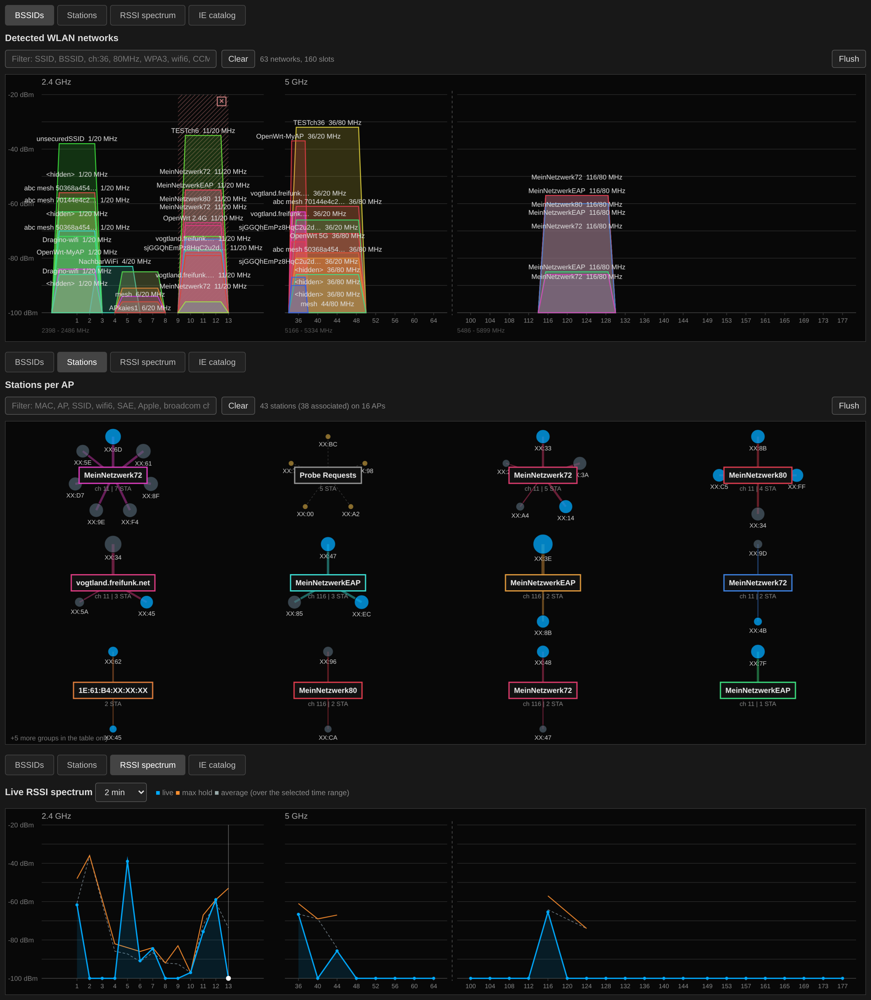
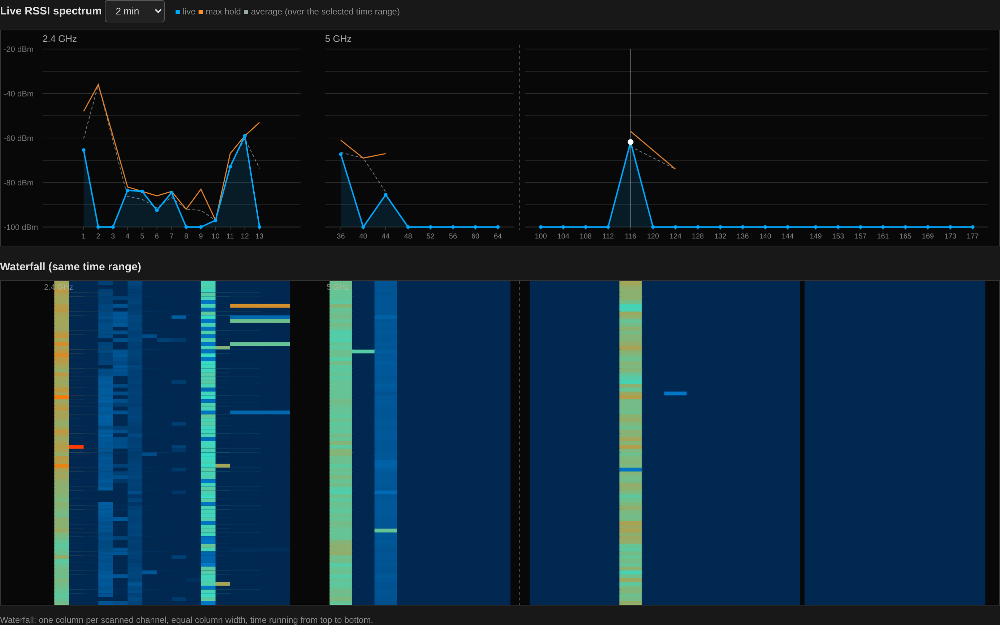
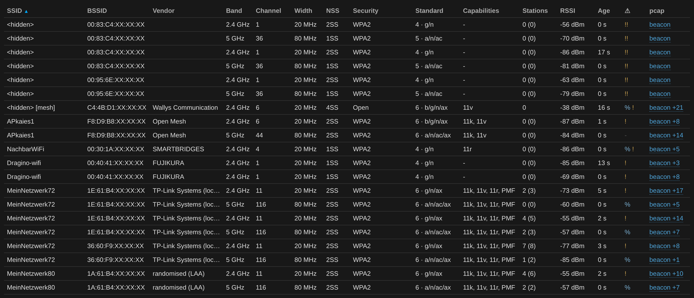
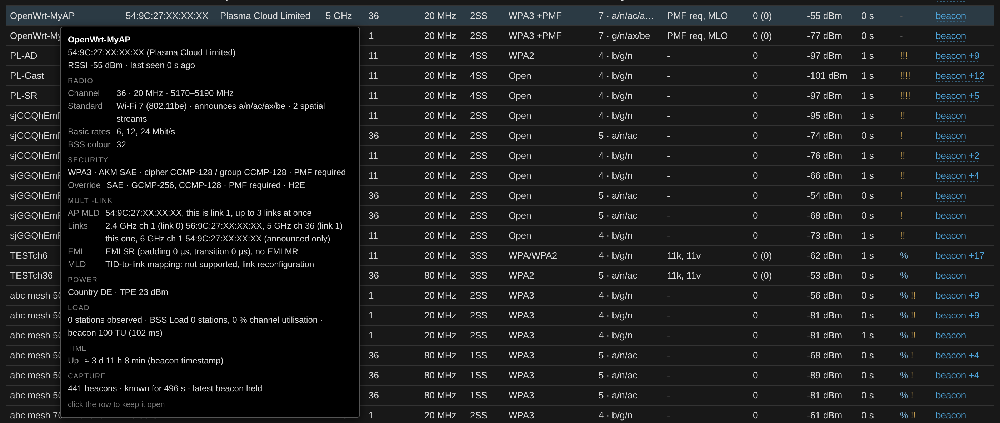
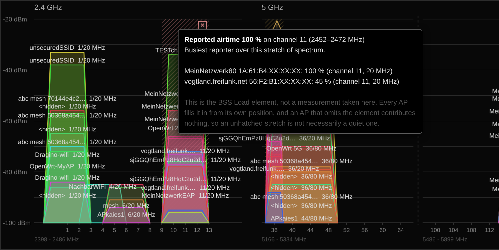
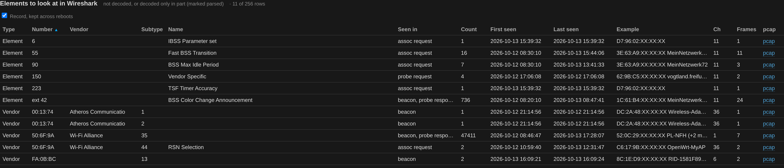
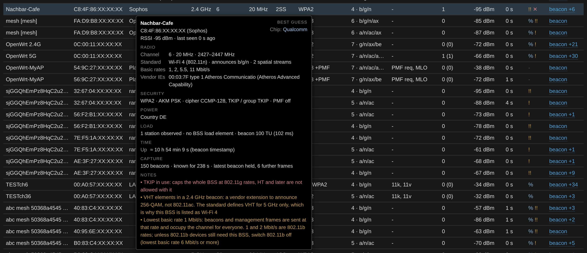
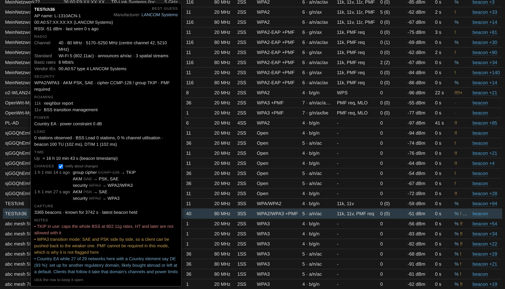
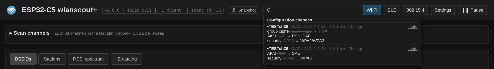

# Wi-Fi views

## The four Wi-Fi views

The tabs under the header switch between them, in the order BSSIDs,
Stations, RSSI spectrum and IE catalog; the stations have a chapter of
their own, [Stations](stations.md).



**BSSIDs** is the frequency-accurate view: every BSS
drawn over the spectrum it actually occupies, at the height of its RSSI,
grouped into panels per band. Clicking a shape restricts the sweep to
that channel (so does clicking an AP node in the station graph; a
click on a table row does not, on a phone the tap opens the tooltip). The axis keeps the channel numbers of the whole range
shown, the scanned channel brighter than the rest. Whenever the sweep differs from the default channel
plan, a *Back to default channels (now: ch 36)* button above the graph
and above the station graph says so and undoes it in one click. The
default plan is set in the scan panel with *Save as default*, see
[Sweep and reception](sweep.md). This is the view
the network table belongs to.

**RSSI spectrum** plots the receive level per channel, with **max hold**
and a dashed **average** over the selected time range, and below it a
**waterfall** — one column per scanned channel, equal column width, time
running from top to bottom. The range is selectable from a few minutes
to several hours.

The difference between the two views is claim versus observation. The
first draws what the beacons *say* about channel occupancy: a 160 MHz
BSS is drawn 160 MHz wide whether or not it ever transmits that wide.
The second shows what the radio *actually received* over time — which
channels carried traffic, how strong it was, and how that changed.

> **This is not a spectrum analyser.** Every RSSI value comes from an
> 802.11 frame the radio decoded; frames that fail the FCS are discarded
> before they are counted. A microwave oven, a video sender or an analog
> camera transmits no 802.11 frames and is therefore **invisible in both
> views** — a channel ruined by one of them shows up as empty, not as
> busy. What such interference does cause is a rise in dropped and
> FCS-failed frames and a fall in the counts of the APs on that channel,
> which is an indirect hint at best.
>
> For raw power regardless of protocol there is the **802.15.4 energy
> sweep**, which uses the radio's energy detect and does see everything
> — but only in the 2.4 GHz band, and only in that mode.
>
> If you want an actual spectrum off an ESP32-C5, look at
> [ESPARGOS/esp-sdr](https://github.com/ESPARGOS/esp-sdr). It drives the
> PHY directly for snapshot FFTs of 256 to 2048 bins at up to 80 MS/s,
> including the 5 GHz path. It is not integrated here: it needs a full
> 128 KiB SRAM bank reserved at link time, which this firmware does not
> have left over. A second C5 running esp-sdr as a dedicated front end
> would be the way to combine the two.

Resolution is per channel, not per subcarrier: one value per dwell, so
the waterfall is as fine as the channel plan and no finer.



**Stations** draws the station graph: which client sits on
which AP, and how much each has been heard.

**IE catalog** collects elements to look at in Wireshark, see
[below](#ie-catalog).

---

## Reading the network table



**Order.** The table starts sorted by SSID, BSSIDs of one SSID by
address, so rows stay where they are while RSSI and counters change. A
click on a column head sorts by it (RSSI for instance), a second click
reverses the order.

**The filter** above the graph narrows table and graph alike. Every
word has to match somewhere, and it searches more than the columns:
the tooltip's capabilities, 11k and 11v detail, multi-link, spatial
streams, Tx power envelope, unknown elements and the notes as well. So
`eirp` lists the APs that send a power envelope, `mlo 5ghz` the 5 GHz
links of AP MLDs, `dfs` those on DFS channels, `ch:36 80mhz` what it
says. Matching is by substring and ignores case; `ch:`, `80mhz` and
`wifi6` are spellings the filter adds so that a channel number or a
width does not also hit every MAC address that contains the digits.

**Flush**, at the right end of the filter row above the graph's top
right corner, empties the network table on the sensor, after asking:
every BSSID with all it learned (beacon counts, first seen, BSS load,
elements) and the 6 GHz list go, and both fill again from what is
heard next — useful after moving the sensor or before a measurement
that should start clean. Otherwise an AP stays until it has been
silent for a minute. The capture buffers, the association history
and the IE catalog stay; they have their own buttons. While a
snapshot is shown, Flush is greyed out: there is no live table to
empty until *Back to live*.

**Standard** shows the Wi-Fi generation and, after a middle dot, every
PHY generation the BSS announces — `6 · b/g/n/ax` rather than just
Wi-Fi 6. An 802.11ax AP on 2.4 GHz normally still carries the DSSS rates
of 802.11b for legacy clients, and whether it does is worth seeing:
those rates cost airtime for everyone on the channel.

The set is derived from the rate elements and the capability elements:

| Mode | Criterion |
|------|-----------|
| b | DSSS/CCK rates 1/2/5.5/11 Mbit/s, channel ≤ 14 |
| g | OFDM rates or the ERP element, channel ≤ 14 |
| a | OFDM rates, channel > 14 |
| n | HT Capabilities (45) |
| ac | VHT Capabilities (191), channel > 14 only |
| ax | HE Capabilities (ext ID 35) |
| be | EHT Capabilities (ext ID 108) |

**NSS** is the number of spatial streams the AP can receive, the
highest of what its HT, VHT, HE and EHT capabilities say: the HT Rx MCS
bitmask, the VHT and HE Rx MCS maps (VHT only on 5 GHz, where it is
802.11ac rather than a vendor extension) and the Rx max NSS of the EHT
MCS and NSS set. It is the same reading the
station tables use, so an AP and its clients can be compared directly —
a 4SS AP with 2SS clients will never see more than two streams in use.
`-` means none of the elements was there, which is the case for
802.11a/b/g-only BSSs.

**Capabilities** lists what a client would act on: `11k`, `11v`, `11r`,
`PMF` or `PMF req`, `HS2.0`, `Pre-Auth`, `OWE-TM`, `WPS`, `MBSSID`,
`MLO`, and first `Ad-hoc` for an IBSS.

**Drones** that broadcast Remote ID over Wi-Fi (ASTM F3411, the
vendor element `FA:0B:BC` type 13 in their beacons, an SSID like
`RID-…`) are required by law to send it for anyone to read, the
pilot's position included. The sensor decodes the message pack:
aircraft type, status, position, altitudes (GNSS and barometric),
height above takeoff or ground, speed, heading and climb rate, the
pilot's position and altitude, the EU class and the self-ID text.
Of the serial number only the manufacturer code is kept (1581 is
DJI); the serial itself and the operator ID are not read. The
positions link to OpenStreetMap. An emergency reported by the drone
is a red note; `drone` or `remote id` in the filter finds them.

**BSS colour** comes from HE Operation. An 802.11ax AP switches its
colour when it notices another BSS on the channel using the same
one, and announces the new colour over a few beacons (BSS Color
Change Announcement); the tooltip shows the switch and how many were
seen, two or more are a blue note.

**Up** in the TIME section is the beacon timestamp: the AP's
microsecond timer, which runs from when the BSS started, normally
when the AP booted. When it goes back, the AP or at least its radio
restarted; in the last hour that is a blue note. Some APs start the
timer elsewhere; beyond three years it is not taken for an uptime.

**Ad-hoc networks (IBSS)** have no access point: their stations take
turns sending the beacon, all with the same BSSID, and the capability
field says IBSS instead of ESS. In practice they are mostly the setup
mode of a device such as a printer, older displays and cameras, or
mesh nodes that run batman-adv over ad-hoc. The tooltip's *Ad-hoc* line adds the ATIM window from the IBSS
Parameter Set (element 6): how long the stations stay awake after a
beacon to announce buffered frames, 0 when none of them sleeps. The
filter finds them with `ibss` or `adhoc`.

**With a mouse** the tooltip follows the pointer. A click on a table row
pins it where it is, outlined in blue: it then takes the mouse, so its
links (a drone's map link, the maker, a pcap) can be clicked and its
text selected, it scrolls, and it stays while the pointer moves on,
until its ✕, Escape or a click outside it. The tooltip says so at its
foot. A click on a link in the row itself does not pin.

**On a phone** a tap on a row or a shape opens its tooltip; a tap
anywhere else, or on the ✕ in its corner, closes it. The tooltip stays
on screen at any page width; one taller than the screen scrolls inside.
It stays put while the tables are drawn anew underneath, live or in a
snapshot: the mouse events a phone browser keeps sending where the
finger was are ignored once the tap is over.

**The tooltip** is laid out in sections, each with a dim heading and
label / value rows; a section without anything to say is left out, so
a plain Wi-Fi 4 BSS stays short. Under the SSID come the AP's own name
when it sends one (Cisco's element 133, which LANCOM and others use
too, MikroTik's radio name, which DD-WRT sends as well, or the name
in Mist's vendor element), BSSID and vendor, RSSI and age; top right, under *BEST GUESS*, stand the
manufacturer of the device, its Wi-Fi chip and, for an AP in a
vehicle, *Device: Vehicle*, for a printer (HP's element) *Device:
Printer*, for a drone *Device: Drone* with its height and a map link
to the pilot's position, as far as the elements give them away
(see below). Then:

| Section | Holds |
|---------|-------|
| REMOTE ID | only for a drone: status, height, altitudes, speed and heading, map links to drone and pilot, EU class, self-ID text, age of the report |
| RADIO | channel, width, occupied range, the centre if it is not the channel itself, standard with the announced generations and spatial streams, basic rates, ad-hoc (IBSS) with its ATIM window, NAN (master preference, anchor master and hops), QoS Management (DSCP policy, SCS traffic description, from the Wi-Fi Alliance Capabilities element), the BSS colour and announced switches, Multiple BSSID, the vendor elements (OUI, types, owner; one line per OUI unless a type has a name of its own), the Apple accessory (manufacturer, model, name), the operating mode (width and streams in use), Wi-Fi Direct (group owner, persistent group, cross connection, device name) and Miracast, an HP printer's model |
| SECURITY | security, AKM, ciphers, PMF and, on the same line, WPS with the device name, manufacturer and model it announces; the config methods and AP Setup Locked are kept from the probe responses, a beacon without them does not clear them; pre-authentication, Hotspot 2.0, beacon protection; the RSNE/RSNXE Override, i.e. the security offered to Wi-Fi 7 clients beside the RSN element for all others; Interworking (access network type, Internet, venue, HESSID) and the Advertisement Protocol (ANQP …); the OWE transition partner |
| MESH | peerings and path selection of an 802.11s mesh BSS |
| ROAMING | the 11k, 11v and 11r detail, MBO-OCE (cellular data aware, OCE, channels to avoid), the measurement pilot interval |
| MULTI-LINK | the AP MLD, its links, EML and MLD capabilities |
| POWER | country, Tx power envelope, power constraint, TPC report, Quiet intervals |
| LOAD | stations observed, BSS load, beacon interval, the DTIM period with buffered group traffic and the stations with frames waiting (TIM), the beacon gaps, extended BSS load, available admission capacity, BSS Max Idle Period, ERP |
| TIME | the AP's uptime from the beacon timestamp and when that last went back, the AP's clock from its Time Advertisement, its time zone |
| CHANGES | the configuration changes, the sensor keeps eight per BSS and the bell's list more, the old value struck through, and AP restarts with how long it had been up (see below) |
| CAPTURE | beacons heard, how long the BSS is known, what is in the capture buffer |
| NOTES | the coloured hints, always last |

**Maker from the vendor elements.** Many drivers add vendor specific
elements (221) of their own to every beacon, and the OUI in them tells
whose they are. Some belong to the chip maker: `00:90:4C` (Epigram) and
`00:10:18` Broadcom, `8C:FD:F0` and `00:03:7F` (Atheros) Qualcomm,
`00:0C:43` and `00:0C:E7` MediaTek, `00:E0:4C` Realtek, `00:26:86`
Quantenna, `00:09:86` (Metalink) MaxLinear/Lantiq, `00:50:43` Marvell,
`18:FE:34` Espressif, `00:1C:51` Celeno, `40:45:DA` Unisoc (Spreadtrum),
`00:02:5B` CSR (Qualcomm); these show as *Chip*. Only the elements
count: the vendor of the BSSID already stands beside the address and is
not repeated. Any other OUI names the device maker, AVM or Ubiquiti for
instance. A few OUIs came with a takeover and are shown under today's
name: `00:0B:86` Aruba (HPE), `00:19:77` Aerohive (Extreme), `00:A0:F8`
Extreme WiNG, `14:22:DB` eero (Amazon), `00:0F:7D` Xirrus (Cambium);
DJI sends under `44:32:44`, ASCII "D2D", which has no registry entry.
MikroTik (`00:0C:42`) counts
only when the BSSID is MikroTik's too, DD-WRT sends that element as
well. An OUI without a registry entry, NeXT's `00:00:0F` and LVL7's
`00:02:BC` (software, not the device) give no maker. The elements everybody sends,
from Microsoft (WPA, WMM, WPS), the Wi-Fi Alliance and the IEEE, are
left out. So are Broadcom's 256-QAM-in-2.4-GHz element (Epigram type 4)
and its pre-802.11n HT elements: other chips copy them so that Broadcom
clients understand them, and they say nothing about the chip. Apple's
Device IE (`00:A0:40` type 0) does not name the maker either: it is
sent by accessories made for Apple devices, car head units with
wireless CarPlay for instance. Its own fields are decoded instead —
name, manufacturer and model, e.g. `My SEAT 4624`, `SEAT`, `SE3821` —
and the manufacturer field shows top right as *Manufacturer: SEAT*. Up to six
vendor elements are kept per BSS, collected over beacons and probe
responses. An AP that sends none of its own shows nothing there; the
BSSID's OUI under the SSID is then all there is.

An AP whose Interworking element (107) gives venue group 10 shows
*Device: Vehicle* there as well. The venue type, such as *Bus* or
*Train*, is in the SECURITY section only: not every AP sets it, and
what is set is not always right.

Beacons of NAN (Wi-Fi Aware) clusters, sent from a cluster ID
`50:6F:9A:01:xx:xx` by phones for Nearby Share and the like, are listed
as *NAN cluster (Wi-Fi Aware)* instead of a hidden network. Their tooltip
has a NAN line from the NAN element: the sender's master preference and
random factor, and how many hops away the cluster's anchor master is
(*is the anchor master* when it is the sender itself). An AP that
requires admission control (WMM ACM bit) for a class gets an amber note:
clients without ADDTS fall back to a lower class there. A red note says
when an AP refuses new associations through MBO (*Association
Disallowed*, with the reason, e.g. maximum number of stations reached),
an amber one when a Wi-Fi Direct group is bridged to the infrastructure
network (cross connection).

`11k` and `11v` in the table only say that the elements are there. The
ROAMING section spells out what is behind them:

- **11k** — the bits of the RM Enabled Capabilities
  element (70): link measurement, neighbor report, beacon passive,
  active and table mode, channel load, noise histogram, statistics,
  LCI, RCPI, RSNI and the rest of 802.11-2020 table 9-191. Beacon
  report support is what an AP or controller needs to ask a client
  which APs it hears, and neighbor report is what lets the client ask
  the AP in return.
- **11v** — the WNM features picked from Extended Capabilities (127): BSS
  transition management, WNM sleep, TIM broadcast, proxy ARP, FMS, TFS,
  DMS, WNM notification, plus FTM responder and initiator. BSS
  transition management is the one that matters for steering: without
  it, an AP cannot ask a client to move. It is not to be confused with
  beacon table measurement, which is a beacon report mode in the 11k
  line.

The same two lines appear in the station tooltip, read from the
client's requests.

**Multi-link (Wi-Fi 7).** An 802.11be AP can run several links — 2.4, 5
and 6 GHz — as one logical device, the AP MLD. Each link has its own
BSSID; an MLD address ties them together. The AP announces this in the
Basic Multi-Link element (255/107) of every beacon, and `MLO` in the
Capabilities column marks it. The tooltip shows the detail, here for the
5 GHz link of an OpenWrt AP MLD with links on 2.4, 5 and 6 GHz:



- **MLD links** are all BSSIDs heard with the same MLD address, sorted
  by link ID, plus 6 GHz BSSs one of them announces under the same SSID
  in its Reduced Neighbor Report. The radio cannot receive 6 GHz, so
  those are *announced only*.
- **Up to n links at once** is the Maximum Number Of Simultaneous Links
  field plus one; the field counts one less.
- **EML** is the enhanced multi-link mode: EMLSR (one radio listening on
  several links and switching to one for the exchange) with padding and
  transition delay, EMLMR (several radios) with its delay, and the
  transition timeout.
- **MLD** lists TID-to-link mapping negotiation (not supported, all TIDs
  to one link set, or per TID), SRS, AAR, link reconfiguration and
  aligned TWT.

Of the Multi-Link element variants only Basic describes an MLD; the
probe request and reconfiguration variants are passed over, also when
one of them comes first — an AP removing a link sends a Reconfiguration
element next to the Basic one. The station side is under
[Stations](stations.md#multi-link-stations).

**Vendor** comes from the OUI of the BSSID. An AP often derives further
BSSIDs from its base MAC by setting the locally administered bit —
OpenWrt does this for some MLO links, many APs for extra SSIDs — so such
an address is local but not random. For a BSSID the vendor is therefore
taken from the MLD address if the AP has one, otherwise from the OUI
with that bit cleared, shown with `(local)` because a truly random
BSSID, a phone hotspot for instance, matches a real OUI now and then.
Only without either is it called `randomised (LAA)`. Station addresses
are not treated this way: a locally administered station address almost
always is a random one.

**Power figures** fill the POWER section, on one line as long as they
need no reading: `Country DE · TPE 23 dBm · power constraint 3 dB ·
TPC 12 dBm`. The power constraint (element 32)
is how many dB the AP keeps below the limit of its Country element; the
TPC report (element 35) is the power the beacon actually went out with,
the most direct sign of what the AP is set to. A TPC report below
18 dBm raises an amber note.

**Tx power envelope** in the tooltip is the Transmit Power Envelope
element (195): the highest power the AP allows on its channel, and
with it the limit its clients are held to. It comes in four kinds —
local or regulatory-client limit, each either as EIRP per channel width
(20, 40, 80, 160, 320 MHz) or as PSD per 20 MHz subchannel, the form
6 GHz uses. An AP can send more than one. A plain EIRP that is the
same for every width and at least 18 dBm is shown as `TPE 23 dBm` on
that line; anything else gets an Envelope row of its own, up to two:

```
Envelope   local EIRP 20 MHz 23 dBm, 40 MHz 20 dBm, 80 MHz 17 dBm
Envelope   regulatory client PSD 11 dBm/MHz on all 4 subchannels
```

A PSD subchannel the AP forbids is shown as `off`, one without a limit
as `no limit`. Category 1, which addresses subordinate devices in
6 GHz, is marked as such.

**Extended BSS Load** (element 193, from VHT on) adds to the BSS load
line: MU-MIMO capable stations, how often spatial streams go unused and
how busy the secondary 20, 40 and 80 MHz channels were — the part of a
wide channel the primary-channel utilisation does not see. Secondary
channels are listed only as far as the BSS is wide. Many APs send the
element with every field zero; then the row is left out.

**ERP** (element 42, 2.4 GHz) gets a row once it says more than
"802.11g": `802.11b station present`, `protection on`, `long preamble`.
Either of the first two raises an amber note: an associated 802.11b
station takes a lot of airtime at 1 to 11 Mbit/s, and with protection
on the AP also sends its OFDM frames behind RTS/CTS or CTS-to-self. Broadcom APs send the same content a second time as element 47,
the number from the 802.11g draft; that one is passed over.

**Time** shows the AP's clock from its Time Advertisement (element 69)
and how far it is from the sensor's, `+15 s against the sensor`, plus
the POSIX time zone of element 98 (`CET-1CEST,M3.5.0,M10.5.0/3`). A
sensor without NTP or a browser sets its own clock from these, see
[Installation](install.md). Some APs send the time zone only in probe
responses; the last one heard is kept.

**Security** covers WEP, WPA, WPA2, WPA3, OWE and OSEN. OSEN is the
Hotspot 2.0 onboarding network, carried in a WFA vendor element rather
than in RSN and laid out like RSN but without the version field — it
needs its own reader, and without one it looks exactly like WEP.

**Enhanced Open** is deployed as a pair of BSSs: an open one that legacy
clients can still use, and an OWE one that does not broadcast its name.
Each beacon names its partner in the OWE Transition element, so the
hidden half can be shown under its real name — which is the only way to
learn it. That source comes from a beacon of the same AP rather than
from station traffic, so it outranks a probe-derived guess and is
labelled separately in the tooltip.

**The station count comes twice.** One figure is what the AP reports in
its BSS Load element, the other is how many stations this sensor has
actually seen frames from on that BSS. They answer different questions
and routinely disagree: the AP knows all of its clients, the sensor only
those within its own range and only on the channels it visits, so its
number is normally the lower one. An AP that reports no BSS Load at all
leaves only the observed count.

**Basic rates** are listed in full in the tooltip, not just the lowest
one. Every station has to support all of them to associate, and the
lowest is what beacons and management frames are sent at — so a BSS
still carrying 1 and 2 Mbit/s occupies the channel far longer per frame
than one starting at 6. The anomaly hint only fires at 2 Mbit/s and
below; the list shows what the whole set looks like.

**The hatched background** of the spectrum view is reported airtime from
the BSS Load element. Each BSS covers its whole width, so an 80 MHz BSS
on 5 GHz hatches all 80 MHz; the band is binned at 2 MHz and the busiest
reporter wins per bin. Amber from 40 %, red from 70 %, with a badge in
the corner of each stretch. Hovering it names the channels in the
stretch, e.g. *channels 36–48 (5170–5250 MHz)* for that 80 MHz BSS on
36, and the contributors with their channel and width.

This is **not** a measurement the sensor made. Every AP fills the
element in from its own position, two APs on one channel can
legitimately disagree, and an AP that omits the element contributes
nothing — so an unhatched stretch is not necessarily a quiet one.



---

## IE catalog

The pink `?` in the hint column of the network table marks elements the
firmware does not know yet (see [Anomaly hints](#anomaly-hints)). Those
marks belong to the networks the table holds, and a network leaves the
table some time after it was last heard, its marks with it. To find out what the firmware still misses out in the field, the
**IE catalog** view keeps a catalog across reboots. Switch on
*Record, kept across reboots*, put the sensor in a backpack with a
power bank and walk or drive around; it needs no network. Fast sweep
over all channels is the setting to use, beacons are only heard on the
channel being swept, probe requests of stations on any.



Every beacon, probe response, probe request and (re)association request
is searched for

- elements the firmware does not know (the same list the pink marks
  use),
- vendor specific elements it neither decodes nor has gone through
  yet (see *What this sensor reads* below),
- AKM and cipher suites it has no name for, in RSN and WPA elements.

Each finding is one row: type; number (element number, `ext 12` for
an extension, the OUI for vendor elements and suites); the OUI's
owner; subtype (vendor type or suite number); its Wireshark name where
known, e.g. `RSNE Override` for `50:6F:9A` type 41; the frame types it
came in, a counter, first and last sighting, one example — sender and
SSID —, the channel it was heard on and the number of stored frames.
The element's bytes are in the pcap. Up to 256 rows. A click on a column head sorts by
it, a second click reverses the order, as in the other tables. The
default is by element number; *First seen* puts what turned up last on
top. The choice is kept in the browser.

Below the table, *What this sensor reads* (closed at first) lists the
other side: the elements decoded and shown, those decoded only in part
and therefore still catalogued, those recognised but deliberately not
shown (Power Capability, QoS Capability …), the vendor elements decoded, the vendor
elements gone through by hand whose content is not shown, and the AKM
and cipher suites that have a name. A vendor element is listed by OUI
and type with its name, or, where no name is published, as
proprietary to the maker of the OUI (*Apple proprietary*): a new type
of a known OUI, or a new OUI, still goes into the catalog. The OUI of every vendor element names maker or chip under
*BEST GUESS* either way. The firmware sends these lists
with the catalog, so they always match the firmware running.

The first three frames of each sender carrying a finding go into a
pcap file of up to 640 kB, for up to ten senders per row, so a second
or third device with the same element brings samples of its own; the
*Example* column says how many more senders there were. The pcap link at the end of a row downloads every stored
frame that carries that element; *Download all frames* gets the whole
file. Worth opening in Wireshark before writing a parser.

A frame in which a known element has a length the standard does not
allow (element 72 with 8 octets instead of 1, say) is not taken any
further from that element on: its device uses the numbers for content
of its own, and what follows would only fill the catalog with rows
that cannot be decoded. The same goes from a second SSID element on:
a frame carries one, and a run of them is a frame filled with zeros.

After a firmware update, the first start removes the rows of what is
decoded now, together with the frames that were stored only for them,
and rows whose stored frames all fail the length check above; a frame
that still carries anything catalogued stays.
The event log says how many rows and how much went. This cannot be
undone, so *Download all frames* first if the old frames matter.

New rows are written within five seconds, counters every five minutes,
both as a whole file written aside and renamed, so a power cut costs
at most the last counts. Times are real once the sensor has a clock —
NTP, the browser, or an AP's Time Advertisement; before that a time is
shown as `boot 3, +2 min 10 s`. The boot counter is kept in NVS; the
settings page shows the current boot under System and the catalog
state under Counters and capture.

## Anomaly hints

Everything notable about a BSS lives in the tooltip rather than in a
column of its own, with a marker column between Age and pcap carrying
the count: `?` pink, `%` blue, `!` amber, `✕` red, always in that order,
repeated per finding and capped at four with a `+`. The column sorts by
weight, one red above any number of amber, one amber above any number of
blue, one blue above any number of pink. In the tooltip the notes come in the same
order: red first, then amber, blue, and pink last.



**Configuration changes.** What a beacon says about channel, width,
standard, spatial streams, the lowest basic rate, beacon interval,
country, security (label, AKM, ciphers, PMF), 802.11k/v/r, WPS, the
BSS colour and the DTIM period is the AP's configuration; it should stay as it is while
the BSS runs. When it changes, the column gets a `Δ` after the other
markers, without a colour: a change is neither good nor bad, a channel
can move after radar on a DFS channel, a colour after a collision. The
tooltip's CHANGES section lists them with the old value
struck through, e.g. *channel ~~36~~ → 52*, and the AP's restarts
seen in its beacon timestamp with the uptime they ended. Only beacons
are compared, probe responses carry more, and a new state counts once
two beacons agree on it. A BSS that goes back to its previous state
within ten minutes is *flapping*: one entry names the fields and counts
the switches, updated while it goes on, instead of every field twice
per switch. Some APs do that on purpose, sending two kinds of beacon. `changed` in the filter finds them all.



The **bell** next to the snapshot button collects the changes of all
BSSs, the last 64 since the sensor started, also of networks that have
left the table since. Its number counts the ones not looked at yet in
this browser and follows on its own while the page is open, newest
change first (a flapping entry moves up when it counts on), the time
itself on hovering over "… ago", e.g. *9:43:27 18.10.2026*; what one
BSS changed at once, a new security setting with its AKM, PMF and
ciphers for instance, is one entry and counts once; opening
the list, which scrolls, marks them read, a click on one filters
the network table to its BSSID.



A BSS that changes by design, a device that sends two kinds of beacon
for instance, can be kept out of the bell: *mute* next to its entry, or
the checkbox *notify about changes* in the title line of its CHANGES
section (click the row to keep the tooltip open). Its changes
are still recorded and shown in the tooltip, its `Δ` turns dim, and the
list ends with the BSSs not notified, each with *unmute*. The choice is
kept on the sensor, for every viewer and across restarts, up to 16
BSSs.

A **snapshot** keeps the bell's list with the networks. Looking at it
later the bell shows the list as it was, times counted back from the
moment it was taken, without a count of unread ones, without *mute*,
and marking nothing read; a snapshot from before the bell has none.

**Blue — state of the air**

- Channel Switch Announcement, with target channel and beacons remaining
  (not yet captured from a real AP: an AP sends it only in the last
  few beacons before it moves, mostly after radar on a DFS channel, so
  it is rare and easy to miss)
- DFS channel under ETSI rules
- channel utilisation at or above 60 %
- a Country element other than the one more than half of the networks
  in range announce (at least five with a Country element): an AP set
  up for another regulatory domain, bought abroad or left at a
  default; its clients take that domain's channels and power limits
- the same SSID with other security on another BSSID of the same
  device (FRITZ!Boxes: WPA2 in 2.4 GHz, WPA2/WPA3 in 5 GHz): a client
  changing band changes between PSK and SAE and logs in anew; not
  where the multi-link split note already says so
- several Country elements for one SSID (a router with DE, its repeater
  with CH): implausible, one of them has its region set wrong
- a WPA element without an AKM (00-50-F2-00) beside an SAE RSN
  element: no station can log in over it, so it does not turn the
  network into WPA2/WPA3 either; the filter finds *wpa element without
  akm*

**Pink — not understood by this sensor**

- an element the firmware does not know (the
  [catalog](#ie-catalog) keeps them across reboots),
  named by Wireshark's element
  table, with the frame types it came in — an AP may send one only in
  its probe responses and not in its beacons:
  `Unknown element 68 BSS AC Access Delay (probe response)`

The firmware keeps a list of the elements it decodes and of those it
deliberately passes over (power capability, MU EDCA and the
like); anything else is recorded, up to six per BSS. Vendor specific
elements are proprietary by definition and not counted. A pink mark is
not a fault of the AP — it means the sensor has met something it cannot
show yet, and the frame is worth a look in Wireshark and worth reporting.
Stations get the same pink lines in their tooltip, read from their
probe and association requests.

**Amber — odd but harmless**

- 40 MHz in 2.4 GHz
- VHT elements in a 2.4 GHz beacon (a vendor extension for 256-QAM, not
  802.11ac), or the same wrapped in Broadcom's vendor element (00:90:4C
  type 4); in a Wi-Fi 6 BSS only for older Broadcom clients, HE brings
  256-QAM in 2.4 GHz anyway
- hidden SSID: it protects nothing, every client that joins sends the
  name in clear and keeps probing for it wherever it goes (not for a
  mesh, a NAN cluster or the hidden OWE half of a transition pair)
- HT Greenfield announced
- WPS present, with the config methods it offers
- WPA3 transition mode
- 40 MHz Intolerant
- lowest basic rate at or below 2 Mbit/s: 802.11b rates, with the
  advice to switch 802.11b off unless 802.11b devices still need it
- no rate marked basic: the BSS requires nothing of its clients,
  control frames fall back to the PHY's mandatory rates and the AP
  picks the beacon rate itself
- pre-authentication announced without an 802.1X AKM: it runs 802.1X
  ahead of a roam, so with PSK or SAE alone it does nothing
- a cipher or AKM suite under an OUI that does not belong in its
  element (00-00-00-00 anywhere, 00-0F-AC in the WPA element,
  00-50-F2 in the RSN element): a firmware fault of the AP, seen in
  the WPA element of cable routers; the filter finds *broken suite*
- Multiple BSSID element
- beacon interval other than 100 TU
- no Country element
- ERP protection on: OFDM frames go out behind RTS/CTS or CTS-to-self,
  for an 802.11b station of the AP's own or one in an overlapping BSS
- 802.11b station associated (ERP Non-ERP Present) without protection:
  its DSSS frames still take a lot of airtime
- PMF not required on one BSS while the other BSSs of its SSID on other
  devices require it, or its Country element missing or other than
  theirs (same rule: two of them at least, two thirds agreeing)
- DTIM period above 3: broadcast and multicast wait that many beacon
  intervals for stations in power save, so ARP, mDNS and the like answer
  late; the filter finds a period with `dtim3`, `dtim10` …
- beacons faster than their interval: of at least ten gaps between two
  beacons heard back to back on the BSS's own channel, more than a fifth
  under half an interval. A late beacon makes the next one early, but
  hardly ever that early; many such gaps mean a second sender under the
  BSSID, a cloned address or software sending beacons of its own beside
  the AP (an ESP32 using `esp_wifi_80211_tx()` beside its SoftAP).
  LOAD then shows the gaps and the shortest, the filter finds them with
  `fastbeacons`
- Tx power envelope below 18 dBm EIRP at 20 MHz: binds the clients,
  and usually means the AP runs at reduced power as well. An AP that
  lowers only its own power and leaves the envelope alone does not
  show up here.
- multi-link split: one device (BSSIDs alike but for the locally
  administered bit, or within a block of sixteen) runs several bands,
  each as an AP MLD of its own with a single link, where one AP MLD
  with a link per band was meant. The links of one AP MLD share SSID
  and security, so separate names per band, or WPA2 on one band and
  WPA3 on another, keep them apart; the note says which of the two it
  is. Clients then get no multi-link across the bands. Only for MLDs
  that each name themselves link 0 and sit on different bands: a guest
  network beside the main one on the same radio is an MLD of its own
  by design, and a link 1 has a link 0 somewhere that is just not
  heard. A lone AP MLD with one link is not flagged either, its other
  link may be on a channel that is not swept.
- a 2.4 GHz channel in neither 1, 6, 11 nor 1, 5, 9, 13 (2, 3, 4, 7,
  8, 10, 12): it overlaps the networks on both sides, which cannot
  share the airtime with it
- no 802.11n (802.11b, a or g alone): old rates that take more airtime
  from everyone; the note advises replacing the device
- an open network without OWE: everything in clear; the note advises
  OWE (Enhanced Open), with an open transition network beside it for
  older clients if need be. Not for the open half of an OWE pair or a
  mesh

**Red — worth fixing**

- two devices sending as one BSSID: every device has its own beacon
  timer, and copying a MAC address does not copy it. The sensor keeps
  the offset between the timer in a frame and the time it heard it;
  a second offset, more than a second off the first and alternating
  with it, at least four times and
  each seen three times, is a second device: a cloned MAC address, an
  evil twin, or two APs set to the same BSSID. A restart switches to a
  new timer once and is no twin, and a device sending extra beacons of
  its own (an ESP32 beside its SoftAP) has one timer, its own beacons
  at most an interval off it; that is the amber
  note on beacon gaps. It also goes to the bell, as *two clocks*
- weaker security than the other BSSs of the same SSID on other
  devices, where at least two of them agree, two thirds of them: WPA2
  where they run WPA2-EAP, WPA2 where they run WPA2/WPA3. A client
  looking for the network may log in here: an evil twin with its own
  BSSID, or an AP left behind with an old setting. Maker and model are
  not compared, networks are built from mixed hardware
- WEP
- TKIP
- SAE without PSK alongside it and PMF not required
- SAE while PMF is not even supported (both not for an 802.11s mesh
  point: WPA3 mandates PMF for access points, a mesh secures its
  peering with SAE and AMPE and wpa_supplicant leaves PMF off there by
  default; that is a blue note instead)
- 40 MHz Intolerant set by a BSS that runs 40 MHz in 2.4 GHz itself: it
  pushes every neighbour down to 20 MHz and keeps the width (without
  the 40 MHz the bit alone stays amber)
- WPS with a PIN method and AP Setup Locked not set
- WPS state "not configured"

A note on the WPA3 rules, because getting them wrong produces constant
false positives: in **transition mode** PMF cannot be required, since
the PSK clients the mode exists for cannot do it. MFPR = 0 is correct
there and is not flagged. Only SAE *without* PSK alongside it has to
require PMF.
