# Wi-Fi views

## The four Wi-Fi views

The tabs under the header switch between them, in the order BSSIDs,
Stations, RSSI spectrum and IE catalog; the stations have a chapter of
their own, [Stations](stations.md).

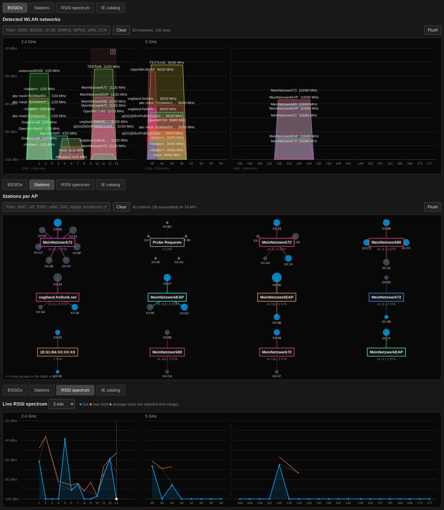

### BSSIDs

**BSSIDs** is the frequency-accurate view: every BSS
drawn over the spectrum it actually occupies, at the height of its RSSI,
grouped into panels per band. OFDM (802.11a/g and everything after)
is flat over the channel with steep edges, a trapeze; an 802.11b-only
BSS sends DSSS, whose spectrum is a bell 22 MHz wide, strongest at the
centre and falling away to either side, and is drawn as one.

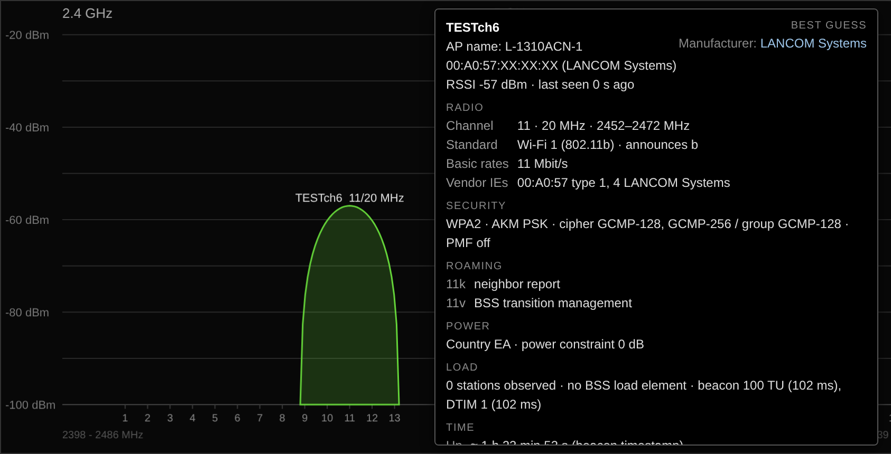

*Example: an AP on channel 11 that sends 802.11b only. It is drawn as
a bell, not as a trapeze; its tooltip says Wi-Fi 1 (802.11b) with
11 Mbit/s as the only basic rate.*

An 80+80 MHz BSS gets its second 80 MHz drawn as well, dashed and
labelled *2nd 80* with its centre channel in the panel of its range,
which is widened for it, filtered to the network alone as well; the
tooltip's Channel row names both ranges.

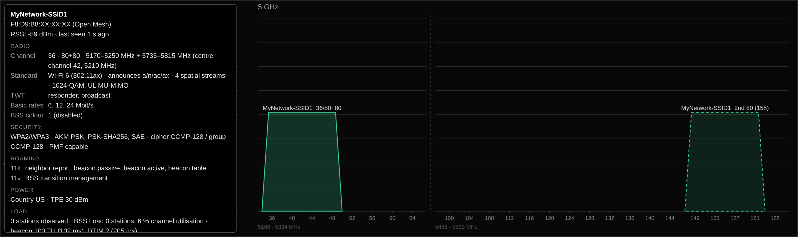

*Example: a Wi-Fi 6 AP on channel 36 with 80+80 MHz. The first 80 MHz
(36–48) is drawn solid, the second (149–161, centre 155) dashed with
2nd 80 in the panel of the upper 5 GHz channels; the Channel row in
the tooltip gives both ranges.*

The band headings *2.4 GHz* and *5 GHz* are buttons (a hover says what
a click does): one shows only that band across the whole width, for a
phone held upright, the lit one both again. The network table below
follows it ("4 of 9 networks shown, 2.4 GHz only"), the station table
and the 6 GHz list do not; the sweep stays as it is, the browser keeps
the choice. Clicking a shape keeps its tooltip open, as a click on a
table row does (so does clicking an AP or station in the station
graph). Its *scan only channel 36* button narrows the sweep to that
channel, see [Sweep and reception](sweep.md#the-sweep). This is the
view the network table belongs to.

A Wi-Fi 7 BSS that leaves 20 MHz subchannels out of its width
(preamble puncturing, from the EHT Operation element) keeps its whole
trapeze, the subchannels left out cross-hatched in its colour, with
the marker of the [airtime hatch](#reported-airtime-hatch) in that
colour at their top right, and a *Punctured* row in RADIO; over the
hatch the tooltip starts with what is left out. An AP may also
puncture dynamically, leaving a subchannel out while other BSSs load
it and taking it back afterwards; the graph shows what the last beacon
says. Each switch rings the bell, and an AP that does this all day is
*flapping*, see [Configuration changes and the
bell](#configuration-changes-and-the-bell).

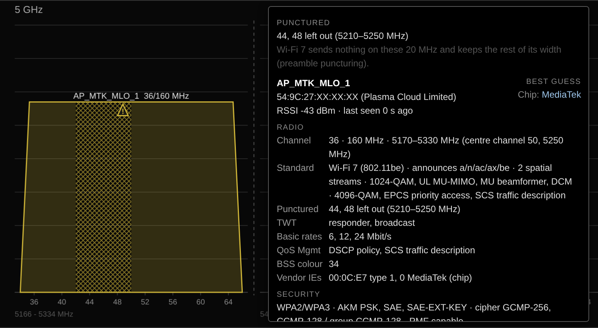

*Example: a Wi-Fi 7 AP on channel 36 with 160 MHz that leaves out 44
and 48. The trapeze still spans 36–64, the two subchannels are
cross-hatched with the marker at their top; with the mouse over the
hatch the tooltip starts with PUNCTURED, and RADIO has the Punctured
row.*

#### Reported airtime hatch

The hatched background of the BSSIDs view is reported airtime from
the BSS Load element. That value is about the primary 20 MHz channel,
yet without more a BSS covers its whole width with it, so an 80 MHz BSS
on 5 GHz hatches all 80 MHz. An AP that also sends the
[Extended BSS Load](#load) element gives each of its secondary 20, 40
and 80 MHz its own value, and the tooltip adds them to that AP's line —
but only if every secondary its width has is filled in. A secondary
20 MHz at 96 % next to 0 for the secondary 40, or numbers for a 20 MHz
BSS that has no secondary at all, are left out of the hatch, and the
BSS tooltip marks them *Note: implausible load*.

The band is binned at 2 MHz and the busiest reporter wins per bin.
Amber from 40 %, red from 70 %, with one badge in the corner of each
hatched stretch, red when any part of it is. Hovering it names the
channels in the stretch, e.g. *channels 36–48 (5170–5250 MHz)* for an
80 MHz BSS on 36, and the contributors with their channel and width.
Where the busiest reporter changes within a stretch, a 160 MHz BSS
with a busier 80 MHz one on its upper half, the tooltip says *up to*
the highest and lists the parts, e.g. *channels 100–112: 87 %,
channels 116–128: 100 %*.

This is **not** a measurement the sensor made. Every AP fills the
element in from its own position, two APs on one channel can
legitimately disagree, and an AP that omits the element contributes
nothing — so an unhatched stretch is not necessarily a quiet one.

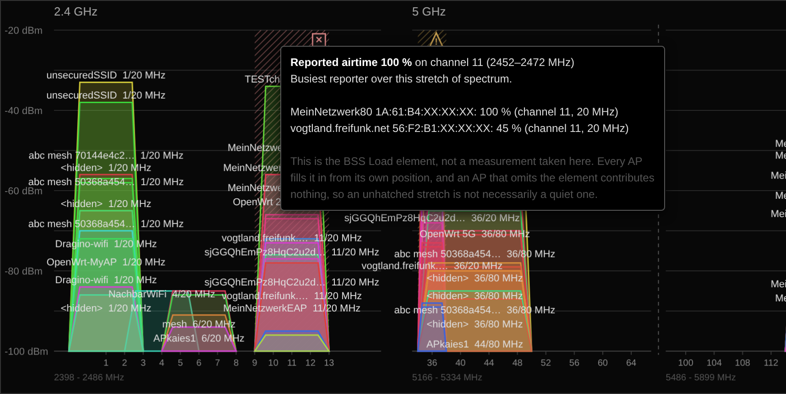

### RSSI spectrum

**RSSI spectrum** plots the receive level per channel, with **max hold**
and a dashed **average** over the selected time range, and below it a
**waterfall** — one column per scanned channel, equal column width, time
running from top to bottom. The range is selectable from 2 minutes to
24 hours. The short ranges come from one row per sweep, as long as
those reach back far enough (about 14 minutes with three channels,
over 3 hours with all of them); the longer ones from one row per
5 seconds, the mean of the sweeps in it, so they reach back the same
time whatever the channel plan. How many hours of those the sensor
keeps is set at boot from the PSRAM free then, 24 at most and 8 at
least.

The difference between the two views is claim versus observation. The
first draws what the beacons *say* about channel occupancy: a 160 MHz
BSS is drawn 160 MHz wide whether or not it ever transmits that wide.
The second shows what the radio *actually received* over time — which
channels carried traffic, how strong it was, and how that changed.

> **This is not a spectrum analyser.** Every RSSI value comes from an
> 802.11 frame the radio decoded; frames that fail the FCS are discarded
> before they are counted. A microwave oven, a video sender or an analog
> camera transmits no 802.11 frames and is therefore **invisible in both
> views** — a channel ruined by one of them shows up as empty, not as
> busy. What such interference does cause is a rise in dropped and
> FCS-failed frames and a fall in the counts of the APs on that channel,
> which is an indirect hint at best.
>
> Raw power regardless of protocol, in 2.4 GHz only, is the
> [802.15.4 energy waterfall](ieee802154.md); a real spectrum from a
> second ESP32-C5 is in the [Outlook](outlook.md).

Resolution is per channel, not per subcarrier: one value per dwell, so
the waterfall is as fine as the channel plan and no finer.

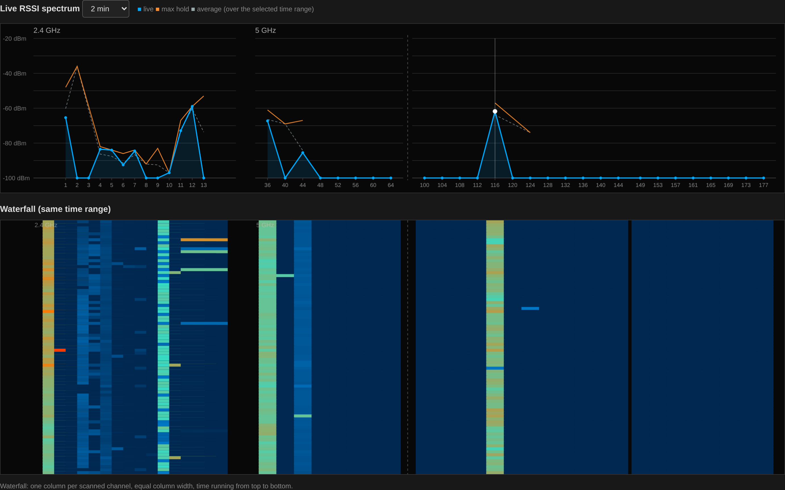

### Stations and IE catalog

**Stations** draws the station graph: which client sits on
which AP, and how much each has been heard.

**IE catalog** collects elements to look at in Wireshark, see
[below](#ie-catalog).

---

## Reading the network table

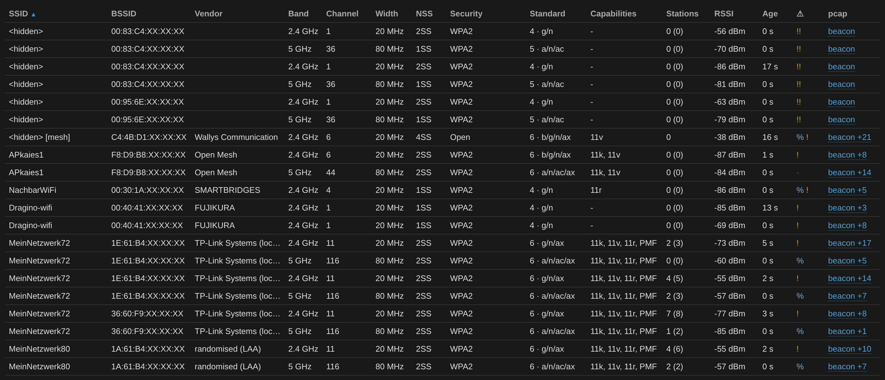

**Order.** The table starts sorted by SSID, BSSIDs of one SSID by
address, so rows stay where they are while RSSI and counters change. A
click on a column head sorts by it (RSSI for instance), a second click
reverses the order.

### Filter and Flush

**The filter** above the graph narrows table and graph alike. Every
word has to match somewhere, and it searches more than the columns:
the tooltip's capabilities, 11k and 11v detail, multi-link, spatial
streams, Tx power envelope, unknown elements and the notes as well. So
`eirp` lists the APs that send a power envelope, `mlo 5ghz` the 5 GHz
links of AP MLDs, `dfs` those on DFS channels, `ch:36 80mhz` what it
says. Matching is by substring and ignores case, word by word:
`pmf required` finds *pmf* in one place and *required* in another, a
note saying "PMF not required" included. Terms of the form key:value
are compared exactly instead: `ch:1` is channel 1, not 11 or 100,
`pmf:required` what it says; `80mhz` and
`wifi6` are spellings the filter adds so that a channel number or a
width does not also hit every MAC address that contains the digits.

The **?** beside the filter lists the terms it adds itself:

| Term | Finds |
|------|-------|
| `ch:36` | channel, exactly |
| `80mhz` | width (`20mhz` … `320mhz`) |
| `2.4ghz` | band, or `5ghz` |
| `wifi6` | standard (`wifi4` … `wifi7`), also `ax` |
| `wpa3` | security as in the table (`open`, `owe`, `wpa2-eap` …) |
| `sae` | AKM (`psk`, `eap`, `owe` …), also in the RSNE Override (2) |
| `ccmp` | cipher (`tkip`, `gcmp-256` …) |
| `pmf:required` | PMF required, or `pmf:capable`, `pmf:off` (`pmf` alone also finds the notes about PMF) |
| `wps` | WPS on |
| `de` | country, two letters |
| `2ss` | spatial streams |
| `mesh` | 802.11s mesh point |
| `ibss` | ad hoc, also `adhoc` |
| `mlo` | multi-link (Wi-Fi 7) |
| `drone` | Remote ID, also `remote id` |
| `changed` | configuration changed (the bell) |
| `fastbeacons` | beacons faster than their interval |
| `probetsf0` | timestamp 0 in every probe response |
| `dtim:3` | DTIM period, exactly |
| `mdid:4a2b` | 802.11r mobility domain, as hostapd or Wireshark has it |
| `ranging` | FTM frames seen with this BSSID |
| `ftm responder` | FTM announced (also `ftm initiator`) |
| `colour change` | BSS colour change announced |
| `broken suite` | cipher suite under a misplaced OUI |
| `basic:1` | a basic rate in Mbit/s, exactly (`basic:none`: none marked) |
| `headunit` | a car's: Car Connectivity Consortium element or CarPlay accessory |
| `camera` | wireless camera kit (Xiongmai/AltoBeam element) |
| `punctured` | Wi-Fi 7 subchannels left out (preamble puncturing) |
| `twt` | Target Wake Time offered or scheduled (`twt schedule`: a broadcast one) |
| `wave2` | Wi-Fi 5 AP with MU-MIMO (Wave 2), `wave1` without |
| `collision` | BSS colour also used by another device on the channel |
| `broadcom chip` | Wi-Fi chip from the vendor elements |
| `ma-m` | BSSID from a small IEEE block, also `ma-s` |

Beyond these, any word of a tooltip line or a note works too: `tkip`,
`evil twin`, `dfs`, a manufacturer or an AP name.

**Flush**, at the right end of the filter row above the graph's top
right corner, empties the network table on the sensor, after asking:
every BSSID with all it learned (beacon counts, first seen, BSS load,
elements) and the 6 GHz list go, and both fill again from what is
heard next — useful after moving the sensor or before a measurement
that should start clean. Otherwise an AP stays until it has been
silent for a minute. The capture buffers, the association history
and the IE catalog stay; they have their own buttons. While a
snapshot is shown, Flush is greyed out: there is no live table to
empty until *Back to live*.

### Columns

**Columns ▾** above every table shows or hides columns; the choice is
kept in this browser, *Default* brings back the original set. The
filter still searches every field. The network, station, BLE and
802.15.4 tables also offer columns that are hidden at first. A column's
width follows its head's right edge when dragged; a double click there,
or *Default widths* in the list, gives it back.

**Standard** shows the Wi-Fi generation and, after a middle dot, every
PHY generation the BSS announces — `6 · b/g/n/ax` rather than just
Wi-Fi 6. An 802.11ax AP on 2.4 GHz normally still carries the DSSS rates
of 802.11b for legacy clients, and whether it does is worth seeing:
those rates cost airtime for everyone on the channel.

The set is derived from the rate elements and the capability elements:

| Mode | Criterion |
|------|-----------|
| b | DSSS/CCK rates 1/2/5.5/11 Mbit/s, channel ≤ 14 |
| g | OFDM rates or the ERP element, channel ≤ 14 |
| a | OFDM rates, channel > 14 |
| n | HT Capabilities (45) |
| ac | VHT Capabilities (191), channel > 14 only |
| ax | HE Capabilities (ext ID 35) |
| be | EHT Capabilities (ext ID 108) |

**NSS** is the number of spatial streams the AP can receive, the
highest of what its HT, VHT, HE and EHT capabilities say: the HT Rx MCS
bitmask, the VHT and HE Rx MCS maps (VHT only on 5 GHz, where it is
802.11ac rather than a vendor extension) and the Rx max NSS of the EHT
MCS and NSS set. It is the same reading the
station tables use, so an AP and its clients can be compared directly —
a 4SS AP with 2SS clients will never see more than two streams in use.
`-` means none of the elements was there, which is the case for
802.11a/b/g-only BSSs.

**Capabilities** lists what a client would act on: `11k`, `11v`, `11r`,
`PMF` or `PMF req`, `HS2.0`, `Pre-Auth`, `OWE-TM`, `WPS`, `MBSSID`,
`MLO`, and first `Ad-hoc` for an IBSS.

**Vendor** comes from the OUI of the BSSID. APs often derive further
BSSIDs from their base MAC by setting the locally administered bit, so
for such a BSSID the vendor is taken from the AP's MLD address, or else
from the OUI with that bit cleared and shown with `(local)`; only
without either is it `randomised (LAA)`. A locally administered
station address is taken as random.

**The notes column**, between Age and pcap, carries the anomaly hints,
see [Anomaly hints](#anomaly-hints).

### Tooltip

**With a mouse** the tooltip follows the pointer. A click on a table row
pins it where it is, outlined in blue: it then takes the mouse, so its
links (a drone's map link, the maker, a pcap) can be clicked and its
text selected, it scrolls, and it stays while the pointer moves on,
until its ✕, Escape or a click outside it. The tooltip says so at its
foot. A click on a link in the row itself does not pin.

**On a phone** a tap on a row or a shape opens its tooltip; a tap
anywhere else, or on the ✕ in its corner, closes it. The tooltip stays
on screen at any page width; one taller than the screen scrolls inside.
It stays put while the tables are drawn anew underneath, live or in a
snapshot: the mouse events a phone browser keeps sending where the
finger was are ignored once the tap is over.

**The Graphs tab.** A pinned tooltip (or a phone's) has two tabs,
*Details* and *Graphs*; the tooltip under the mouse shows them
already, Graphs dashed, and it works once the row is clicked.

- **What it records.** Only opening the Graphs tab makes the sensor
  record anything: every 5 s the RSSI of the BSS's beacons and probe
  responses (average, and the band from lowest to highest), the channel
  utilisation and stations of its BSS Load element, and the stations
  the sensor itself sees on it, up to 24 hours in a ring. The curves
  start with what the tooltip said when the tab opened; the page
  fetches what came since every 5 s.
- **When it stops.** Back to Details, the ✕ or another tooltip stops
  it, and a sensor nobody asks stops after 3 min (a closed browser,
  say); a background tab polls about once a minute and keeps it. Should
  the sensor have dropped it anyway, or restarted, the tab starts anew
  and says which.
- **Keep recording without this tab** makes the sensor go on alone: the
  tab and the browser can close, and after a restart the sensor begins
  again (the samples start anew, they live in RAM). Such a BSS has a
  small chart symbol beside its notes in the network table; Settings →
  Capture, *Graphs recorded*, lists every recording with *CSV* (one line
  per 5 s step) and *stop*.
- **Limits.** Up to four BSSs are recorded at once, from any number of
  browsers. While the sweep is on other channels a step has no beacon:
  the curves break there, and the tab says how many such steps there
  were; for whole curves use *scan only channel* in the BSS's tooltip
  in the graph. A snapshot has no graphs.

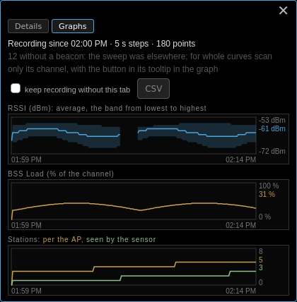

**The Beacons tab**, beside it with firmware that keeps beacon versions
([Capture](capture.md)), lists them newest first: when each was first
heard, whether it became the current one again, and what changed from
the one before, element by element: `+` added, `−` gone, `~` changed,
with the octets of both. What changes with every beacon is left out, as
on the sensor; *pcap* downloads exactly these beacons for Wireshark.

### Tooltip sections

The tooltip is laid out in sections, each with a dim heading and
label / value rows; a section without anything to say is left out, so
a plain Wi-Fi 4 BSS stays short. Under the SSID come BSSID and
vendor (from a small IEEE block with the block after it, *Flextronics
Computin · MA-M F8:2B:E6:2*), RSSI and age, then the AP's own name
when it sends one (Cisco's element 133, which LANCOM and others use
too, MikroTik's radio name, which DD-WRT sends as well, the name
in Mist's vendor element, or in LANCOM's, with the UUID set on
the device under it) and its firmware version.

Top right, under *BEST GUESS*, stand the manufacturer of the device,
its Wi-Fi chip and its type, as far as the elements give them away;
routers are left out:

| Device shown | Recognised from |
|--------------|-----------------|
| Manufacturer, Chip | the vendor elements, see [Maker from the vendor elements](#maker-from-the-vendor-elements) |
| *Device: Vehicle* | an AP in a vehicle; also Interworking venue group 10 |
| *Device: Printer* | HP's element |
| *Device: Drone* | Remote ID |
| *Device: TV*, printer, set-top box, game console … | the device type from WPS or Wi-Fi Direct |
| display | a Miracast sink without a device type, or with only *computer, unknown* |
| *Device: Car (head unit, Mercedes MBUX)*, BMW, Audi MMI, Ford SYNC, *My Škoda*, *My VW*, *My SEAT*, *My Fiat* | a car's head unit by its name; a Toyota's *Smartphone_connect_* from Panasonic Automotive's OUI, a Mazda's *Mazda_…_SPL* with its own BSSID in the name, *Magneti Marelli* by its OUI alone, whatever the owner named it |
| car maker as manufacturer, *Porsche · HARMAN*, *Fiat · Marelli* | when nothing else names one: the brand in the model field of Apple's Device IE, alone or as its first word, before the supplier naming itself |
| *Module: AUMOVIO (telematics)*, Visteon, Panasonic Automotive, Magneti Marelli | on a vehicle, a module made for cars, by the BSSID |
| *Vehicle (aftermarket head unit)* | an `AndroidAP_` calling itself a bus |
| chip *Arkmicro* | a CarPlay dongle: its SoC maker |
| *wireless CarPlay adapter, Magic AutoBox* | a box retrofitted for wireless CarPlay, by the model in Apple's Device IE |
| *wireless Android Auto* | an `AndroidAuto_` on a vehicle or from Alps Alpine's OUI |
| with wireless CarPlay, *Vehicle (wireless CarPlay)* | a car or Wi-Fi Direct carrying Apple's Device IE |
| Xbox, Microsoft as maker | the link to its controllers |
| Nintendo | its own suites |

A maker named by a vendor element goes by one short name for all its
OUIs, *TP-Link*, *Samsung*, *HUAWEI*, where the IEEE registry spells it
in several ways or cuts it off after 20 characters; the Vendor column
keeps the registry's name. Then:

| Section | Holds |
|---------|-------|
| REMOTE ID | only for a drone: status, height, altitudes, speed and heading, map links to drone and pilot, EU class, self-ID text, age of the report |
| RADIO | channel, width, occupied range, the centre if it is not the channel itself, standard with the announced generations and spatial streams and what the capabilities say beyond them, TWT, basic rates, ad-hoc (IBSS) with its ATIM window, NAN (master preference, anchor master and hops), QoS Management (DSCP policy, SCS traffic description: a client asks for priority for one of its flows such as a call, from the Wi-Fi Alliance Capabilities element), the BSS colour and announced switches, Multiple BSSID, the 6 GHz BSSs it announces (channel, width, BSSID, co-located, SSID), the vendor elements (OUI, types, owner; one line per OUI unless a type has a name of its own), the Apple accessory (manufacturer, model, name), the operating mode (width and streams in use), Wi-Fi Direct (group owner, persistent group, cross connection, device name) and Miracast, an HP printer's model, a wireless camera kit's status; see [Radio](#radio) |
| SECURITY | security, AKM, ciphers, PMF and, on the same line, WPS with the device name, manufacturer and model it announces; the config methods and AP Setup Locked are kept from the probe responses, a beacon without them does not clear them; pre-authentication, Hotspot 2.0, beacon protection; the RSNE/RSNXE Override, i.e. the security offered to Wi-Fi 7 clients beside the RSN element for all others; Interworking (access network type, Internet, venue, HESSID) and the Advertisement Protocol (ANQP …); the OWE transition partner |
| MESH | peerings and path selection of an 802.11s mesh BSS |
| ROAMING | the 11k, 11v and 11r detail (with the mobility domain), MBO-OCE (cellular data aware, OCE, channels to avoid), the measurement pilot interval |
| FTM | Fine Timing Measurement seen with this BSSID as the responder, see below |
| MULTI-LINK | the AP MLD, its links, EML and MLD capabilities |
| POWER | country, Tx power envelope, power constraint, TPC report, Quiet intervals |
| LOAD | stations observed, BSS load, beacon interval, the DTIM period with buffered group traffic and the stations with frames waiting (TIM), the beacon gaps, extended BSS load, available admission capacity, BSS Max Idle Period, ERP |
| TIME | the AP's uptime from the beacon timestamp and when that last went back, the AP's clock from its Time Advertisement, its time zone |
| CHANGES | the configuration changes, eight per BSS, the old value struck through, and AP restarts with how long it had been up, see [Configuration changes and the bell](#configuration-changes-and-the-bell) |
| CAPTURE | beacons heard, how long the BSS is known, what is in the capture buffer |
| NOTES | the coloured hints, always last |

#### Remote ID

**Drones** that broadcast Remote ID over Wi-Fi (ASTM F3411, the
vendor element `FA:0B:BC` type 13 in their beacons, an SSID like
`RID-…`) are required by law to send it for anyone to read, the
pilot's position included. The sensor decodes the message pack:
aircraft type, status, position, altitudes (GNSS and barometric),
height above takeoff or ground, speed, heading and climb rate, the
pilot's position and altitude, the EU class and the self-ID text.
Of the serial number only the manufacturer code is kept (1581 is
DJI); the serial itself and the operator ID are not read. The
positions each have a [map] link to OpenStreetMap, marked with the
external-link icon. An emergency reported by the drone is a red note;
`drone` or `remote id` in the filter finds them.

#### Maker from the vendor elements

Many drivers add vendor specific elements (221) of their own to every
beacon, and the OUI in them tells whose they are. Only the elements
count: the vendor of the BSSID already stands beside the address and is
not repeated. These OUIs belong to the chip maker and show as *Chip*:

| OUI | Chip |
|-----|------|
| `00:90:4C` (Epigram), `00:10:18` | Broadcom |
| `8C:FD:F0`, `00:03:7F` (Atheros) | Qualcomm |
| `00:0C:43`, `00:0C:E7` | MediaTek |
| `00:E0:4C` | Realtek |
| `00:26:86` | Quantenna |
| `00:09:86` (Metalink) | MaxLinear/Lantiq |
| `00:50:43` | Marvell |
| `18:FE:34` | Espressif |
| `00:1C:51` | Celeno |
| `40:45:DA` | Unisoc (Spreadtrum) |
| `00:02:5B` | CSR (Qualcomm) |

- Any other OUI names the device maker, AVM or Ubiquiti for instance.
- A few OUIs came with a takeover and are shown under today's name:
  `00:0B:86` Aruba (HPE), `00:19:77` Aerohive (Extreme), `00:A0:F8`
  Extreme WiNG, `14:22:DB` eero (Amazon), `00:0F:7D` Xirrus (Cambium).
  DJI sends under `44:32:44`, ASCII "D2D", which has no registry entry.
- MikroTik (`00:0C:42`) counts only when the BSSID is MikroTik's too,
  DD-WRT sends that element as well. NeXT's `00:00:0F` and LVL7's
  `00:02:BC` (software, not the device) give no maker.
- Left out: the elements everybody sends, from Microsoft (WPA, WMM,
  WPS), the Wi-Fi Alliance and the IEEE; Broadcom's 256-QAM-in-2.4-GHz
  element (Epigram type 4) and its pre-802.11n HT elements, which other
  chips copy so that Broadcom clients understand them.
- Apple's Device IE (`00:A0:40` type 0) does not name the maker either:
  it is sent by accessories made for Apple devices, car head units with
  wireless CarPlay for instance. Its own fields are decoded instead —
  name, manufacturer and model, e.g. `My SEAT 4624`, `SEAT`, `SE3821` —
  and the manufacturer field shows top right as *Manufacturer: SEAT*.

Up to six vendor elements are kept per BSS, collected over beacons and
probe responses. An AP that sends none of its own shows nothing there;
the BSSID's OUI under the SSID is then all there is.

An AP whose Interworking element (107) gives venue group 10 shows
*Device: Vehicle* there as well. The venue type, such as *Bus* or
*Train*, is in the SECURITY section only: not every AP sets it, and
what is set is not always right.

#### Radio

**Standard row.** Beyond streams and width it adds, for a Wi-Fi 5 AP,
what VHT Capabilities say (256-QAM or not, MU-MIMO for Wave 2 or none
for Wave 1, then SU beamformer); for Wi-Fi 6 what HE Capabilities say
(1024-QAM, UL MU-MIMO, MU or SU beamformer, DCM) and a co-hosted BSS of
a Multiple BSSID group; for Wi-Fi 7 what EHT Capabilities say beyond
the streams: 4096-QAM, 320 MHz (6 GHz), restricted TWT, EPCS priority
access, SCS traffic description (left to the QoS Mgmt row when the
Wi-Fi Alliance element says it too).

**TWT row.** Target Wake Time from HE Capabilities (responder,
requester, broadcast, required by the AP per HE Operation) and the
broadcast schedules of the TWT element, every so many ms for so many,
restricted TWT for low latency.

**Basic rates** are listed in full, not just the lowest one. Every
station has to support all of them to associate, and the lowest is
what beacons and management frames are sent at — so a BSS still
carrying 1 and 2 Mbit/s occupies the channel far longer per frame than
one starting at 6. The anomaly hint only fires at 2 Mbit/s and below;
the list shows what the whole set looks like.

<a id="bss-colour"></a>**BSS colour** comes from HE Operation. It lets
stations tell their own BSS's frames from others' on the channel and
so allows spatial reuse. An 802.11ax AP switches its colour when it
notices another BSS on the channel using the same one (a collision,
an amber note), and announces the new colour over a few beacons (BSS
Color Change Announcement); the tooltip shows the switch and how many
were seen, two or more are a blue note. Colour 0 is no colour: the
tooltip shows *0 (none)*, spatial reuse stays off, a blue note says
so, and it is never a collision.

**Ad-hoc networks (IBSS)** have no access point: their stations take
turns sending the beacon, all with the same BSSID, and the capability
field says IBSS instead of ESS. In practice they are mostly the setup
mode of a device such as a printer, older displays and cameras, or
mesh nodes that run batman-adv over ad-hoc. The tooltip's *Ad-hoc*
line adds the ATIM window from the IBSS Parameter Set (element 6): how
long the stations stay awake after a beacon to announce buffered
frames, 0 when none of them sleeps. The filter finds them with `ibss`
or `adhoc`.

**NAN clusters.** Beacons of NAN (Wi-Fi Aware) clusters, sent from a
cluster ID `50:6F:9A:01:xx:xx` by phones for Nearby Share and the like,
are listed as *NAN cluster (Wi-Fi Aware)* instead of a hidden network.
Their tooltip has a NAN line from the NAN element: the sender's master
preference and random factor, and how many hops away the cluster's
anchor master is (*is the anchor master* when it is the sender itself).

**Not an access point.** A device that beacons without being an AP, an
Xbox's link to its controllers or a Wi-Fi Direct device waiting to be
found (SSID `DIRECT-`, not yet a group), shows *Wi-Fi Direct* or *Xbox
Wireless* as its security instead of WEP and gets a blue *Not an
access point* note in place of the notes about an AP's hidden SSID,
basic rates, Country element and old standard.

#### Roaming: 11k and 11v

`11k` and `11v` in the table only say that the elements are there. The
ROAMING section spells out what is behind them:

- **11k** — the bits of the RM Enabled Capabilities
  element (70): link measurement, neighbor report, beacon passive,
  active and table mode, channel load, noise histogram, statistics,
  LCI, RCPI, RSNI and the rest of 802.11-2020 table 9-191. Beacon
  report support is what an AP or controller needs to ask a client
  which APs it hears, and neighbor report is what lets the client ask
  the AP in return.
- **11v** — the WNM features picked from Extended Capabilities (127): BSS
  transition management, WNM sleep, TIM broadcast, proxy ARP, FMS, TFS,
  DMS, WNM notification, plus FTM responder and initiator. BSS
  transition management is the one that matters for steering: without
  it, an AP cannot ask a client to move. It is not to be confused with
  beacon table measurement, which is a beacon report mode in the 11k
  line.
- **11r** — the Mobility Domain ID and whether FT also goes over the
  DS. The ID is a field of two octets: Wireshark reads them as a number,
  0x2B4A, hostapd's `mobility_domain` takes them in the order sent,
  `4a2b`; the tooltip gives both, the filter finds a domain by either,
  `mdid:4a2b` or `mdid:2b4a`.

The same lines appear in the station tooltip, read from the client's
requests.

#### Fine Timing Measurement

A station measures its distance to an AP (802.11mc) from the time FTM
frames take, for positioning indoors (Wi-Fi RTT on Android). FTM
responder and initiator in the 11v line only say that a device can;
the FTM section appears once the sensor has seen the frames themselves,
Public Action frames sent to and from the BSSID: the requests and the
stations ranging, the FTM frames the AP sent, the parameters it granted
(frames per burst, bursts, period, ASAP, format and bandwidth), and the
position (LCI: latitude, longitude, altitude or floor) and address
(Location Civic) it gives a station that asks for them; both have a
[map] link to OpenStreetMap, the address searched by street, city and
country. That is what was configured on the AP, and any station can ask
for it, which a blue note points out. The station tooltip has the same
from the other side: which responders it ranges with, how often,
whether it asked for position or address. `ranging` in the filter
finds BSSs and stations with FTM frames seen, `ftm responder` those
that only announce it. (Decoded from the standard, not yet from frames
of a real responder.)

The ESP32-C5 receives 20 MHz frames only, so it sees part of the
ranging at most. Ranging likes 80 MHz or more, as a wider channel
times more precisely: the FTM frames of a burst go out in the format
and bandwidth agreed, 80 MHz VHT for instance, and 802.11az and
802.11bk (up to 320 MHz) measure with wide frames anyway. The sensor
sees the requests and whatever is sent in 20 MHz and misses the rest.
Position and address come in the AP's FTM frames, so LCI and Location
Civic may well never be captured at all.

#### Multi-link (Wi-Fi 7)

An 802.11be AP can run several links — 2.4, 5 and 6 GHz — as one
logical device, the AP MLD. Each link has its own BSSID; an MLD address
ties them together. The AP announces this in the Basic Multi-Link
element (255/107) of every beacon, and `MLO` in the Capabilities column
marks it. The tooltip shows the detail, here for the 5 GHz link of an
OpenWrt AP MLD with links on 2.4, 5 and 6 GHz:

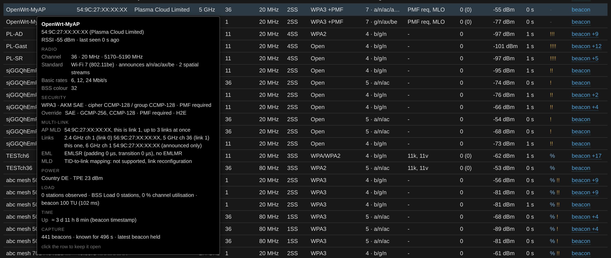

- **MLD links** are all BSSIDs heard with the same MLD address, sorted
  by link ID, plus 6 GHz BSSs one of them announces under the same SSID
  in its Reduced Neighbor Report, marked *announced only*: see
  [6 GHz](sweep.md#6-ghz).
- **Up to n links at once** is the Maximum Number Of Simultaneous Links
  field plus one; the field counts one less.
- **EML** is the enhanced multi-link mode: EMLSR (one radio listening on
  several links and switching to one for the exchange) with padding and
  transition delay, EMLMR (several radios) with its delay, and the
  transition timeout.
- **MLD** lists TID-to-link mapping negotiation (not supported, all TIDs
  to one link set, or per TID), SRS, AAR, link reconfiguration and
  aligned TWT.

An AP removing a link sends a Reconfiguration Multi-Link element beside
the Basic one, a blue note. The station side is under
[Stations](stations.md#multi-link-stations).

#### Power

The POWER section keeps the figures on one line as long as they need
no reading: `Country DE · TPE 23 dBm · power constraint 3 dB ·
TPC 12 dBm`. The power constraint (element 32) is how many dB the AP
keeps below the limit of its Country element; the TPC report
(element 35) is the power the beacon actually went out with, the most
direct sign of what the AP is set to.

**Tx power envelope** is the Transmit Power Envelope element (195): the
highest power the AP allows on its channel, and with it the limit its
clients are held to. It comes in four kinds — local or
regulatory-client limit, each either as EIRP per channel width (20, 40,
80, 160, 320 MHz) or as PSD per 20 MHz subchannel, the form 6 GHz uses.
An AP can send more than one. A plain EIRP that is the same for every
width and at least 18 dBm is shown as `TPE 23 dBm` on that line;
anything else gets an Envelope row of its own, up to two:

```
Envelope   local EIRP 20 MHz 23 dBm, 40 MHz 20 dBm, 80 MHz 17 dBm
Envelope   regulatory client PSD 11 dBm/MHz on all 4 subchannels
```

A PSD subchannel the AP forbids is shown as `off`, one without a limit
as `no limit`. Category 1, which addresses subordinate devices in
6 GHz, is marked as such. An envelope or a TPC report below 18 dBm is
an amber note.

#### Load

**The station count comes twice.** One figure is what the AP reports in
its BSS Load element, the other is how many stations this sensor has
actually seen frames from on that BSS. They answer different questions
and routinely disagree: the AP knows all of its clients, the sensor only
those within its own range and only on the channels it visits, so its
number is normally the lower one. An AP that reports no BSS Load at all
leaves only the observed count.

**Extended BSS Load** (element 193, from VHT on) adds to the BSS load
line: MU-MIMO capable stations, how often spatial streams go unused and
how busy the secondary 20, 40 and 80 MHz channels were — the part of a
wide channel the primary-channel utilisation does not see, and what
the [airtime hatch](#reported-airtime-hatch) draws. Secondary channels
are listed only as far as the BSS is wide. Many APs send the element
with every field zero; then the row is left out.

**ERP** (element 42, 2.4 GHz) gets a row once it says more than
"802.11g": `802.11b station present`, `protection on`, `long preamble`.
Either of the first two is an amber note. Broadcom APs send the same
content a second time as element 47, the number from the 802.11g
draft; that one is passed over.

#### Time

**Up** is the beacon timestamp: the AP's microsecond timer, which runs
from when the BSS started, normally when the AP booted. When it goes
back, the AP or at least its radio restarted; in the last hour that is
a blue note. Some APs start the timer elsewhere; beyond three years it
is not taken for an uptime.

The AP's clock comes from its Time Advertisement (element 69), with how
far it is from the sensor's, `+15 s against the sensor`, plus the POSIX
time zone of element 98 (`CET-1CEST,M3.5.0,M10.5.0/3`). A sensor
without NTP or a browser sets its own clock from these, see
[Installation](install.md). Some APs send the time zone only in probe
responses; the last one heard is kept.

#### Security

Security covers WEP, WPA, WPA2, WPA3, OWE and OSEN. OSEN is the
Hotspot 2.0 onboarding network, carried in a WFA vendor element rather
than in RSN.

**Enhanced Open** is deployed as a pair of BSSs: an open one that legacy
clients can still use, and an OWE one that does not broadcast its name.
Each beacon names its partner in the OWE Transition element, so the
hidden half can be shown under its real name — which is the only way to
learn it. That source comes from a beacon of the same AP rather than
from station traffic, so it outranks a probe-derived guess and is
labelled separately in the tooltip.

---

## IE catalog

The pink `?` in the notes column of the network table marks elements
the firmware does not know yet (see [Anomaly hints](#anomaly-hints)).
Those marks belong to the networks the table holds, and a network
leaves the table some time after it was last heard, its marks with it.
To find out what the firmware still misses out in the field, the
**IE catalog** view keeps a catalog across reboots. Switch on
*Record, kept across reboots*, put the sensor in a backpack with a
power bank and walk or drive around; it needs no network. Fast sweep
over all channels is the setting to use, beacons are only heard on the
channel being swept, probe requests of stations on any.

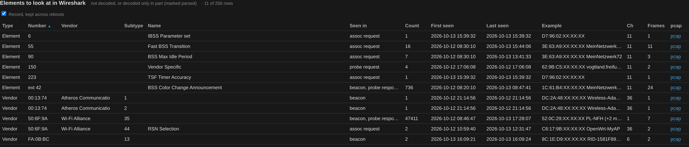

Every beacon, probe response, probe request and (re)association request
is searched for

- elements the firmware does not know (the same list the pink marks
  use),
- vendor specific elements it neither decodes nor has gone through
  yet (see *What this sensor reads* below),
- AKM and cipher suites it has no name for, in RSN and WPA elements.

Such a frame with the Protected bit set is skipped, here and in the
network table: these frames are never encrypted, so one with the bit is
something else in their shape (a ZTE device sends "beacons" of
ciphertext), and its bytes would read as elements of random numbers.

Each finding is one row: type; number (element number, `ext 12` for
an extension, the OUI for vendor elements and suites); the OUI's
owner; subtype (vendor type or suite number); its Wireshark name where
known, e.g. `RSNE Override` for `50:6F:9A` type 41; the frame types it
came in, a counter, first and last sighting, one example — sender and
SSID —, the channel it was heard on and the number of stored frames.
The element's bytes are in the pcap. Up to 256 rows. A click on a
column head sorts by it, a second click reverses the order, as in the
other tables. The default is by element number; *First seen* puts what
turned up last on top. The choice is kept in the browser.

Below the table, *What this sensor reads* (closed at first) lists the
other side: the elements decoded and shown, those decoded only in part
and therefore still catalogued, those recognised but deliberately not
shown (Power Capability, QoS Capability …), the vendor elements decoded, the vendor
elements gone through by hand whose content is not shown, and the AKM
and cipher suites that have a name. A vendor element is listed by OUI
and type with its name, or, where no name is published, as
proprietary to the maker of the OUI (*Apple proprietary*): a new type
of a known OUI, or a new OUI, still goes into the catalog. The OUI of
every vendor element names maker or chip under *BEST GUESS* either way.
The firmware sends these lists with the catalog, so they always match
the firmware running.

The first three frames of each sender carrying a finding go into a
pcap file of up to 1 MB, for up to ten senders per row, so a second
or third device with the same element brings samples of its own; the
*Example* column says how many more senders there were. The pcap link
at the end of a row downloads every stored frame that carries that
element; *Download all frames* gets the whole file. Worth opening in
Wireshark before writing a parser.

A frame is not catalogued past a known element with a length the
standard does not allow (element 72 with 8 octets instead of 1, say),
or past a second SSID element: what follows is the device's own use of
the numbers, or zeros.

After a firmware update, the first start removes the rows of what is
decoded now, with the frames stored only for them; the event log says
how much went. This cannot be undone, so *Download all frames* first
if the old frames matter.

New rows are saved within five seconds, counters every five minutes,
so a power cut costs at most the last counts. Times are real once the
sensor has a clock — NTP, the browser, or an AP's Time Advertisement;
before that a time is shown as `boot 3, +2 min 10 s`. The boot counter
is kept in NVS; the settings page shows the current boot under Sensor
and the catalog state under Capture.

## Anomaly hints

Everything notable about a BSS lives in the tooltip rather than in a
column of its own, with the notes column between Age and pcap carrying
the count: `?` pink, `%` blue, `!` amber, `✕` red, always in that order,
repeated per finding and capped at four with a `+`. The column sorts by
weight, one red above any number of amber, one amber above any number of
blue, one blue above any number of pink. In the tooltip the notes come in the same
order: red first, then amber, blue, and pink last. A configuration
change adds a `Δ`, see [Configuration changes and the
bell](#configuration-changes-and-the-bell).

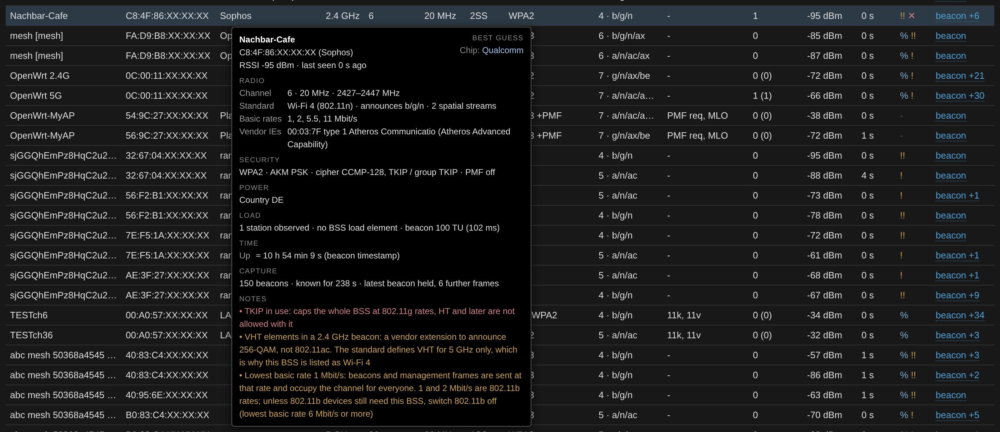

**Blue — state of the air**

- position or address given in FTM frames, see
  [Fine Timing Measurement](#fine-timing-measurement)
- a multi-link AP removing a link (Reconfiguration Multi-Link element),
  with the beacons left and about how long that is; the bell notes the
  announcement, not the countdown
- part of the channel left out (preamble puncturing): the 20 MHz
  subchannels a Wi-Fi 7 BSS does not use, after radar on a DFS
  channel, interference there, or dynamically while other BSSs load
  that subchannel; `punctured` in the filter
- a wireless camera kit (an AltoBeam chip, a Xiongmai recorder; its
  element under the unregistered OUI 30:FF:83): a camera's link to
  its recorder, "signal 63", or the recorder's model and whether it
  takes new cameras; the RADIO section has it as *Camera kit*, the
  filter finds them with `camera`
- Channel Switch Announcement, with target channel and beacons
  remaining, the width after it (Wide Bandwidth Channel Switch, alone or
  in the Channel Switch Wrapper), a new country and, from the Max
  Channel Switch Time, how long the AP is off the air at most
  (*97 TU (99 ms)* from a Ruckus AP moving from 1 to 6). Mode 1, the stations
  stop sending until the switch, points to radar; the same width and
  centre as now only move the primary channel, the AP's own choice. An
  AP sends it only in the last few beacons before it moves, so it is
  easy to miss
- DFS channel under ETSI rules
- BSS colour 0 (no colour), see [BSS colour](#bss-colour)
- BSS colour switched more than once: another BSS on the channel keeps picking the same colour
- AP restarted in the last hour (beacon timestamp went back)
- not an access point, see [Radio](#radio)
- channel utilisation at or above 60 %
- a Country element other than the one more than half of the networks
  in range announce (at least five with a Country element): an AP set
  up for another regulatory domain, bought abroad or left at a
  default; its clients take that domain's channels and power limits
- the same SSID with other security on another BSSID of the same
  device (FRITZ!Boxes: WPA2 in 2.4 GHz, WPA2/WPA3 in 5 GHz): a client
  changing band changes between PSK and SAE and logs in anew; not
  where the multi-link split note already says so
- several Country elements from one device (DE on its 2.4 GHz radio, US
  on 5 GHz): implausible, one radio has its region set wrong. Another
  country on other devices of the same SSID is the amber note below
- a WPA element without an AKM (00-50-F2-00) beside an SAE RSN
  element: no station can log in over it, so it does not turn the
  network into WPA2/WPA3 either; the filter finds *wpa element without
  akm*

**Pink — not understood by this sensor**

- an element the firmware does not know (the
  [catalog](#ie-catalog) keeps them across reboots),
  named by Wireshark's element
  table, with the frame types it came in — an AP may send one only in
  its probe responses and not in its beacons:
  `Unknown element 68 BSS AC Access Delay (probe response)`

The firmware keeps a list of the elements it decodes and of those it
deliberately passes over (power capability, MU EDCA, the CF
Parameter Set of old Linksys APs, the empty Neighbor Report some
FRITZ!Boxes put into probe responses and the like); anything else is recorded, up to six per BSS. The note follows the
catalog's rules for broken frames: nothing after an element of a
length the standard does not allow or after a second SSID. A beacon
or probe response like that is broken past the FCS check and not
read at all, so it leaves no note the catalog has no row for, nor a
change of configuration (a PAX9500 once sent an "element 24" with
garbage for its ciphers). A station's frames are still read, some
devices put content of their own under standard numbers. Vendor specific
elements are proprietary by definition and not counted. A pink mark is
not a fault of the AP — it means the sensor has met something it cannot
show yet, and the frame is worth a look in Wireshark and worth reporting.
Stations get the same pink lines in their tooltip, read from their
probe and association requests.

**Amber — odd but harmless**

*Security*

- Wi-Fi 7 without SAE-EXT-KEY, GCMP-256 or beacon protection, on a
  PSK or SAE network: Wi-Fi 7 asks for WPA3 with all three, and many
  Wi-Fi 7 clients connect as Wi-Fi 6 on one link without them, no
  multi-link. The RSNE Override and Override 2 count, together, it is
  where many APs offer them; OpenWrt puts SAE-EXT-KEY into Override 2
  for multi-link
- hidden SSID: it protects nothing, every client that joins sends the
  name in clear and keeps probing for it wherever it goes (not for a
  mesh, a NAN cluster or the hidden OWE half of a transition pair)
- WPS present, with the config methods it offers
- WPA3 transition mode
- pre-authentication announced without an 802.1X AKM: it runs 802.1X
  ahead of a roam, so with PSK or SAE alone it does nothing
- a cipher or AKM suite under an OUI that does not belong in its
  element (00-00-00-00 anywhere, 00-0F-AC in the WPA element,
  00-50-F2 in the RSN element): a firmware fault of the AP, seen in
  the WPA element of cable routers; the filter finds *broken suite*
- an open network without OWE: everything in clear; the note advises
  OWE (Enhanced Open), with an open transition network beside it for
  older clients if need be. Not for the open half of an OWE pair or a
  mesh
- a Wi-Fi Direct group bridged to the infrastructure network (cross
  connection)

*Radio and PHY*

- BSS colour collision: another device's BSS on the same channel uses
  the same colour (BSSs of one device and colour 0 do not count), see
  [BSS colour](#bss-colour); `collision` in the filter, the bell has a
  switch as *BSS colour*

  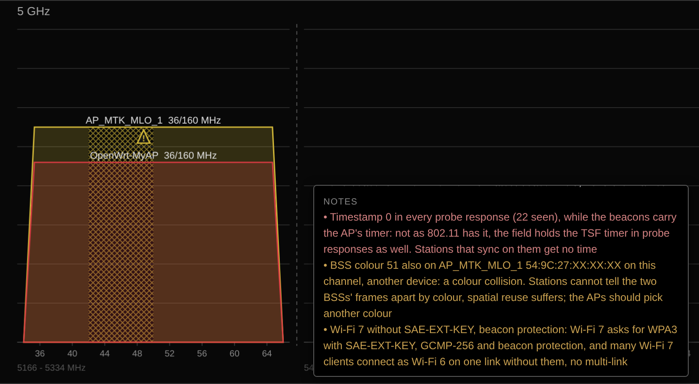

- 40 MHz in 2.4 GHz
- VHT elements in a 2.4 GHz beacon (a vendor extension for 256-QAM, not
  802.11ac), or the same wrapped in Broadcom's vendor element (00:90:4C
  type 4); in a Wi-Fi 6 BSS only for older Broadcom clients, HE brings
  256-QAM in 2.4 GHz anyway
- HT Greenfield announced
- 40 MHz Intolerant
- a 2.4 GHz channel in neither 1, 6, 11 nor 1, 5, 9, 13 (2, 3, 4, 7,
  8, 10, 12): it overlaps the networks on both sides, which cannot
  share the airtime with it
- Multiple BSSID element
- beacon interval other than 100 TU
- no Country element
- DTIM period above 3: broadcast and multicast wait that many beacon
  intervals for stations in power save, so ARP, mDNS and the like answer
  late; the filter finds a period with `dtim:3`, `dtim:10` …
- beacons faster than their interval: of at least ten gaps between two
  beacons heard back to back on the BSS's own channel, more than a fifth
  under half an interval. A late beacon makes the next one early, but
  hardly ever that early; many such gaps mean a second sender under the
  BSSID, a cloned address or software sending beacons of its own beside
  the AP (an ESP32 using `esp_wifi_80211_tx()` beside its SoftAP).
  LOAD then shows the gaps and the shortest, the filter finds them with
  `fastbeacons`
- Tx power envelope below 18 dBm EIRP at 20 MHz: it binds the clients,
  and usually the AP runs at reduced power as well; an AP that lowers
  only its own power and leaves the envelope alone does not show up
  here. See [Power](#power)
- TPC report below 18 dBm, see [Power](#power)
- admission control required (WMM ACM bit) for a class: clients
  without ADDTS fall back to a lower class there
- multi-link split: one device (BSSIDs alike but for the locally
  administered bit, or within a block of sixteen) runs several bands,
  each as an AP MLD of its own with a single link, where one AP MLD
  with a link per band was meant. The links of one AP MLD share SSID
  and security, so separate names per band, or WPA2 on one band and
  WPA3 on another, keep them apart; the note says which of the two it
  is. Clients then get no multi-link across the bands. Only for MLDs
  that each name themselves link 0 and sit on different bands: a guest
  network beside the main one on the same radio is an MLD of its own
  by design, and a link 1 has a link 0 somewhere that is just not
  heard. A lone AP MLD with one link is not flagged either, its other
  link may be on a channel that is not swept.

*Rates and legacy*

- lowest basic rate at or below 2 Mbit/s: 802.11b rates, with the
  advice to switch 802.11b off unless 802.11b devices still need it
- no rate marked basic: the BSS requires nothing of its clients,
  control frames fall back to the PHY's mandatory rates and the AP
  picks the beacon rate itself
- ERP protection on: OFDM frames go out behind RTS/CTS or CTS-to-self,
  for an 802.11b station of the AP's own or one in an overlapping BSS
- 802.11b station associated (ERP Non-ERP Present) without protection:
  its DSSS frames at 1 to 11 Mbit/s still take a lot of airtime
- no 802.11n (802.11b, a or g alone): old rates that take more airtime
  from everyone; the note advises replacing the device

*Consistency across an SSID*

- compared with the other BSSs of its SSID on other devices (two of
  them at least, two thirds agreeing): PMF not required where they
  require it, the Country element missing or other than theirs, or
  another mobility domain than theirs with 802.11r — fast transition
  works within one domain only, so a station roaming between them logs
  in anew (see [Roaming](#roaming-11k-and-11v))

**Red — worth fixing**

- timestamp 0 in every probe response, at least three and none with a
  time, while the beacons carry the AP's timer: 802.11 has the TSF
  timer in that field in probe responses as well, and some OpenWrt APs
  leave it empty. Such a 0 is no restart and no uptime; the filter
  finds them with `probetsf0`
- two devices sending as one BSSID: every device has its own beacon
  timer, and copying a MAC address does not copy it. The sensor keeps
  the offset between the timer in a frame and the time it heard it;
  a second offset, more than a second off the first and alternating
  with it, at least four times and
  each seen three times, is a second device: a cloned MAC address, an
  evil twin, or two APs set to the same BSSID. A restart switches to a
  new timer once and is no twin, and a device sending extra beacons of
  its own (an ESP32 beside its SoftAP) has one timer, its own beacons
  at most an interval off it; that is the amber
  note on beacon gaps. It also goes to the bell, as *two clocks*
- weaker security than the other BSSs of the same SSID on other
  devices, where at least two of them agree, two thirds of them: WPA2
  where they run WPA2-EAP, WPA2 where they run WPA2/WPA3. A client
  looking for the network may log in here: an evil twin with its own
  BSSID, or an AP left behind with an old setting. Maker and model are
  not compared, networks are built from mixed hardware
- an AP refusing new associations through MBO (*Association
  Disallowed*, with the reason, e.g. maximum number of stations
  reached)
- an emergency reported by a drone
- WEP; with no SSID it may as well be the proprietary link of a device
  that is no AP
- TKIP
- SAE without PSK alongside it and PMF not required. In transition mode
  (SAE beside PSK) PMF cannot be required, since the PSK clients the
  mode exists for cannot do it, so MFPR = 0 is correct there and not
  flagged
- SAE while PMF is not even supported (neither this nor the one above
  for an 802.11s mesh point: WPA3 mandates PMF for access points, a
  mesh secures its peering with SAE and AMPE and wpa_supplicant leaves
  PMF off there by default; that is a blue note instead)
- 40 MHz Intolerant set by a BSS that runs 40 MHz in 2.4 GHz itself: it
  pushes every neighbour down to 20 MHz and keeps the width (without
  the 40 MHz the bit alone stays amber)
- WPS with a PIN method and AP Setup Locked not set
- WPS state "not configured"

## Configuration changes and the bell

What a beacon says about the following is the AP's configuration; it
should stay as it is while the BSS runs:

- the SSID, also hidden or not
- channel, width, standard, spatial streams, the basic rates, beacon
  interval, country
- security (label, AKM, ciphers, PMF, pre-authentication), the RSNE
  Override (and Override 2) with its AKM, cipher, PMF and SAE H2E
- 802.11k/v/r with the mobility domain and FT over the DS
- WPS (on or off, state, AP Setup Locked, methods)
- the BSS colour, the DTIM period
- Wi-Fi 7: the subchannels it punctures, the links it announces to
  remove, its broadcast TWT schedule, whether it requires TWT, the MLD
  address and links
- power (Power Constraint, Transmit Power Envelope)
- MBO's *association disallowed*, OWE transition and its partner,
  Hotspot 2.0, Interworking with its network type
- WMM admission control, 40 MHz Intolerant
- a mesh point's gate, peering and authentication settings

Load, stations, signal, buffered traffic and the clock are not: they
change all the time and are left out.

When the configuration changes, the notes column gets a `Δ` after the
other markers, without a colour: a change is neither good nor bad, a
channel can move after radar on a DFS channel, a colour after a
collision, punctured subchannels with the load. The tooltip's CHANGES
section lists them with the old value struck through, e.g. *channel
~~36~~ → 52*, and the AP's restarts seen in its beacon timestamp with
the uptime they ended. Only beacons are compared, probe responses carry
more, and a new state counts once two beacons agree on it. `changed`
in the filter finds them all.

**Flapping.** A BSS that goes back to its previous state within ten
minutes is *flapping*: one entry names the fields and counts the
switches, updated while it goes on, instead of every field twice per
switch; names that do not fit end in …. Switching an AP's configuration
over (`wifi reload` on OpenWrt) often gives one: for a moment its
beacons lack HT and VHT or show another security. Some APs do that on
purpose, sending two kinds of beacon, and an AP that punctures
dynamically does it all day; *mute* keeps them out of the bell.

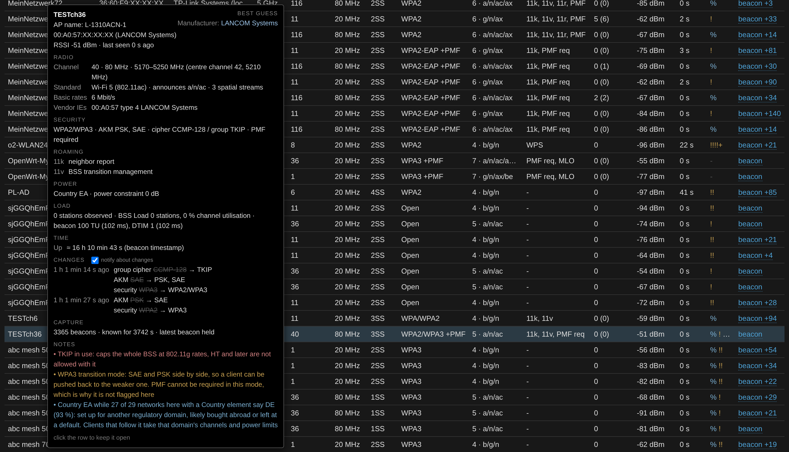

The **bell** next to the snapshot button collects the changes of all
BSSs:

- **What it holds:** the last 64 changes since the sensor started, also
  of networks that have left the table since, newest first (a flapping
  entry moves up when it counts on); the time itself on hovering over
  "… ago", e.g. *9:43:27 18.10.2026*.
- **Unread count:** its number counts the entries not looked at yet in
  this browser and follows on its own while the page is open; opening
  the list, which scrolls, marks them read.
- **Merged entries:** what one BSS changed at once, a new security
  setting with its AKM, PMF and ciphers for instance, is one entry and
  counts once, and so is the same change of several BSSIDs of one
  device at once, a radio sending three SSIDs that switches its BSS
  colour for instance: their SSIDs in the title, the first BSSID and
  how many more, *mute* for all of them.
- **Click to filter:** a click on an entry filters the network table to
  its BSSID.
- **Mute:** *mute* next to an entry, or the checkbox *notify about
  changes* in the title line of the BSS's CHANGES section (click the
  row to keep the tooltip open), keeps a BSS that changes by design out
  of the bell. Its changes are still recorded and shown in the tooltip,
  its `Δ` turns dim, and the list ends with the BSSs not notified, each
  with *unmute*. The choice is kept on the sensor, for every viewer and
  across restarts, up to 16 BSSs.

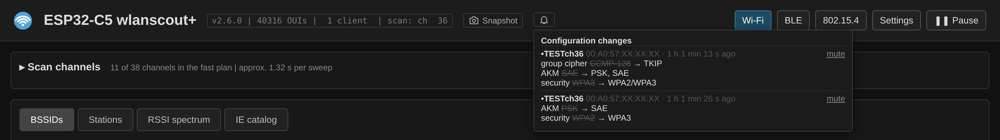

A **snapshot** keeps the bell's list with the networks. Looking at it
later the bell shows the list as it was, times counted back from the
moment it was taken, without a count of unread ones, without *mute*,
and marking nothing read; a snapshot from before the bell has none.
